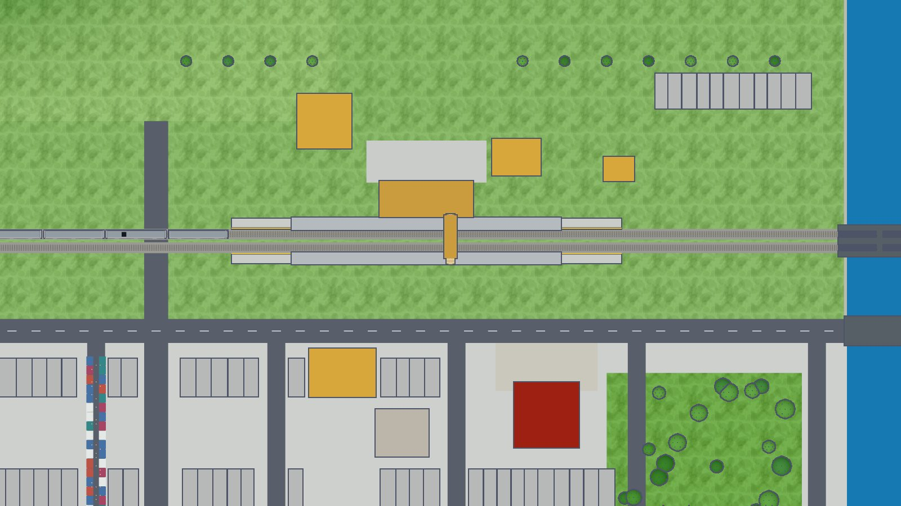

# 3D 地圖畫風：三種方向（2026-10-13，請作者選）

> 2026-10-22 起這個資料夾只留這份 README、總覽圖 `ftwplus-top.jpg` 和文字紀錄；其他 7 張圖搬到 `a91453/railway-reference-private: Railway/game-art-previews/docs/art/3d-style-2026-10-13/`，檔名不變（作者 2026-10-21 的規則，`docs/HANDOFF.md` §2）。

NEXT_PRIORITIES §0 第 14 項「同一張地圖拉近就傾斜」開工前要先定畫風。這裡把**同一個場景**畫成四種方向（D 是作者看了導航 App 的 3D 路況畫面後加的），每種都有正上方（建造時）、中間傾斜、拉近傾斜三張，再加一張手機橫拿的實際大小（iPhone 852×393 點、3 倍像素）。**只是示意圖，沒有改遊戲程式。**

四種方向並排（`a91453/railway-reference-private: Railway/game-art-previews/docs/art/3d-style-2026-10-13/compare.jpg`）

場景：一個車站（兩座側式月台、雨棚、站房、跨站天橋）、一段雙線（**靠左行駛**：往東的列車走北側那一股，決策 202）、一列 4 節的電聯車正要進站、玩家的暖黃建物（站房、商店、辦公大樓、住宅、百貨）、城市建物（住宅、商業、辦公、公共、工業，用 `Palette` 的土地用途色）、一座小山、一條河與鐵橋、平交道。地圖一律北朝上；正上方用正交投影，拉近時只是把同一張地圖往後傾斜（拉近那張多轉了 32°，讓車頭看得到）。

## 定案（作者 2026-10-13）：F 台灣版＋

看過九種之後，作者選 **F 台灣版＋**（見下方），並決定**參考庫的 3D 模型只搬白模，再修改成遊戲內的風格**。寫進了 `docs/research/NEXT_PRIORITIES_2026-10-12.md` §0 第 14 項與 art-style §7。下面依出圖順序保留每一種方向與當時的評語，A 的「推薦」是第一輪的看法。

## A. 扁平低多邊形（推薦）

| 正上方（建造時） | 中間傾斜 | 拉近傾斜 |
| --- | --- | --- |
| `a91453/railway-reference-private: Railway/game-art-previews/docs/art/3d-style-2026-10-13/a-flat-top.jpg` | `a91453/railway-reference-private: Railway/game-art-previews/docs/art/3d-style-2026-10-13/a-flat-mid.jpg` | `a91453/railway-reference-private: Railway/game-art-previews/docs/art/3d-style-2026-10-13/a-flat-close.jpg` |

手機橫拿（`a91453/railway-reference-private: Railway/game-art-previews/docs/art/3d-style-2026-10-13/a-flat-phone.jpg`）

- **感覺**：App 圖示站起來變成立體模型。藏青粗外框、平塗色塊、三段明暗（頂面最亮），沒有陰影與質感；淺底 `#ECEEF6`、綠松色軌道、暖黃玩家建物、`Palette` 的城市用途色。
- **好處**：正上方幾乎就是現在的 2D 地圖（同樣的底色、軌道顏色、建物顏色），建造時切到正上方不會像換了一個遊戲；玩家「建造時看起來像 3D」的困擾（56.1 回報）在這個方向最小。最便宜（見下面的效能）。
- **取捨**：看久了可能顯得簡單；遠景沒有空氣感，小山只能靠顏色與稜面表現。

## D. 霧面模型（像導航 App 的 3D 路況）

作者 2026-10-13 給了一張導航 App 的 3D 路況截圖，說「比較喜歡這種風格，既有現實又有線條」。它不屬於 A、B、C 任何一種，所以照它補畫一種。

| 正上方（建造時） | 中間傾斜 | 拉近傾斜 |
| --- | --- | --- |
| `a91453/railway-reference-private: Railway/game-art-previews/docs/art/3d-style-2026-10-13/d-clay-top.jpg` | `a91453/railway-reference-private: Railway/game-art-previews/docs/art/3d-style-2026-10-13/d-clay-mid.jpg` | `a91453/railway-reference-private: Railway/game-art-previews/docs/art/3d-style-2026-10-13/d-clay-close.jpg` |

手機橫拿（`a91453/railway-reference-private: Railway/game-art-previews/docs/art/3d-style-2026-10-13/d-clay-phone.jpg`）

- **感覺**：沒有貼圖的白模，像建築模型。暖灰白的地面、深灰的路、白色車道線與路緣線、灰白的建物、低飽和的橄欖綠低多邊形樹；柔和的陰影和角落的環境遮蔽讓它有「現實感」，「線條」來自車道線、路緣線、月台邊線、軌道，不是物件的外框。玩家的建物仍是暖黃（作者 #752 的規則：玩家蓋的一律暖黃），在一片灰白裡最醒目。
- **好處**：比 A 成熟、比 B 乾淨；玩家建物和城市建物用「有顏色／灰白」分開，比 A 的「暖黃／橘」清楚得多。沒有貼圖，資產和 A 一樣便宜。
- **取捨**：正上方時城市建物都是灰白方塊、沒有外框，彼此分不太開，軌道也偏淡；建造時的正上方可以借 A 的做法加細外框，或把軌道顏色加深。和 App 圖示的藏青、綠松不是同一套顏色，介面與地圖要再對一次色（`docs/UI_THEME.md`）。陰影＋環境遮蔽是手機上最貴的兩項。

## D+. 霧面模型加上光線、台灣味與生活感

作者看過 D 之後問：最低已經是 iOS 17，畫面要不要好一點，不然怎麼跟對手比。D+ 是 D 加上美術 session 建議的幾樣東西，網格仍然不貼質感。

D 與 D+（`a91453/railway-reference-private: Railway/game-art-previews/docs/art/3d-style-2026-10-13/compare-d-dplus.jpg`）

| 正上方（建造時） | 中間傾斜 | 拉近傾斜（移軸） |
| --- | --- | --- |
| `a91453/railway-reference-private: Railway/game-art-previews/docs/art/3d-style-2026-10-13/dplus-top.jpg` | `a91453/railway-reference-private: Railway/game-art-previews/docs/art/3d-style-2026-10-13/dplus-mid.jpg` | `a91453/railway-reference-private: Railway/game-art-previews/docs/art/3d-style-2026-10-13/dplus-close.jpg` |
| | `a91453/railway-reference-private: Railway/game-art-previews/docs/art/3d-style-2026-10-13/dplus-mid-night.jpg` | `a91453/railway-reference-private: Railway/game-art-previews/docs/art/3d-style-2026-10-13/dplus-close-night.jpg` |

手機橫拿（`a91453/railway-reference-private: Railway/game-art-previews/docs/art/3d-style-2026-10-13/dplus-phone.jpg`）

加了什麼：

1. **正上方是地圖**：拉遠、建造時建物壓平，只剩輪廓、細灰線與路網（影片的做法），玩家的暖黃最醒目。
2. **光**：建物腳下一圈柔和的接地陰影（貼一張模糊方塊，可以事先算好）、斜一點的午後陽光、角落暗影。
3. **台灣味**：頂樓的藍色與不鏽鋼水塔、鐵皮頂樓加蓋、騎樓（一樓暗色退縮＋柱子）、往外伸的直立招牌、冷氣室外機。
4. **顏色有變化**：城市建物從九種低飽和的暖色裡挑，不再全是灰白；玩家的暖黃仍然最亮。
5. **生活感**：路上的車靠右行駛；平交道柵欄放下，汽車排隊、機車停在最前面；月台上等車的人（實作時人數照遊戲裡真的乘客數）；路燈。
6. **夜景**：窗戶隨機亮燈、店面與招牌亮起來、列車車窗與頭燈、路燈與月台燈的光暈。
7. **移軸**：拉近時上下模糊，像微縮模型（參考庫 `street_scene_reference_clean` 的「微縮」做法）。

- **取捨**：三角形是 D 的三倍多（窗戶、招牌、人車），夜景要多一遍泛光；實作時窗戶和人車要做遠近分級（遠處只畫屋頂和光點）。
- 顏色與 App 圖示仍是兩套：介面的藏青、綠松要和這套暖灰白再對一次（`docs/UI_THEME.md`）。

## F. 定案候選：D+ 當底，E 的四樣，明亮晴朗的模型感

作者問美術 session 會怎麼決定。美術 session 的判斷：不選 E（寫實這條路對手做得比我們多，照片質感拉遠變雜訊、建造時蓋過路網、之後每樣東西都要畫得更細），用 D+ 當底；從 E 只拿花費小、效果大的四樣；改掉 D+ 的三個缺點。作者同意，並要求融合《A列車で行こう はじまる観光計画》（Switch，手機等級的硬體）的畫風，作者認為那是最適合手機的方案。

D+、E、F（`a91453/railway-reference-private: Railway/game-art-previews/docs/art/3d-style-2026-10-13/compare-dplus-e-f.jpg`）

| 正上方（建造時） | 中間傾斜 | 拉近傾斜（移軸） |
| --- | --- | --- |
| `a91453/railway-reference-private: Railway/game-art-previews/docs/art/3d-style-2026-10-13/f-final-top.jpg` | `a91453/railway-reference-private: Railway/game-art-previews/docs/art/3d-style-2026-10-13/f-final-mid.jpg` | `a91453/railway-reference-private: Railway/game-art-previews/docs/art/3d-style-2026-10-13/f-final-close.jpg` |
| | `a91453/railway-reference-private: Railway/game-art-previews/docs/art/3d-style-2026-10-13/f-final-mid-night.jpg` | `a91453/railway-reference-private: Railway/game-art-previews/docs/art/3d-style-2026-10-13/f-final-close-night.jpg` |

手機橫拿（`a91453/railway-reference-private: Railway/game-art-previews/docs/art/3d-style-2026-10-13/f-final-phone.jpg`）

- **從 D+**：整套元素（壓平的建造地圖、玩家暖黃、台灣屋頂與騎樓招牌、人車、夜景、移軸）；建物仍是頂點色、共用一個材質。
- **從 E 拿的四樣**：天空漸層與遠方的空氣感、水面反射、玻璃窗反射天空（實作時只在拉近開）、很淡的地面變化（手繪感的草地斑點，不用照片）。
- **改掉的三個缺點**：車站是主角（月台站名牌用台灣站名牌的藍、站前雨庇與站名板、花圃）；地面不再是一整片（站前停車場、人行道、公園）；夜景的地面壓暗，燈光才跳出來。
- **觀光計畫的感覺（只參考做法，沒有用它的任何素材，art-style §7）**：晴天、明亮飽和但柔和的顏色、綠意多、圓圓的樹、彩色的斜屋頂、像桌上的鐵道模型；這是那款遊戲在 Switch 上做得到的程度，也是手機做得到的程度。
- **取捨**：草地的綠在正上方仍偏重，建造時可以再調淡；斜屋頂的顏色要和玩家的暖黃保持距離（不用黃、橘）。

## F 台灣版：特色從內容來，不從畫法來

作者問怎樣才有特色、又是微縮而不失真，會不會撞到對手。美術 session 的判斷：微縮模型的畫法很多遊戲在用（觀光計画、Tiny Glade、Townscaper），沒有人能獨佔，畫法像不構成問題（風格不受保護，素材全部自己畫）；能拉開距離的是內容，目前沒有以台灣街景為主角的鐵道經營遊戲。「不失真」是比例和塗裝照真的、不做 Q 版；「微縮」只靠光線、乾淨的霧面與拉近時的移軸。

F 與 F 台灣版（`a91453/railway-reference-private: Railway/game-art-previews/docs/art/3d-style-2026-10-13/compare-f-ftw.jpg`）

| 正上方（建造時） | 中間傾斜 | 街景（拉近） |
| --- | --- | --- |
| `a91453/railway-reference-private: Railway/game-art-previews/docs/art/3d-style-2026-10-13/ftw-top.jpg` | `a91453/railway-reference-private: Railway/game-art-previews/docs/art/3d-style-2026-10-13/ftw-mid.jpg` | `a91453/railway-reference-private: Railway/game-art-previews/docs/art/3d-style-2026-10-13/ftw-street.jpg` |
| `a91453/railway-reference-private: Railway/game-art-previews/docs/art/3d-style-2026-10-13/ftw-close.jpg` | `a91453/railway-reference-private: Railway/game-art-previews/docs/art/3d-style-2026-10-13/ftw-mid-night.jpg` | `a91453/railway-reference-private: Railway/game-art-previews/docs/art/3d-style-2026-10-13/ftw-street-night.jpg` |

午後雷陣雨：

午後雷陣雨（`a91453/railway-reference-private: Railway/game-art-previews/docs/art/3d-style-2026-10-13/ftw-street-storm.jpg`）

手機橫拿（`a91453/railway-reference-private: Railway/game-art-previews/docs/art/3d-style-2026-10-13/ftw-phone.jpg`）

比 F 多了：

1. **成排的透天厝**：寬 4.2–5.6 公尺、三到五層、一樓騎樓與柱子（店面或鐵捲門）、每層鐵窗與陽台、冷氣室外機、頂樓鐵皮加蓋與水塔、直立招牌、門口停機車；九種台灣常見的外牆磁磚色。全部由程式依寬度、樓數隨機組合，不用一棟一棟畫。
2. **廟**：站前一座，三川殿與正殿、燕尾屋脊、牌樓、香爐、紅燈籠，當城鎮的視覺焦點。
3. **夜市**：一條街的攤位與遮雨棚，晚上掛燈串、人潮。
4. **午後雷陣雨**：陰天的光、雨絲、濕亮的路面，窗戶與招牌提早亮起來。
5. **正上方**：透天厝壓平成一格一格的細長地塊，一眼看出是台灣的街廓；廟是一塊紅色。

- **取捨**：透天厝的細節多（每戶的鐵窗、陽台、招牌），這個場景一個畫面約 33 萬個三角形，是 F 的兩倍多，**實作時一定要做遠近分級**：遠處的透天厝只畫盒子、屋頂與水塔，拉近才長出鐵窗與招牌。
- 鐵路旁的中高樓仍會擋住列車（手機那張），實作時要讓擋住列車的建物變透明。
- 夜景與雷雨是同一個場景換光線，不用多畫素材。

## F 台灣版＋：照參考庫街景的做法重畫人車與街道細節

作者覺得參考庫的香港街景試作（`Railway/street_scene_reference_clean/`）風格適合：動畫不會太寫實而吃效能，畫面好看，又不是一堆方塊。作者選擇「照它的做法自己重畫，模型保留」：它的模型檔沒有載入、沒有複製，只當量尺（汽車 4.56 × 2.08 × 1.38 m、小巴 7.2 × 2.5 × 2.98 m、行人約 1.7 m，零件為腿、軀幹、手臂、頸、頭、頭髮、手、鞋、雨傘；軀幹中心 1.03 m），人車與細節全部是這裡的程式畫的（art-style §7）。

F 台灣版與 F 台灣版＋（`a91453/railway-reference-private: Railway/game-art-previews/docs/art/3d-style-2026-10-13/compare-ftw-ftwplus.jpg`）

| 正上方（建造時） | 中間傾斜 | 街景 |
| --- | --- | --- |
|  | `a91453/railway-reference-private: Railway/game-art-previews/docs/art/3d-style-2026-10-13/ftwplus-mid.jpg` | `a91453/railway-reference-private: Railway/game-art-previews/docs/art/3d-style-2026-10-13/ftwplus-street.jpg` |
| `a91453/railway-reference-private: Railway/game-art-previews/docs/art/3d-style-2026-10-13/ftwplus-close.jpg` | `a91453/railway-reference-private: Railway/game-art-previews/docs/art/3d-style-2026-10-13/ftwplus-street-night.jpg` | `a91453/railway-reference-private: Railway/game-art-previews/docs/art/3d-style-2026-10-13/ftwplus-street-storm.jpg` |

手機橫拿（`a91453/railway-reference-private: Railway/game-art-previews/docs/art/3d-style-2026-10-13/ftwplus-phone.jpg`）

比 F 台灣版多了（街景的做法）：

1. **人**：低多邊形的人，腿、軀幹、手臂、頭、頭髮、手、鞋分件，上衣與褲子每人換色；雷雨時八成撐傘。廟前廣場、人行道、月台、夜市都有人。
2. **車**：汽車、小巴、台灣的單層公車、機車與戴安全帽的騎士；車身每台換色，晚上有頭燈。平交道前排隊、機車停在最前面。
3. **騎樓店面**：店內的櫃台與貨架擺到騎樓、低的遮雨棚。
4. **樓上**：鐵皮雨遮、陽台曬衣、花台、樓層飾帶。
5. **站前大樓**：兩層商場裙樓＋退縮的塔樓（街景的 podium 與 tower 做法）。
6. **做法**：人與車都用 InstancedMesh，同一種東西不管幾個都是一兩個 draw call（街景也是這樣做）。

- **取捨**：這個場景一個畫面約 72–78 萬個三角形（人與透天厝細節），是 F 台灣版的兩倍多；實作時人和車一定要做遠近兩級（街景有 `person_far_` 遠景版本，遠處的人只剩幾個面），透天厝的細節也只在拉近時長出來。
- 參考庫 `site_archive_clean/rail-3d/assets/` 另有台灣的列車（EMU3000、EMU800、莒光、藍皮、鳴日等）與車站、地標模型（新竹、台中、台北、花蓮等）。作者要求直接套用，但這個工作環境的權限檢查擋下了複製與載入，所以這一版的列車與站房仍是自己畫的。

## E. 3D 試作（`/city/`）的寫實，加上 D+ 的元素

作者看過 D+ 之後問：能不能做到 3D 試作那樣，再融合 D+ 的元素。E 是 B 的畫法（天空漸層、環境反射、柔和陰影、草地與道碴與柏油的質感、ACES 色調）加上 D+ 的全部元素；牆面換成台灣常見的二丁掛磁磚質感，窗戶是會反射天空的玻璃。

B、D+、E（`a91453/railway-reference-private: Railway/game-art-previews/docs/art/3d-style-2026-10-13/compare-b-dplus-e.jpg`）

| 正上方（建造時） | 中間傾斜 | 拉近傾斜（移軸） |
| --- | --- | --- |
| `a91453/railway-reference-private: Railway/game-art-previews/docs/art/3d-style-2026-10-13/e-realplus-top.jpg` | `a91453/railway-reference-private: Railway/game-art-previews/docs/art/3d-style-2026-10-13/e-realplus-mid.jpg` | `a91453/railway-reference-private: Railway/game-art-previews/docs/art/3d-style-2026-10-13/e-realplus-close.jpg` |
| | `a91453/railway-reference-private: Railway/game-art-previews/docs/art/3d-style-2026-10-13/e-realplus-mid-night.jpg` | `a91453/railway-reference-private: Railway/game-art-previews/docs/art/3d-style-2026-10-13/e-realplus-close-night.jpg` |

手機橫拿（`a91453/railway-reference-private: Railway/game-art-previews/docs/art/3d-style-2026-10-13/e-realplus-phone.jpg`）

- **感覺**：和網站的 3D 城市同一家族，但有暖黃的玩家建物、台灣的屋頂與騎樓、人車與夜景，正上方仍是乾淨的地圖。
- **和真正的 `/city/` 差在哪**：`/city/` 還有雲、水面倒影、照片立面、真實的建物輪廓（Overture／PLATEAU 的資料）。E 的建物是遊戲自己的方塊；要接上真實輪廓，是之後「城市資料」的工作，不是畫風。
- **取捨**：比 D+ 多了貼圖與環境反射。貼圖要做成一張圖集（或貼圖陣列），所有建物共用一個材質，不然 draw call 會跟著貼圖種類變多；`/city/` 的 `performance.md` 第 7 步就是這件事，還沒做。玻璃反射只在拉近時開。
- 草地的綠在正上方會蓋過路網，建造時可以把地面調淡（D+ 的米白），只在傾斜時換成草地。

## B. 接上寫實 3D 城市（`Web/CityView`，網站 `/city/`）

| 正上方（建造時） | 中間傾斜 | 拉近傾斜 |
| --- | --- | --- |
| `a91453/railway-reference-private: Railway/game-art-previews/docs/art/3d-style-2026-10-13/b-real-top.jpg` | `a91453/railway-reference-private: Railway/game-art-previews/docs/art/3d-style-2026-10-13/b-real-mid.jpg` | `a91453/railway-reference-private: Railway/game-art-previews/docs/art/3d-style-2026-10-13/b-real-close.jpg` |

手機橫拿（`a91453/railway-reference-private: Railway/game-art-previews/docs/art/3d-style-2026-10-13/b-real-phone.jpg`）

- **感覺**：照 `Web/CityView` 的設定畫（ACES 色調、柔和陰影、天空漸層與霧、草地與道碴的質感、立面窗格、白車身細紅線的台鐵電聯車）。真正的 `/city/` 還有雲、環境遮蔽、水面倒影與照片立面，所以實際會比這張更細緻、也更重。（本來想直接截網站的 `/city/`，這個環境只有軟體算圖，一張都算不出來。）
- **好處**：拉近時最有「真的城市」的感覺，和已經上線的 3D 城市接得起來。
- **取捨**：正上方時軌道只剩一條細灰線，和 App 的 2D 地圖、介面配色接不上，建造時看不清楚；玩家建物要靠屋頂顏色硬分。最重：要陰影、貼圖，`/city/` 本身在桌機上一個畫面就要 700 個 draw call（`Web/CityView/performance.md`）。`/city/` 是 three.js 網頁，搬進 App 的地圖要嘛用 WebView 疊在 SwiftUI 下面，要嘛用 Metal／SceneKit 重寫，兩條都是大工程。

## C. 兩者之間：寫實地形＋扁平建物與列車

| 正上方（建造時） | 中間傾斜 | 拉近傾斜 |
| --- | --- | --- |
| `a91453/railway-reference-private: Railway/game-art-previews/docs/art/3d-style-2026-10-13/c-mix-top.jpg` | `a91453/railway-reference-private: Railway/game-art-previews/docs/art/3d-style-2026-10-13/c-mix-mid.jpg` | `a91453/railway-reference-private: Railway/game-art-previews/docs/art/3d-style-2026-10-13/c-mix-close.jpg` |

手機橫拿（`a91453/railway-reference-private: Railway/game-art-previews/docs/art/3d-style-2026-10-13/c-mix-phone.jpg`）

- **感覺**：地面、道碴、水、天空、陰影是寫實的，建物、月台、樹與列車是 A 的扁平色塊加外框，像桌上的鐵道模型。
- **好處**：比 A 有份量，建物和列車仍然一眼分得出是玩家的。
- **取捨**：兩種畫法放在一起，正上方時草地很暗、軌道不明顯；陰影＋外框兩種開銷都要付，是三種裡最重的。

## 效能估計

同一個場景（約 520 × 520 公尺、約 200 棟建物、一列 4 節）在 three.js r186 量的；靜態物件照參考庫 `island_city_reference_clean` 的 `g41.js` 做法**依材質合併**，所以 draw call 約等於材質數。

| | 材質（合併後的網格） | 三角形 | 一個畫面的 draw call | 每個畫面畫的三角形 | 另外要的 |
| --- | --- | --- | --- | --- | --- |
| A 扁平 | 37 | 1.8 萬 | 37（外框另一遍 → 75） | 1.8 萬（外框 → 3.5 萬） | 外框 |
| B 寫實 | 38 | 4.4 萬 | 65（含陰影圖） | 6.1 萬 | 陰影、貼圖、天空 |
| C 中間 | 37 | 4.4 萬 | 63（陰影）＋外框 → 127 | 12 萬 | 陰影、外框、貼圖 |
| F 台灣版＋ | 36 | 21 萬＋人車 | 街景 79–98（含陰影）＋環境遮蔽 | 72–78 萬（環境遮蔽 → 約 150 萬） | 人車用 InstancedMesh；一定要遠近分級 |
| F 台灣版 | 35 | 18.4 萬 | 街景 47（含陰影）＋環境遮蔽 → 99 | 33.2 萬（環境遮蔽 → 66.4 萬） | 和 F 相同；三角形多在透天厝的鐵窗、陽台、招牌，要做遠近分級 |
| F 定案候選 | 35 | 8.7 萬 | 白天 57（含陰影）＋環境遮蔽 → 119 | 14.6 萬（環境遮蔽 → 29.1 萬） | 和 D+ 相同，加天空環境反射；沒有照片貼圖 |
| E 寫實＋D+ | 36 | 8.5 萬 | 白天 60（含陰影）＋環境遮蔽 → 125 | 14.2 萬（環境遮蔽 → 28.4 萬） | 陰影、環境遮蔽、貼圖、環境反射、夜景泛光、移軸 |
| D+ 霧面模型加料 | 31 | 7.9 萬 | 白天 49（含陰影）＋環境遮蔽 → 103；夜景 → 118 | 12.8 萬（環境遮蔽 → 25.6 萬） | 陰影、環境遮蔽、夜景泛光、移軸；建造時的正上方只有 25 個 draw call |
| D 霧面模型 | 37 | 3.8 萬 | 62（含陰影）＋環境遮蔽 → 129 | 4.7 萬（環境遮蔽 → 9.5 萬） | 陰影、環境遮蔽（後處理） |

列車：A 一列 1,252 個三角形、B／C 1,380 個（照 rolling-stock skill，一節 6,000–8,000 個三角形的精細版只用在最近的那列）。

放到整張遊戲地圖（拉遠時畫面裡可能有十倍的建物）：

- **A**：三角形跟建物數量成正比，十倍也只有約 20 萬。顏色全部可以改成頂點色，整張地圖只要 **1–2 個材質**，每個分塊 1–2 個 draw call；外框在手機上改用「反向外殼」（每個網格多畫一次背面）或預先算好的線，不用整畫面再畫一遍。
- **B**：照 `/city/` 的實測，一個畫面 700–1,800 個 draw call、還有水面倒影、陰影、環境遮蔽（桌機 RTX 5090 每格 2–6 ms）；手機的處理器慢好幾倍，要大砍才能穩定 60 fps，而且照片貼圖要下載與占記憶體。
- **C**：介於兩者之間，但陰影與外框兩邊都要付。
- **D+**：顏色全部是頂點色，城市建物、樹、車、人合成一個材質，所以 draw call 反而比 D 少；三角形多在窗戶與招牌，遠處改成貼圖或不畫就降下來。十倍的城市大約 80 萬個三角形，**要做遠近分級才放得進預算**。
- **D**：網格和 A 一樣便宜（顏色可以全部改頂點色），貴的是光：一張陰影圖加環境遮蔽。手機上可以把環境遮蔽預先烘進頂點色（靜態建物不會動），陰影只畫拉近時的範圍，就能接近 A 的成本。

手機的經驗值（iPhone 上穩定 60 fps 還有餘裕）：一個畫面 **300 個 draw call 以內、30–50 萬個三角形以內、最多一張陰影圖**。A 很容易在預算內；B 要重新設計才放得進來。**以上都是在 Linux 的軟體算圖量的數字與經驗值，沒有在實機量過**（UNVERIFIED，§0 第 14 項本來就要求先做實機原型、量幀時間）。

## 我的推薦：A 扁平低多邊形

1. 建造時一律正上方（56.1 玩家回報），A 的正上方就是現在的 2D 地圖，換視角不會換畫風。
2. 和 App 圖示、介面、站長同一套（art-style、`docs/UI_THEME.md`），不用另外維護一套寫實素材。
3. 最便宜，整張地圖都放得進手機的預算。

寫實的 `/city/` 可以保留成「看看真實城市」的另一個畫面（現在就是這樣），不必是地圖本身。

## 畫的時候看到、之後要處理的

- **玩家建物和城市辦公樓顏色太近**：3D 裡城市辦公樓（`Palette` 的 `office`：牆 `#D99649`、屋頂 `#F5CD95`）和玩家的暖黃（`#FFC86B`）站在一起時很難分（A 的中間傾斜那張最明顯）。2D 地圖是小方塊所以還好；做 3D 時要給玩家建物一個形狀上的記號（例如屋頂的藏青邊、小旗子），不能只靠顏色（art-style §5 灰階檢查）。
- **高樓會擋住鐵路**：傾斜時線路南側的高樓會蓋住列車（手機那張原本整列被擋住，示意圖裡把鐵路旁那一排城市建物壓到 14 公尺以下）。實作時要讓鏡頭和列車之間的建物變透明或只畫輪廓。
- 夜間、深色模式沒畫；選定方向後再畫。

## 怎麼做的、參考了什麼

- 用 scratchpad 裡的 three.js r186（和 `Web/CityView` 同一版，MIT）寫一頁場景，在環境預裝的 Chromium（Playwright、SwiftShader 軟體算圖）算圖；腳本照 art-style 的做法放 scratchpad，不進 repo。所有幾何、貼圖都是程式畫的，沒有搬任何圖片或模型（art-style §7）。
- 外框：一遍物件編號＋法線的畫面，在物件交界與摺角畫藏青線（自己寫的後處理）。
- 參考庫 `a91453/railway-reference-private`：

| 參考 | 用到這裡的 |
| --- | --- |
| `Railway/island_city_reference_clean/source/js/g41.js`（`bake`：依分塊把靜態網格依材質合併） | 示意場景的靜態物件依材質合併，效能估計的 draw call 依這個算 |
| `Railway/street_scene_reference_clean/`（八種畫面風格：剪紙、水粉、水墨、漫畫、黑白漫畫、微縮、素描、水彩；建物遠近 LOD） | 只看了做法。八種是整畫面的後處理，和地圖要讀得清楚的需求不合，所以沒有拿來當方向；「微縮」（移軸模糊）可以之後加在 A 或 C 的拉近上。建物 LOD 留給實作 |
| `Web/CityView/src/main.js`（ACES、PCFSoft 陰影）、`performance.md` | B 的光線設定、B 的效能數字 |
| `Simulator/`、`OpenWorld/` | 這次沒有讀（只出示意圖）；實作傾斜時再看它們的 3D 執行與軌道幾何 |

## 搬到私有庫

2026-10-21 起，這個資料夾的其他預覽圖（含檢視頁）在私有庫 a91453/railway-reference-private 的 `Railway/game-art-previews/docs/art/3d-style-2026-10-13/`，內容完整、連結照舊；這裡只留本說明與被程式或文件直接引用的圖。上面連到已搬走檔案的連結請到那裡看。
