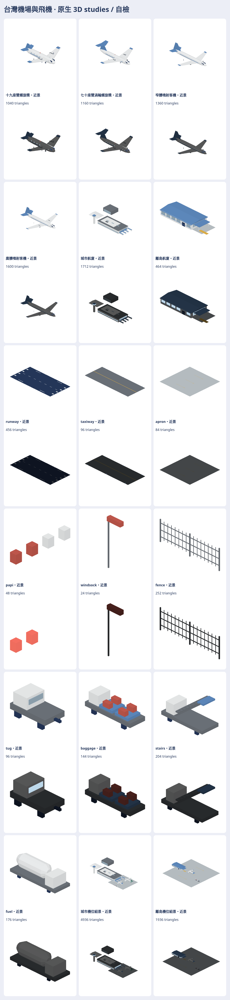

# 台灣機場與飛機原生 3D studies

只是素材 studies，尚未接營運。四型飛機、城市與離島航廈、跑道／滑行道／停機坪／PAPI／風向袋／圍界／四款地勤車、城市與離島兩個組景，各近遠景一份。只用通用塗裝。這輪依既有 `Map3DTaoyuanAirport`／`Map3DE1000` 的截面與配色節奏、`StationKitBuilder` 的立面方法，重做機身、機翼、窗帶及航廈屋頂／外牆。私庫 `railway-assets-private/game-art-previews/docs/art/airport-aircraft-2026-11/` 存 M3DM、GLB、日夜七方向透明 PNG、manifest、SOURCE.md 和自含離線 viewer；不放照片、history 或 ZIP。尺寸與來源詳私庫 SOURCE.md。

## 驗證

- VERIFIED（本環境 Python）：每個幾何 solid 封底、正體積、非退化／有限；四型近遠景的實際頂點包絡長、翼展、高距公開規格均 <0.05 m，輪子最低點 z=0；LOD 三角減量、兩個城市機位的空橋端距艙門 <0.15 m 且機翼起點在空橋端後方 >0.5 m。全 36 單元最高近景 4,936 三角，低於 15,000。
- VERIFIED（本環境 Node/WebGL）：GLB 編碼契約四項測試過，36 個模型渲染日夜七方向共 504 張透明 RGBA PNG，離線 viewer 已產生；同一份自含 HTML 在封鎖網路的頁面中載入 36 型、900 × 600 canvas 並切換夜間。已人工看總覽、底面、七方向與組景（輪子、空橋、翼尖和標線）；仍需在作者看過後才判定外觀。
- UNVERIFIED：本環境政策封鎖 `file://` 導航，未直接用該 URL 開 viewer；本機缺 Swift 工具鏈，`swift build --build-tests -Xswiftc -warnings-as-errors` 和指定 `swift test --skip-build --filter Map3DAirportAircraftStudiesTests` 無法執行。Metal 實機、實景地圖、動畫、跑道工程及營運全未驗。

近景與遠景只是視覺 LOD。跑道 60 m 段長、80 m 停機坪是組裝規格；日後自動航班仍要按實際 OSM／機場資料決定位置、長度、進出場。參考庫的歷史航跡授權狀態未核實，沒有使用資料。場景接點、關節以及授權界線詳私庫 SOURCE.md。總覽的「自檢」不代表作者外觀通過。
