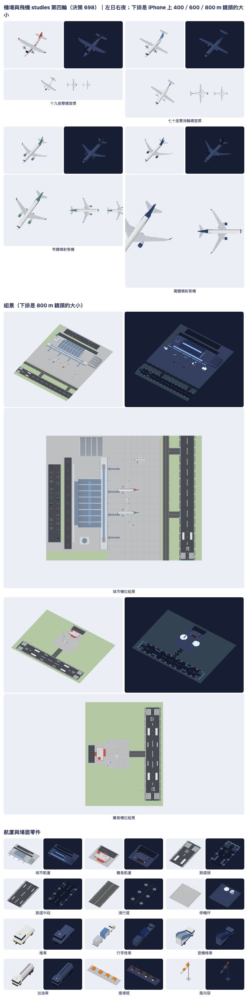

# 台灣機場與飛機原生 3D studies

只是素材 studies，還沒接進遊戲（接進去是 AIRPORT-2）。決策 594 做了第一版；作者 2026-11-11 說「飛機模型有點醜」，決策 698 照 `.claude/skills/model-look/SKILL.md` 重做外觀：四型飛機、城市與離島航廈、跑道頭／跑道中段／滑行道／停機坪／進場燈／風向袋／圍界／四款地勤車、城市與離島兩個組景，各近遠景一份（38 個模型）。只用通用塗裝，不畫航空公司的名稱、標誌、註冊號。

重檔（模型、GLB、日夜七向 PNG、離線 viewer、各輪的看圖紀錄、參考照片與它們的作者和授權）在私庫 `railway-assets-private/game-art-previews/docs/art/airport-aircraft-2026-11/`。這裡只留配方、測試、這份說明和總覽圖。

## 憑什麼認得出來

動手前先寫下每一型的特徵，每一輪拿它們對照片：

- **十九座雙螺旋槳**：方的機身、長而下垂的尖鼻、架在機身頂上的直翼與後掠的翼尖、翼下兩具螺旋槳、機身兩側的起落架艙。
- **七十座雙渦輪螺旋槳**：圓機身、機頂的高單翼、翼下細長的引擎艙與六葉螺旋槳、T 形尾翼、機腹兩側的起落架艙。
- **窄體噴射客機**：細長的圓機身、後掠的下單翼、翼前緣之前的大引擎、翼尖上翹的小翼、往上收的尾錐。
- **廣體噴射客機**：粗機身、很長而往後往上彎的翼尖、兩具很大的引擎、四輪的主起落架。
- **場面**：深灰柏油與白色標線的跑道（跑道頭有斑馬線、號碼、瞄準點）、黃線的滑行道、分格的淺灰水泥停機坪；城市航廈是拱頂大廳加一長條登機廊與四座空橋，塔台與機棚站在同一塊地上；離島航廈是白牆紅帶的平房，屋頂上一個小塔台。

## 四輪

每一輪都是：用 `tools/model-look/shoot.mjs`（飛機，和照片並排、和決策 594 的版本並排）與 `tools/airport-aircraft-studies/sheet.mjs`（零件與組景，日夜並排）拍圖，打開圖看，對清單寫毛病，改。

| 輪 | 看到的毛病 | 改了什麼 |
| --- | --- | --- |
| 1（重寫） | 決策 594 的版本：機身是兩端平切的圓筒、機翼是等厚的平板、螺旋槳是兩根看不到的細條、輪子是方塊、跑道是深藍色、航廈／塔台／機棚各自浮著、夜間只是整體變暗 | 機身改成沿機長分段的截面（有機鼻、尾錐往上收，十九座是方截面）；機翼、平尾、垂尾改成根厚尖薄的翼型；引擎艙加進氣口、整流錐與掛架，螺旋槳照實際半徑做五葉與六葉；圓輪加輪轂，起落架接到機體；跑道改深灰柏油並加邊線、斑馬線、號碼、瞄準點；航廈、塔台、機棚、車道站在同一塊地上；燈具與它照亮的地面加發光旗標 |
| 2 | 機鼻前半整個是黑的；七十座的機翼被塗成塗裝色；十九座的垂尾像一個大三角形；輪轂太亮像圈圈；跑道邊燈的光池白天看得到，還超出跑道邊緣變成一排鼓包；航廈屋頂從上面看是一整塊平板；離島航廈從上面看只是白色長方形；登機梯車像一個空盒子 | 擋風玻璃只佔機鼻一段；機翼只塗翼尖；垂尾改窄；輪轂縮小變暗；光池改用鋪面自己的顏色（白天看不到）並移進鋪面裡；噴射機加機腹整流罩、襟翼滑軌罩、引擎唇口；航廈屋頂加白色拱肋、屋脊採光帶、登機廊的屋頂與機房，前面加停車場與綠帶；離島航廈女兒牆改紅色，屋頂加設備；登機梯車加梯身 |
| 3 | 在遊戲大小，白機身放在淺色地面上幾乎看不到，七十座與十九座最嚴重；組景的夜景裡跑道燈小到看不見；機坪的光池太大 | 機翼與平尾改成真機翼面的淺灰；遠景版的燈放大；跑道加中線燈；機坪光池縮小 |
| 4（作者 11-12 問「窄體寬體擋風玻璃要修嗎」） | 近看機鼻：擋風玻璃是一整塊蓋住機鼻頂的深色頭罩，真機是一條繞著機鼻的窄帶，兩側的窗往後延伸 | 窄體、廣體、七十座的機鼻多切兩段：前面一條窄的擋風玻璃，後面一段只有兩側的側窗 |

## 清單現況（第四輪）

1. **像盒子**：過。飛機沒有平切的端面；航廈有拱頂、拱肋與登機廊。
2. **比例不對**：長、翼展、高照製造商公開規格，實際頂點包絡在 0.05 m 內；其餘（機鼻長度、翼根位置、引擎大小、尾翼）是對照片估的，沒有三視圖。
3. **窗戶太平**：客艙窗是貼在機身曲面上、略凸出的小片，遠景是一條帶；航廈玻璃凸出牆面 6–14 cm。
4. **屋頂與牆接不起來**：過。拱頂兩端有白色封簷板，山牆補滿到拱底。
5. **零件浮空**：過。起落架接到機體或翼下，引擎有掛架，空橋有圓樓、輪架與支柱，組景裡的東西都站在鋪面上。
6. **顏色灰、糊成一片**：機身白、翼面淺灰、塗裝色在尾部／引擎／翼尖；鋪面三種灰分得開。
7. **光太平**：靠截面的轉折與顏色分面；夜間靠發光旗標。
8. **遠看認不出來**：四型在 800 m 鏡頭的大小分得出來（翼的平面形狀、引擎位置、尾翼）；十九座在 800 m 只剩 28 點寬，是最弱的一個。

## 驗證

- VERIFIED（Mac 本機，Python 3.9）：`python3 -m unittest discover -s tools/airport-aircraft-studies -p 'test_*.py'` 5 項全過：每個 solid 封閉、體積為正；四型近遠景的長、翼展、高在規格 0.05 m 內，輪子落地；機鼻與尾端收尖、尾錐上收；螺旋槳葉數與半徑；引擎在翼前緣之前；輪子是圓的；航廈站在一塊地上；鋪面是灰的；燈與光池有發光旗標，光池是鋪面的顏色；組景兩座空橋對到艙門、在機翼之前。全 38 個模型最多 14,880 三角（上限 15,000，是城市組景）。
- VERIFIED（Mac 本機，Swift 6.4.2）：`swift build --build-tests -Xswiftc -warnings-as-errors` 乾淨；`swift test --skip-build --filter Map3DAirportAircraftStudiesTests` 6 項全過。
- VERIFIED（Mac 本機）：`tools/airport-aircraft-studies/parity.sh <私庫資料夾>`：Swift 配方匯出的 34 個模型（組景只有預覽，沒有 Swift 配方）和 `produce.py` 寫出的逐三角形相同（頂點差 3 mm 內、顏色與發光旗標一致）。
- VERIFIED（Mac 本機，Playwright Chromium）：`render.mjs` 出 38 個模型的日夜七向圖與離線 viewer；viewer 以 `file://` 開啟，載入 38 個模型。
- UNVERIFIED：Linux CI（等 PR 的 run）；Metal 實機上的樣子（預覽用 WebGL，夜間的發光旗標在遊戲裡怎麼畫沒有驗）；接進實景地圖、動畫、營運都沒有做。

## 還有哪裡不好

- **擋風玻璃還是粗**：它是機身上一段一段的面塗成深色，不是一片片的窗，近看是有稜角的色塊；廣體機窗框那圈黑色只做了大概。
- **十九座與七十座在遊戲大小偏小、偏淡**：白機身在淺色地面上只靠灰色翼面與螺旋槳撐著；放在停機坪上比較清楚。
- **夜間的飛機只有變暗**：客艙窗是深色的，加了發光旗標也不像亮著的窗；航行燈在遊戲大小看不到。
- **跑道的夜景靠燈具本身**：光池最亮只到白天的柏油色，所以遠看是一排亮點，不是一條亮的跑道；遊戲的 Metal 畫法會不會一樣沒有驗。
- **城市組景只有一架近景飛機**：為了守住 15,000 三角的上限，另外兩架與跑道、滑行道、地勤車用遠景版；空橋是直的一段，沒有做伸縮節。
- **顏色沒有全用 `Map3DPalette`**：柏油、水泥、翼面灰等是這批自己的色（`Map3DStudyColor`），接進遊戲時要對一次地圖的地面與道路色。
- **比例只對了三個外部尺寸**：見清單第 2 條。

跑道 60 m、滑行道 30 m、停機坪 80 m 是組裝用的格距，不是真實機場的工程尺度；日後自動航班仍要按實際機場資料決定位置與長度。
