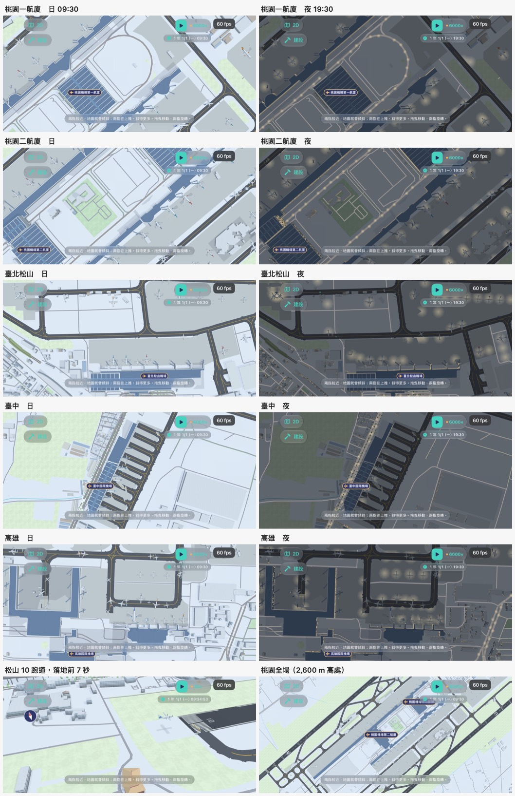

# 機場接進 3D 地圖：看圖五輪（決策 699，2026-11-12）



規矩在 [model-look skill](../../../.claude/skills/model-look/SKILL.md)。程式是 `Sources/GamePresentation/Map3DAirfields.swift`（場面）與 `Map3DAircraft.swift`（飛機），資料是 `tools/airfields/`。這裡只放一張總覽圖；每一輪的截圖、高處與遠景、fps 對照、2D 標記與面板的截圖、參考照片在私有素材庫 `a91453/railway-assets-private` 的 `game-art-previews/docs/art/airports-on-map-2026-11-12/`。

圖都是這台 Mac 的 iPhone 模擬器（iPhone 18 Pro，iOS 27.2，橫放）拍的，沒有開 CI 的截圖 run。重拍：

```sh
xcodebuild build-for-testing -project RailwayGameApp/RailwayGame.xcodeproj -scheme RailwayGame -destination 'id=<模擬器>'
xcodebuild test-without-building … -only-testing:RailwayGameUITests/WebsiteScreenshotTests/testAirportsIn3D -resultBundlePath out.xcresult
xcrun xcresulttool export attachments --path out.xcresult --output-path shots
```

`TEST_RUNNER_AIRPORT_SHOTS=airportSongshan,airportSongshanNight` 只拍指定的場景，`TEST_RUNNER_AIRPORT_VIEWS=game` 只拍指定的鏡頭（`game` 800 m、`game1` 桃園一航廈、`high` 2,600 m、`far` 9,000 m）。

## 參考與特徵

這次不是做一個新模型（飛機、塔台、地勤車的外觀是決策 698 看過四輪的），而是把它們和真實的場面擺進地圖，所以對的是**整座機場從空中看的樣子**。照片都來自 Wikimedia Commons，只拿來比對配置與顏色，沒有當貼圖、沒有放進這個 repo：

| 照片 | 作者 | 授權 | 用來看 |
| --- | --- | --- | --- |
| [Taiwan Taoyuan Airport from departing flight May 2025.jpg](https://commons.wikimedia.org/wiki/File:Taiwan_Taoyuan_Airport_from_departing_flight_May_2025.jpg) | 4300streetcar | CC BY 4.0 | 桃園全場：兩條平行跑道夾著航廈與登機廊 |
| [Taoyuan Airport Terminal 1 Aerial View.jpg](https://commons.wikimedia.org/wiki/File:Taoyuan_Airport_Terminal_1_Aerial_View.jpg) | 交通部鐵道局 | Attribution | 一航廈與登機廊、空橋與停著的飛機 |
| [Taoyuan Airport from above at night.jpg](https://commons.wikimedia.org/wiki/File:Taoyuan_Airport_from_above_at_night.jpg) | Jidanni | CC0 | 夜間：機坪的泛光與跑道燈 |
| [Taichung Airport Airfield color.jpg](https://commons.wikimedia.org/wiki/File:Taichung_Airport_Airfield_color.jpg) | 写真小僧 | CC BY-SA 3.0 | 臺中全場：一條南北向跑道、平行滑行道 |
| [Remote view of Taipei 101, Taipei City and Taipei Songshan Airport at sunset.jpg](https://commons.wikimedia.org/wiki/File:Remote_view_of_Taipei_101,_Taipei_City_and_Taipei_Songshan_Airport_at_sunset.jpg) | Wei-Te Wong | CC BY-SA 2.0 | 松山：市區裡的一條東西向跑道 |
| [Taipei skyline from Songshan Airport 20170611.jpg](https://commons.wikimedia.org/wiki/File:Taipei_skyline_from_Songshan_Airport_20170611.jpg) | Rutger van der Maar | CC BY 2.0 | 松山機坪 |
| [EVA Air MD-90 Landing down Taipei Songshan Airport Runway 20090926.jpg](https://commons.wikimedia.org/wiki/File:EVA_Air_MD-90_Landing_down_Taipei_Songshan_Airport_Runway_20090926.jpg) | 玄史生 | CC BY-SA 3.0 | 降落的姿態 |
| [Kaohsiung Airport Terminal.jpg](https://commons.wikimedia.org/wiki/File:Kaohsiung_Airport_Terminal.jpg) | Alec @ Taiwan | CC BY 2.0 | 高雄航廈 |

尺寸與位置：全部照 OpenStreetMap（© OpenStreetMap contributors，ODbL 1.0）。跑道的長、寬、方向、號碼是 OSM 的；航廈的平面是建物足跡；高度是足跡的樓層數（至少四層），不是量的。

憑什麼認得出是機場，以及是哪一座：

- 一條又長又直的深灰跑道，白色的邊線、中線、跑道頭的斑馬線與號碼；旁邊有平行的滑行道與黃線。
- 一大片淺灰的停機坪，上面一排一排停著飛機，機鼻對著航廈。
- 航廈：藍灰屋頂、白邊，伸出一根根空橋。
- 晚上：兩排跑道邊燈拉成一條線，機坪上一團一團的泛光。
- **桃園**：兩條平行跑道（05L／23R、05R／23L）夾著中間的航廈與長長的登機廊，廣體機多。**松山**：市區裡一條東西向跑道（10／28），航廈在南側。**臺中**：一條南北向跑道（18／36），航廈在西南角。**高雄**：一條東西向跑道（09／27），U 形的國際航廈與一字形的國內航廈在北側。

## 每一輪

| 輪 | 看圖找到的毛病 | 改了什麼 |
|---|---|---|
| 0（接之前） | 機場在 3D 地圖上是一片白：沒有跑道、沒有停機坪，航廈是和地面同色的矮盒子 | — |
| 1 | 跑道、滑行道、標線、飛機都有了，但柏油被 3D 畫風調成中灰、停機坪和地面幾乎同色；航廈還是白的；白飛機在淺色地上看不到；松山的遊戲鏡頭對著跑道中段的草地，看不到航廈 | 鋪面與標線的顏色列進畫風「不調淡」的那一組；航廈改成白牆、藍灰屋頂（加深一階）；鏡頭對準機位 |
| 2 | 桃園的主航廈（登機廊後面的大廳）還是白的：它不靠空橋，沒被認成航廈；航廈屋頂是一整片平的藍；夜間機坪的光池太大太亮，高處看像一排圓點；起降的飛機落地後在跑道上消失、起飛前憑空出現 | 緊貼航廈的大建物也算航廈；屋頂加白邊，方正的大廳與登機廊加採光帶與白色橫肋；光池縮小調暗；飛機沿滑行道進出機位、後推；加地勤車 |
| 3 | 松山跑道頭上站著幾棟房子（足跡資料裡有，沒有清掉）；改成部分機位給航班輪用之後，桃園的機位空了一大半；降落那張的鏡頭沒對到飛機，而且算的是桃園的班次 | 跑道佔的格子不留建物；固定停著的機位加多；降落場景改用地圖中央那座機場的班次，鏡頭對準跑道頭外 |
| 4 | 桃園還是空：OSM 把一個廣體機位和共用同一塊地的兩個窄體機位畫成三個，原本「離鄰位太近就不擺」把它們全跳過了；桃園一航廈的大廳還是白的（它比認定範圍寬，機場點落在建物裡面卻離牆太遠）；臺中補的機位有飛機的翼尖壓到航廈；量到每幀 CPU 多 2.1 ms | 機位改成依序配機型、翼尖留 4 m；機場點落在建物裡也算航廈；補機位時機鼻、機尾、兩個翼尖都要離航廈 8 m；航班與滑行路線一小時算一次、暫停時整幀沿用、影子只給近的 |
| 5 | 見下面「還有哪裡不好」 | — |

清單現況（事實，不是評分）：

1. **像盒子**：航廈是真實輪廓拉高的平頂量體，屋頂只有白邊、採光帶、橫肋，沒有拱頂。形狀不規則的航廈（高雄國際線的 U 形、桃園的折線登機廊）只有白邊。
2. **比例不對**：平面是 OSM 的，照真的。高度是樓層數推的，桃園二航廈的大廳實際比登機廊高得多，這裡差不多高。
3. **窗戶太平**：航廈的牆是一整面玻璃格的貼圖，沒有進出。
4. **屋頂與牆接不起來**：過（平頂，白邊壓在牆頂）。
5. **零件浮空**：空橋兩端有支柱；飛機、地勤車站在停機坪上。
6. **顏色灰、糊成一片**：深灰跑道、中灰滑行道、淺灰停機坪、淺色地面、藍灰屋頂、綠草，分得開。
7. **光太平**：鋪面本來就是平的；靠顏色分。
8. **遠看認不出來**：9 km 高處看得出兩條跑道與航廈的藍色，機場標記在上面；2.6 km 看得到滑行道的黃線與停著的飛機（很小）。

## 效能

`WebsiteScreenshotTests.testAirportsFrameCost`：這台 Mac 的 iPhone 18 Pro 模擬器（iOS 27.2），桃園，畫質「高」，遊戲暫停在 09:30，打開幀數的細節讀數；同一個 build 加 `-map3D.noAirfields` 就是沒有機場。量了幾次（每次四個畫面各開一次 App；「沒有」那兩列各列出讀到的兩次）：

| 鏡頭 | 機場 | fps | CPU ms | main ms | draws | 三角形 |
| --- | --- | --: | --: | --: | --: | --: |
| 遊戲鏡頭 800 m | 沒有 | 60／60 | 0.6／1.7 | 1.1／2.3 | 38 | 24,931 |
| 遊戲鏡頭 800 m | 有（第一版：每幀重算航班） | 58 | 2.7 | 3.4 | 45 | 146,760 |
| 遊戲鏡頭 800 m | 有（最後） | 60 | 1.2 | 2.0 | 45 | 182,956 |
| 高處 2,600 m | 沒有 | 60／60 | 1.8／0.7 | 2.3／1.4 | 127 | 36,356 |
| 高處 2,600 m | 有（第一版） | 58 | 2.2 | 3.1 | 132 | 146,964 |
| 高處 2,600 m | 有（最後） | 58 | 2.3 | 2.9 | 131 | 167,560 |
| 遊戲鏡頭 800 m，**遊戲在跑**（6000×） | 沒有 | 42 | 0.7 | 10.2 | 38 | 24,931 |
| 遊戲鏡頭 800 m，**遊戲在跑**（6000×） | 有（最後） | 41 | 1.1 | 9.8 | 45 | 182,720 |

- **三角形**：有機場時多 13–16 萬個（場面的鋪面、標線、夜間光池，加最多 10 架近景與 90 架遠景飛機）。沒有上限時桃園高處看是 25 萬（190 架遠景機），所以加了上限：近景最多 10 架、遠景最多 90 架、3.6 km 外不畫。
- **CPU**：第一版每幀重算五個小時的航班與滑行路線，遊戲鏡頭多 2.1 ms；改成每小時算一次、暫停時整幀沿用、影子只給 1.2 km 內的之後，和沒有機場的讀數差在量測的雜訊裡（同一個「沒有機場」的畫面，各次讀到 0.6 到 1.8 ms）。
- **fps**：模擬器上暫停時有、沒有都是 58–60。遊戲以 6000 倍在跑時掉到 41–42，有、沒有機場一樣（那是 Debug 的 App 在主執行緒跑模擬，main 約 10 ms），飛機在動並沒有多花。
- 模擬器用的是 Mac 的 GPU，**不代表實機**；實機的幀數、畫面負荷階梯（決策 417，飛機的三角形算在列車那一幀裡）會不會因此降階，UNVERIFIED。

圖在私庫 `app/airport-cost-*.jpg`。

## 還有哪裡不好

- **航廈沒有自己的樣子**：五座都是「藍灰平頂加白邊」，分得出機場，分不出桃園一航廈的斜屋頂、二航廈的弧形屋面、松山的老航廈。真的輪廓救了平面，救不了立面。
- **桃園二航廈大廳的橫肋太密、太白**，像百葉窗；登機廊上的採光帶在折角的地方會斷。
- **停機坪的飛機是配的**：哪個機位停哪一型是照機場的比例配的，不是實際的機位表；桃園靠登機廊的機位實際上幾乎全滿，這裡約六七成。
- **飛機小**：800 m 鏡頭下窄體機只有二十幾點寬，七十座與十九座更小；白機身在淺灰停機坪上只靠尾翼色與影子認。
- **夜景只有地上的光**：飛機沒有航行燈與客艙窗，航廈的窗不亮，塔台只有桃園與臺中有。
- **滑行不讓路**：兩架飛機會在滑行道上交錯穿過；轉彎是在 16 m 內硬轉，不是沿弧線。
- **地勤車太小**：遊戲鏡頭下幾乎看不到，只有拉到最近才看得出是車。
- **臺中的機位是補的**：排在最靠近航廈的停機坪上，和實際的機位位置不同。
- **動起來只看了一段**：`testAirportLandingMoves` 讓遊戲以 10 倍跑、連拍九張（私庫 `app/airport-landing-moves.jpg`）：飛機落地、沿跑道減速往東都看得到；之後脫離、滑行到機位那段，1,500 m 高的鏡頭下飛機太小，照片裡找不到，只有單元測試逐秒查過位置不跳、不急轉。後推與起飛沒有在畫面上看過。
- **只在模擬器看過**：實機的顏色、遠處標線的閃爍（細帶子在遠處會不會閃）、幀數都沒驗。
