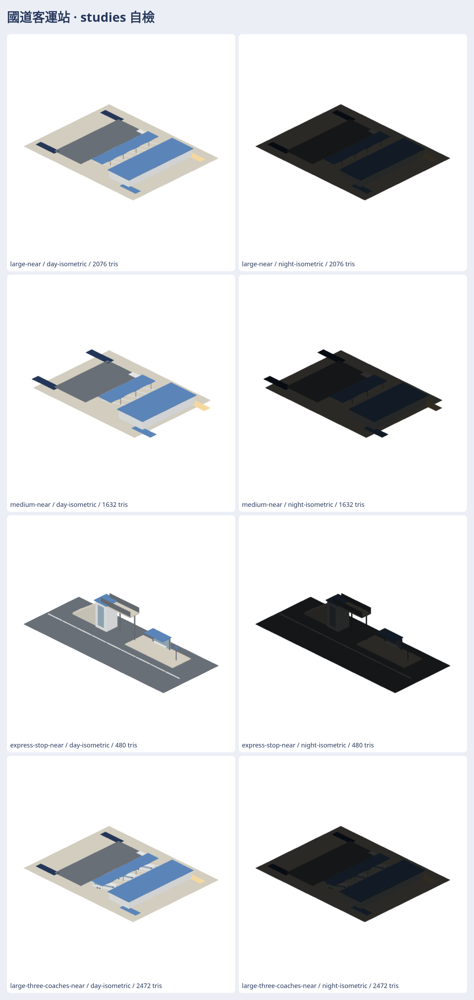

# 國道客運站原生 3D studies

大型 8 格、中型 5 格、交流道旁招呼站、11 種零件，各有近／遠景；另有大型站與三輛 coach 比例代理車組景。重素材、離線 viewer 與來源紀錄在私有 `railway-assets-private/game-art-previews/docs/art/bus-terminal-2026-11/`；公開庫只留[配方](../../../tools/bus-terminal-studies/README.md)、Swift 按需模型及測試。

VERIFIED：Swift 6.4 `swift build --build-tests -Xswiftc -warnings-as-errors` 成功；`swift test --skip-build --filter Map3DBusTerminalStudiesTests` 3 項全過。producer 產出 30 個封閉 M3DM；GLB 由同一模型轉換；420 張日夜七方向透明 PNG 解碼成功；最高近景 2,472 三角；格位可停長 15 m、淨寬 3.6 m、入口出口 z=0。已看總覽、零件、底面、七方向及三車組景；雨棚柱頂接屋面，座椅腿接地，看板組件有壁掛接點。

UNVERIFIED：真 Metal 實機、實際教練車轉彎倒車軌跡、作者外觀接受、營運接入。WebGL 圖是預覽，不是 Metal 畫面。站形、格位與站房比例是概念推估，沒有工程測量。
