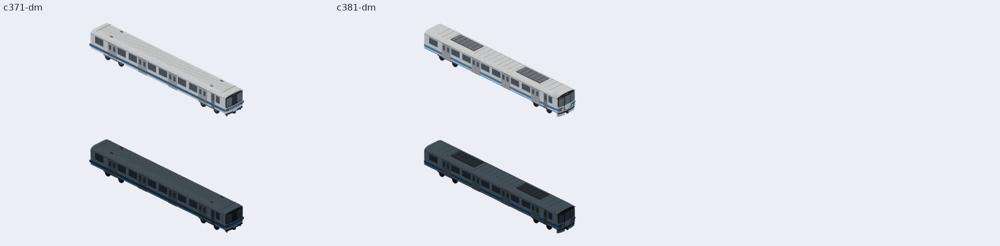

# C371／C381 原生靜態研究：雙車修訂與main格式核對（2026-10-28）

本輪依使用者要求同修C371／C381，並核對main `8be2242361f3622eeb0853bd3bd01db05631354f` 的最新資產規範。**兩款外觀均待使用者驗收**。撤回先前把「可以」推定為C371外觀已接受的紀錄；完成匯出／測試不等於外觀合格。



## 外觀與證據

C371保留雙駕駛窗、中央無玻璃逃生門、單條藍腰帶。車頭橫向分片加密、肩部收進前罩弧線，燈座由六角黑塊改圓角燈腔／金屬圈／頭燈及尾燈圈；縮小並壓暗兩個真實存在的鼻下圓件，縮窄支架與連結器，薄防爬肋有實心背板。C381保留寬中央逃生窗、三片玻璃、中央收尖V帶與下細線，細化雙軸曲面／肩部，收薄燈罩、降低分離前裙並縮窄支架與連結器。

原有T/M裸原生及GLB、兩型車頂設備／走行組位置均保護；不以修改輪徑、輪距或抬輪來消除正交正面輪組疊影。前、左右、俯、斜、白模、剪影及尾／整列均須實際查看。鼻部曲率、局部尺寸、隱藏設備及另一側補全仍比例推估，不冒稱工程還原。

[原C371查證](REFERENCE_RECHECK.md)、[C381完整原圖與本輪界線](C381_REFERENCE_RECHECK.md)記錄來源、查看、SHA、作者／授權。TRSC C371完整實車原圖與C381近正面原圖本輪重新打開；這段對話先前已打開的其他原圖如實保留查看紀錄。只目視，不重發照片、插畫、商標、車號或mesh。主要規格用TRSC：六輛DM–T–M–M–T–DM，C371每節23.5m；C381 DM23.710m、T/M23.5m；寬3.18m、車頂3.585m、台車中心16.5m、軸距2.3m、新輪徑0.85m、軌距1435mm、每側四雙門。連結面間長不是最外鼻端。

## 最新main格式核對

| 項目 | 本輪結果與依據 |
|---|---|
| 遊戲模型包 | #1403已合main；八個C371/C381靜態單元在`Map3DModelPack.studies`，不進`standard`；保留標準包529模型／3,127,704頂點釘值，不改營運set／dispatch。 |
| 原生格式 | 既有M3DM v1；+X前、+Y左、+Z上，公尺、軌面Z0；單元<=15,000三角。完整六車沿既有M3DAssembly，僅內嵌該列引用的四類最終單元，不保留未引用的另一型車記錄，不放寬loader上限。 |
| GLB | 從同一最終原生／組裝轉出，+X前、+Y上、-Z左；獨立Blender importer核對。GLB供研究交付，不是App直接載入格式。 |
| 共用工具／材質 | 用已合#1357的`tools/train-models`匯出、日夜模型光、FNV與總覽；配方實色／霧面，既有glass色系；僅加`c371`／`c381`鋼材質key，不改`metroC381`營運映射。 |
| 新素材庫 | `a91453/railway-assets-private`，`game-art-previews/docs/art/c371-2026-10-28/revision-1`與`c381-2026-10-28/revision-1`，每款獨立目錄。舊reference-private #103只保留前版／交接。 |
| 預覽上限 | 每車19張：頭車日／夜各七向、T/M/rear/formation各一斜視、真前後比較一張；每張<=2MiB。完整暫存77＋112七向及白模／剪影在本機驗證，不全部重複提交。 |
| 歷史／ZIP | 新素材庫不新增history／old／backup或ZIP，僅最新一輪放模型／viewer；完整真前版從固定git提交取回，沒有刪除舊PR中的版本。 |
| 檔案／PR大小 | 遵守素材庫AGENTS較嚴格的單檔50MiB、PR新增200MiB；來源、重建commit／指令、每輪README與SOURCE.md齊備；實跑asset_guard，另核PNG上限。 |
| 公開交付 | Swift／工具／測試／來源／交接及一張`overview.py`總覽，完整原生／GLB／viewer／PNG在新私有素材庫。 |

`rolling-stock`第7節及舊建模prompt仍含舊私庫路徑／ZIP敘述；本輪依最新main的AGENTS／CLAUDE及新素材庫AGENTS執行，不照舊範本把ZIP／history加回。沒有藉此改全專案skill或別人的資產。

## 真正前版與重建

完整真前版是公開producer `cf8d79ba59f3965961d8cca7e67673fbae920472`；私庫 `a91453/railway-reference-private` 的 `63b446933a7ed0e31b2a565b0bb46f09f69fa54b`（素材本身commit `e791fdb7b34caf522b469550cb1f1a066b1d4515`），路徑`Railway/game-art-previews/docs/art/c371-c381-2026-10-27`。前ZIP SHA `2e26bbdc08046639ff724cf3d4ac8312e633d996f5ac01f08a99229e8366162a`，只指歷史原檔，不是本輪新增ZIP。舊reference-private的main已移除遷走的素材，應讀上述精確提交；其更早歷史仍在git，不再複製到新素材庫。

本輪producer以各車`source-record.json`的真提交為準。Swift6.4：

```sh
tools/c371-c381/export.sh OUT
tools/train-models/run.sh OUT/game-light --tag after --ids c371-dm,c371-t,c371-m,c371-rear,c381-dm,c381-t,c381-m,c381-rear
CHROMIUM_PATH=/usr/bin/chromium node tools/train-models/render.mjs OUT/game-light --time both
node tools/c371-c381/render.mjs OUT
node tools/c371-c381/clay.mjs OUT
node tools/c371-c381/revision-compare.mjs TRUE_PRIOR OUT
```

完整驗收／分車交付命令見[接手文件](CROSS_ACCOUNT_HANDOFF.md)及[工具README](../../../tools/c371-c381/README.md)。新輪不再需要凍結C371容器輸入，兩型都從當前最終配方生成。M3DAssembly預期raw triangle資料是比對用.bin，不是超限M3DM。

## 驗收界線

只註冊`studies`；合併重建App不會自動替換營運列車。GameCore、存檔、Golden／Save／Replay及玩法不動。Linux／Chromium WebGL／Blender結果和最新head CI分開記錄，不沿用舊head綠燈；UI／iPad skipped不算通過。兩型外觀、本輪Simulator畫面、真機Metal、效能、動畫、完整碰撞／結構工程、隱藏設備及直接file協定啟動仍未驗收。單檔viewer以loopback驗內容／互動，不冒稱直接file啟動已驗。

公開draft #1342持續更新；舊reference-private draft #103註明新素材庫接手，當前資產draft互鏈於公開PR與issue #1341。全部保持draft，不合併／auto-merge，不啟動TestFlight。
