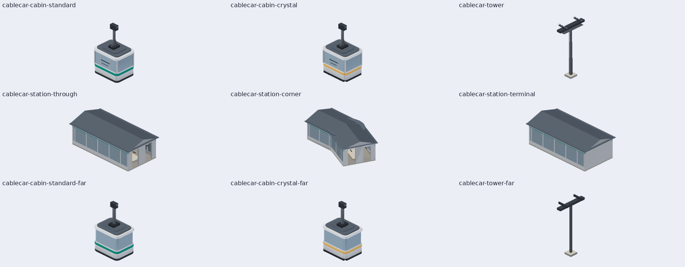

# 貓空纜車原生 3D studies（決策 575）

配方 `Sources/GamePresentation/Map3DCableCar.swift`，13 個模型都在 `Map3DModelPack.studies`（遊戲不畫；接進地圖等決策 574 的纜車運具）。`crystal-bottom.png` 是水晶吊廂的車底（玻璃地板）；`span-isometric.png` 是兩條鋼索的一段。

| 模型 | 近景三角形 | 遠景 |
| --- | --: | --: |
| `cablecar-cabin-standard`（一般，8 座） | 1,004 | 444 |
| `cablecar-cabin-crystal`（水晶，5 座，玻璃地板） | 1,012 | 460 |
| `cablecar-tower`（塔柱，14 m，兩組滑輪組） | 988 | 92 |
| `cablecar-station-through`（通用站房） | 496 | 256 |
| `cablecar-station-corner`（轉角站，轉 24°） | 956 | 536 |
| `cablecar-station-terminal`（終點站，臥式驅動輪） | 576 | 272 |
| `cablecar-span`（兩條鋼索，懸垂 1.1 m／60 m） | 576 | — |

座標：原生（+x 沿鋼索、+y 左、+z 上、公尺）。吊廂的原點在鋼索上（抱索器在 z 0，車廂掛在下面 3.6 m）；塔柱、站房、鋼索段站在地面。鋼索的畫法用 `Map3DCableCar.ropePoints(from:to:sag:segments:)`（場景座標 y 向上，拋物線，`sag` 0 就是直線），兩條索相距 `ropeSpacing` 5.2 m，塔頂索高 `ropeHeight(ofTower:)`，站內索高 `stationRopeHeight` 4.2 m。

## 出處（記錄的事實）

- 貓空纜車：POMA 的單索脫掛式纜車，約 4.03 km（POMA 頁 4,105 m），4 站、47 座塔、147 輛吊廂、6 m/s；一般吊廂 8 人（640 kg），水晶吊廂 5 人（400 kg）、48 mm 三層強化玻璃地板，2010-03-30 起 30 輛。來源：[Wikipedia: Maokong Gondola](https://en.wikipedia.org/wiki/Maokong_Gondola)、[POMA](https://www.poma.net/en/work/maokong-gondola-lift-taiwan/)、Taipei Fun Pass 的載重頁。
- 參考庫（`a91453/railway-reference-private`）與素材庫（`railway-assets-private`，`meshy-batch-2026-10/`）：只找到路線資料（`tw3d-reference-clean/.../official-routes.js`、geo-scene 的 `MK` 路線）與景點名，**沒有纜車模型或照片可用**；外部開源模型沒有採用。所以外型是本專案自己寫的。

## UNVERIFIED（設計值，不是實測）

吊廂車身尺寸（2.2 × 1.7 m、坐高 1.7 m）、吊架長度、鋼索間距 5.2 m、塔高 14 m、塔頂橫臂與滑輪組尺寸、站房尺寸（22 × 11 m、牆高 6.6 m）與屋頂形狀、轉角 24°、全部顏色（白身、藍綠線、水晶黃線、深灰屋頂）。動物園站、貓空站的實際外型特徵沒有查到可引用的照片或圖面，三款站房是簡化的通用型；動物園南站、指南宮站是轉角站的說法也 UNVERIFIED。真機 Metal 畫面、效能、營運接入都 UNVERIFIED；Linux 預覽不是 Metal。
