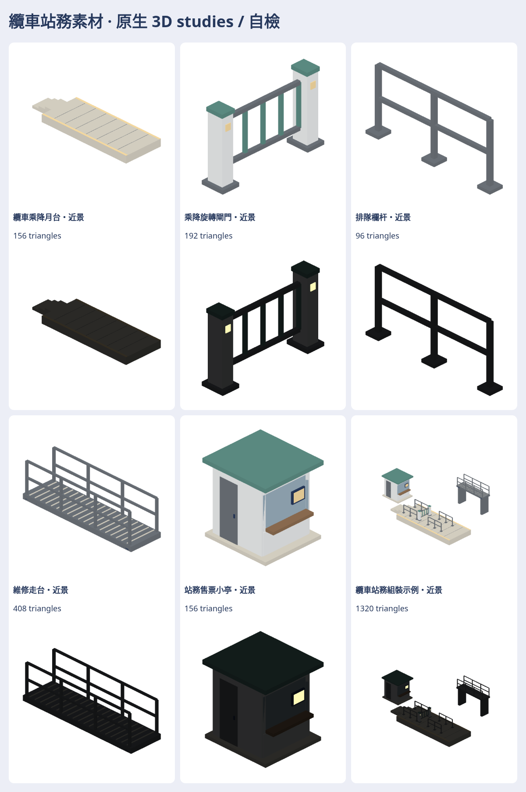

# 纜車可用的站務配套 studies

五款素材：乘降月台、0–90°旋轉閘門、排隊欄杆、維修走台、站務售票小亭，加組裝示例，各近遠景共12 native＋12 GLB、168張日夜七向透明PNG、自含viewer、SOURCE與接點metadata。

**只是studies，還沒接營運；外觀待作者看過，目前只有自檢。** CABLE3D [#1782](https://github.com/a91453/railway-game-ios/pull/1782)原有一般／水晶吊廂、塔柱、索與三種站房，本批補它周邊；不取代／改寫該分支，不改CABLE-2介面與規則。

[配方／重建](../../../tools/cable-support-studies/README.md) · [完整私庫成品／來源／viewer](https://github.com/a91453/railway-assets-private/tree/codex/cable-support-assets/game-art-previews/docs/art/cable-support-2026-11)

| 素材 | 近景三角 | 遠景 |
|---|---:|---:|
| 乘降月台 | 156 | 72 |
| 乘降旋轉閘門 | 192 | 156 |
| 排隊欄杆 | 96 | 60 |
| 維修走台 | 408 | 132 |
| 站務售票小亭 | 156 | 132 |
| 組裝示例 | 1320 | 756 |

相容性profile鎖定#1782 commit `aaaaaca6f93da7e27d2e62df87fd0ac55979483d`：索距5.2m、站內索高4.2m、吊廂底板下垂3.6m，得到新月台面z=.60；月台邊y±1.65至1.7m廂寬的近側有名義.10m間隙。**原站房平台頂面.90，比廂底.60高.30m；本批平台需替換原平台，不能疊放。** 只保留這些接點設計值，不宣稱整站或動態乘降已相容。

還不像：通用直線月台／旋轉門／綠頂小亭，不是貓空四站實景或照片中的三桿票閘；維修走台未還原原廠支架／格柵。全部尺寸為study設計值／比例推估，沒有安全／無障礙／承重認證。透明窗為不透明頂點色，顯示器無文字內容；沒有業者商標、廣告或公司名。組裝例不包含吊廂／索／塔柱或站房，維修架是另置服務區。

VERIFIED（Linux）：Swift6.4 `swift build --build-tests -Xswiftc -warnings-as-errors`；6項配方測試、4Node編碼測試；12模型真正Swift loader逐頂點／色值／glow讀回、GLB byte重建、168PNG完整RGBA／SHA／透明非空不裁邊；同份HTML關網12模型／七向／日夜／閘門分件與390px。相關XCTest與證據詳私庫README、validation.log、browser-verification.json。UNVERIFIED：作者外觀接受、Metal/iPhone/iPad／效能／動態淨空／營運；file://被受管Chromium政策封鎖，直接雙擊開檔未驗。原生逐solid有向閉合，不代表全模型做過布林聯集或已證明所有三角無穿插。file://受管Chromium可能阻擋；另驗同份HTML關網互動，不能冒充直接雙擊或Metal真機通過。

五方：玩家可看見乘降／排隊分工；交通迷官方系統資料與設計推估分開記；開發獨立工具與接點不動權威狀態；美術沿用霧面色票、外觀待作者看過；音樂無交付。

GameCore、存檔、golden、SaveFixtures／ReplayFixtures、standard模型與其他人的分支不動。兩庫draft、不合併／auto-merge／main push／TestFlight。沿用575作相容參照，不新增或修改其他人的決策。下一步由作者看外觀，再由整合者選用、解決原月台高度差並另驗動態淨空。
