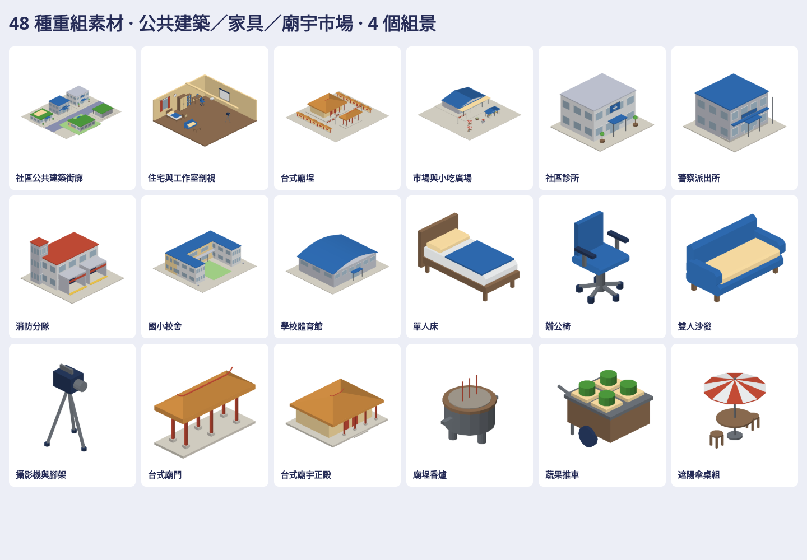

# 公共建築、家具、廟宇市場素材

48件原生3D素材：公共建築12、室內家具24、廟宇市場12；另附公共街廓、室內剖視、台式廟埕、市場廣場4個組景。共52個native、52個GLB、364張上／下／左／右／前／後／立體透明圖。

| 類別 | 素材 |
| --- | --- |
| 公共建築 | 診所、派出所、消防分隊、郵務所、國小、幼兒園、圖書館、活動中心、體育館、日照中心、公廁、市場主棟 |
| 家具 | 單／雙人床、衣櫃、床頭櫃、書桌、辦公椅、休閒椅、沙發、茶几、書櫃、工作桌、水槽、壁鐘、桌燈、投影機／幕、撞球桌、咖啡桌、吧檯／高腳椅、窗簾、吸音板、置物櫃、攝影機 |
| 廟宇市場 | 廟門、正殿、側殿、香爐、燈籠串、圍牆、供桌、攤位、蔬果車、小吃車、連續雨棚、傘桌組 |

入口：`Map3DCivicKit.model(for:)`、`Part.mount`／`connectors`、`Map3DModelPack(civicKit:)`。按需產生，不加入standard常駐。地面件底z=0、壁掛件背x=0、吊掛件頂z=0。書桌desktop接點z=.80；例子將桌燈對齊桌面、壁掛件貼實體牆、投影機固定在橫樑。

讀取私有procedural_assets的Clinic、Police Station、Firehouse、Japan School Gym、Temple Gate／Hall、Rooms Vintage Bed共7個factory，重新設計尺寸、比例、部件與布局；廟宇改台式紅柱、燕尾脊、廟埕，家具簡化霧面分件，未保留來源貼圖、招牌文字、品牌或原factory。其餘建物家具依既有原生幾何補建；不宣稱48件逐一直接移植。各factory SHA與來源→新配方對照留私有庫。

大型成品：[私有素材分支](https://github.com/a91453/railway-reference-private/tree/codex/civic-assets-2026-10-21/Railway/game-art-previews/docs/art/civic-kit-2026-10-21)。公開只保留配方、工具、測試、總覽與小驗證JSON。

[重建工具](../../../tools/civic-kit/README.md) · [Claude延伸指引](../../../.claude/skills/civic-kit/SKILL.md) · [實際驗證](verification.json)。這是靜態遊戲資產，非實測建築；原生／WebGL檢查不等於真機Metal、來源並排或App地圖已採用。
