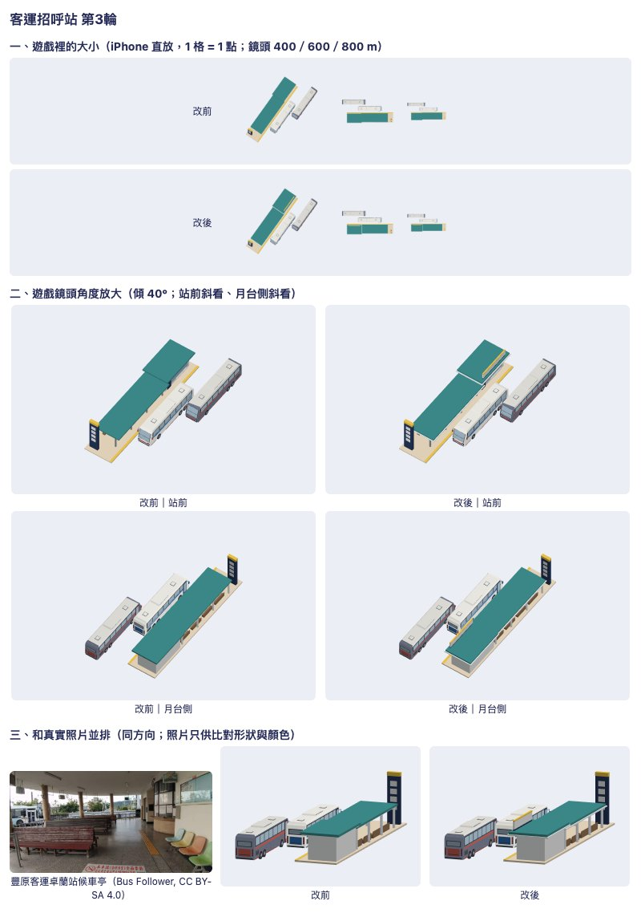
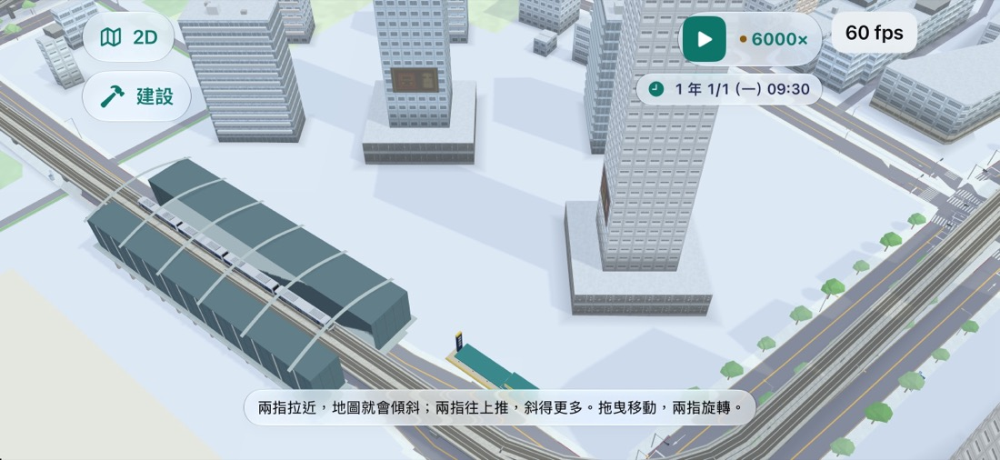
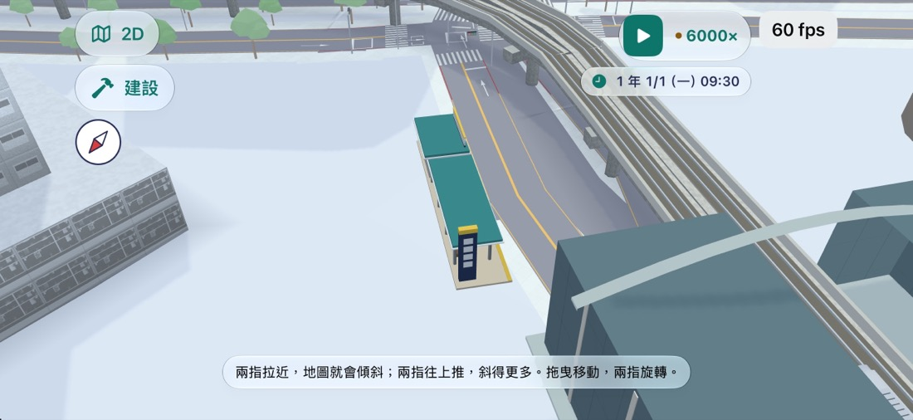
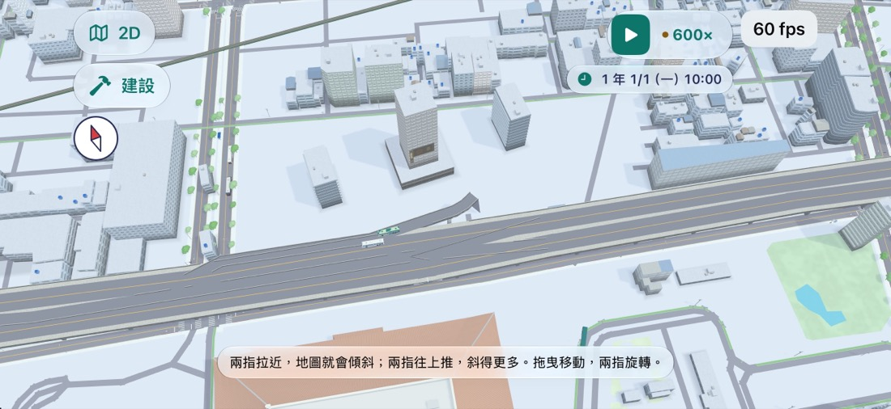
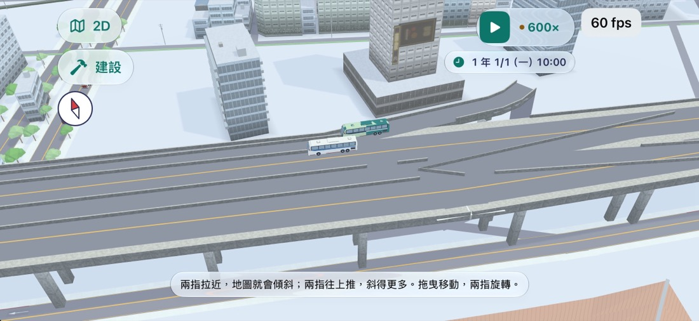

# 3D 地圖的長途客運與客運站（決策 708，2026-11-13）

派工單 COACH-3D。決策：[708](../../decisions/708.md)。模型的配方在 `Sources/GamePresentation/Map3DCoaches.swift`（`Map3DCoachStop`），車是決策 593 的遊覽車（`Map3DCoachBus`）套決策 593 的塗裝。

總覽（第 3 輪，改前＝第 2 輪）：



重建這張圖：

```sh
tools/model-look/export-coaches.sh /tmp/coach
node tools/model-look/shoot.mjs --model /tmp/coach/coach-stop-scene.m3dmodel --title 客運招呼站 --out sheet.jpg
```

## 真實照片（只供比對形狀與顏色，不進版控）

全部來自 Wikimedia Commons，CC BY-SA 4.0：

| 照片 | 作者 | 看什麼 |
| --- | --- | --- |
| [Hsinchu Science Park Life Hub Bus Station 2022-10-07](https://commons.wikimedia.org/wiki/File:Hsinchu_Science_Park_Life_Hub_Bus_Station_(%E5%9C%8B%E9%81%93%E5%AE%A2%E9%81%8B%E7%AB%99)_2022-10-07.jpg) | T Gordon Cheng | 路邊國道客運站：長雨遮、圓柱、月台 |
| [Xiangshan Bus Station Platform 6 2022-10-09](https://commons.wikimedia.org/wiki/File:Xiangshan_Bus_Station_Platform_6_(Taichung%26Hsinchu)_2022-10-09.jpg) | T Gordon Cheng | 月台吊牌、候車椅 |
| [南方澳金龍寺大葉雀榕與下方的國光客運南方澳站](https://commons.wikimedia.org/wiki/File:%E5%8D%97%E6%96%B9%E6%BE%B3%E9%87%91%E9%BE%8D%E5%AF%BA%E5%A4%A7%E8%91%89%E9%9B%80%E6%A6%95%E8%88%87%E4%B8%8B%E6%96%B9%E7%9A%84%E5%9C%8B%E5%85%89%E5%AE%A2%E9%81%8B%E5%8D%97%E6%96%B9%E6%BE%B3%E7%AB%99.jpg) | Outlookxp | 小站房＋屋頂招牌 |
| [清大客運站 Rihao Bus 2023-09-01](https://commons.wikimedia.org/wiki/File:%E6%B8%85%E5%A4%A7%E5%AE%A2%E9%81%8B%E7%AB%99_NTHU_Bus_Station_Rihao_Bus_2023-09-01.jpg)、[Yalan Bus](https://commons.wikimedia.org/wiki/File:%E6%B8%85%E5%A4%A7%E5%AE%A2%E9%81%8B%E7%AB%99_NTHU_Bus_Station_Yalan_Bus_2023-09-01.jpg) | T Gordon Cheng | 車停在站邊的比例 |
| [豐客卓蘭站候車亭](https://commons.wikimedia.org/wiki/File:%E8%B1%90%E5%AE%A2%E5%8D%93%E8%98%AD%E7%AB%99%E5%80%99%E8%BB%8A%E4%BA%AD.jpg) | Bus Follower | 候車亭內：售票窗、長椅、圓柱 |

認得出來靠的三件事：**長雨遮接一間小站房**、**路邊一根高站牌**、**站房屋頂的橫招牌**。

## 每一輪

| 輪 | 圖 | 看到的毛病 | 改了什麼 |
| --- | --- | --- | --- |
| 0 | [round0.jpg](round0.jpg) | 只是一片棚子加幾根柱子，像公車候車亭，沒有站房，400 m 以上認不出來 | 重做：售票／候車站房（白牆、臨路玻璃面）、比站房低一階的長雨遮、圓柱、長椅、吊牌、高站牌 |
| 1 | [round1.jpg](round1.jpg) | 從上面看兩片屋頂都是白的，和鐵路站的白雨棚、附近的白屋頂混在一起 | 屋頂頂面全綠（鐵路站的雨棚沒有這個綠），白色只留在簷口 |
| 2 | [round2.jpg](round2.jpg) | 兩片綠屋頂變成一塊平板，看不出邊；站房和雨遮分不開；沒有招牌 | 簷口白邊比屋頂寬出一圈（從上面看是白框）；站房屋頂臨路加一塊橫招牌（白板、深色底條、琥珀色頂條，沒有字） |
| 3 | [overview.jpg](overview.jpg) | 見下面「還有哪裡不好」 | — |

遠景版（`coach-stop-roadside-far`）拿掉門、窗台、長椅、吊牌與站牌下兩格，柱子 6 邊。

## 在遊戲裡（iPhone 17 Pro 模擬器，高畫質）

| | |
| --- | --- |
|  板橋客運站，220 m |  同一站，75 m |
|  台北車站北側，市民大道高架上的兩班客運，420 m |  同一處，170 m |

[game-banqiao-before-clear.jpg](game-banqiao-before-clear.jpg) 是加「找一段沒有建築的路邊」之前：站塞進板橋車站的站體裡。

## 還有哪裡不好

1. **站只有一種**。台北轉運站、板橋客運站這種整棟的轉運站，和路邊一根站牌的招呼站，現在都畫同一座 26 m 的路邊站。
2. **沒有影子**。站和車都是每格放進去的模型，不投影子，貼在地上有點浮。
3. **站牌與招牌沒有字**，也沒有站名膠囊，點不到。
4. **車的塗裝偏淡**：決策 593 的七款在 400 m 以上白的那幾款分不太出來。
5. **終點站附近車會停在高架上**：台北轉運站的站位被接到最近的路（市民大道高架），兩班車並排停在高架上。
6. **站不清場**：只會沿路找一段沒有建築、水、道路的路邊（前後 120 m、兩側），找不到就放在原地，可能和行道樹、街景小物重疊。
7. 夜景沒有看過（站沒有發光的面）。
