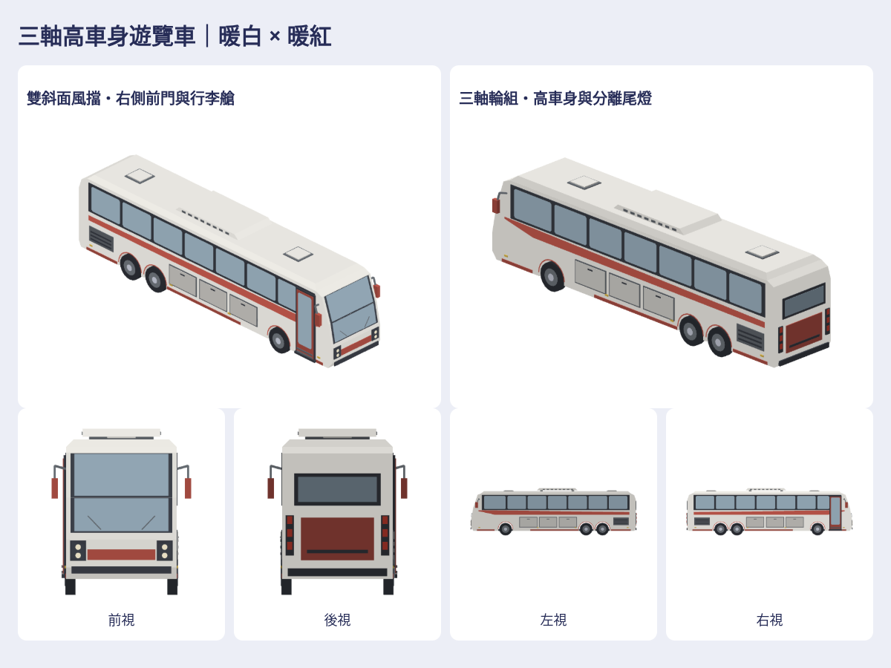

# 暖白暖紅三軸遊覽車

依作者4張綠白高車身遊覽車圖保留長窗帶、後雙軸與右前門；改遊戲暖白／暖紅霧面頂點色，重組兩段斜面車頭／雙燈、車尾／尾燈、行李艙、鏡架和車頂HVAC，無品牌。

新增1款life-coachBus；另3款已完成車型（藍綠小巴／白藍低地板／既有大型）只作對照，不算新增。4native／4GLB／28張上、下、左、右、前、後、立體RGBA，另900px前後底、四車比較、同尺度車隊、風格檢查與可旋轉viewer／ZIP。

Map3DCoachBus.model()／Map3DStreetModel.coachBus直接進standard。長約13.19、身寬2.50、含鏡3.16、高3.76m，三軸輪底0；非品牌工程實測。耳切輪拱真空隙、玻璃貼真實支持面、支腳連屋頂與冷氣，頭尾燈glow。原5%公車池中30%小巴／35%低地板／20%遊覽車／15%既有大型；前兩款seed選型不變，總交通量／上限／17m間距不增。街景視覺車型，非GameCore購車營運功能。

小巴#941已完成藍綠米白重組，本批不再改造；四款並排供確認風格。主要比例依本批圖片建置，重用小巴耳切殼／窗片與station/civic封底／封閉輪子方法，不搬原始factory、mesh或貼圖。

[完整私有成品](https://github.com/a91453/railway-reference-private/tree/codex/coach-bus-assets-2026-10-21/Railway/game-art-previews/docs/art/coach-bus-2026-10-21) · [重建工具](../../../tools/coach-bus/README.md) · [Claude/Codex指引](../../../.claude/skills/coach-bus/SKILL.md) · [驗證](verification.json)。真機Metal／效能、車門輪子動畫未驗證。

本批stacked PR以尚未合併#942為base（#942依賴#941），合併後可轉main。各批差異各自審查。
