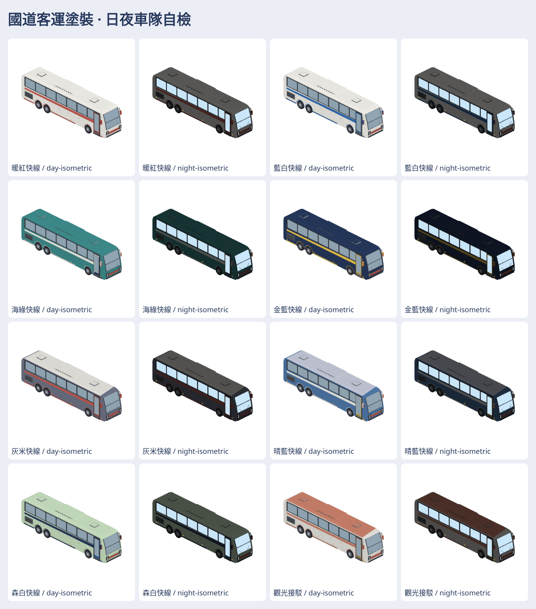

# 國道客運車塗裝 studies

8 組中性配色（含既有暖白／暖紅和一組觀光接駁），共 16 個近遠景模型。每組有固定 id 與中英文顯示名稱；不畫品牌、字樣或官方標誌。私庫 `game-art-previews/docs/art/coach-liveries-2026-11/` 存 M3DM、GLB、日夜七向透明 PNG、可切配色的自含 viewer、車隊圖及 SOURCE.md；公開庫只留配方與一張總覽。

VERIFIED：`swift build --build-tests -Xswiftc -warnings-as-errors` 通過；`swift test --skip-build --filter 'Map3DCoachLiveryTests|Map3DCoachBusTests'` 通過 8 項測試；既有 coach-bus rebuild 的七個測試組共 50 項通過。16 個模型與 GLB、224 張透明 PNG、日夜車隊圖已由 producer 驗證。近景每組 2,884 三角，遠景每組 1,586 三角。離線 viewer 的 16 個模型選項、七方向及日夜切換已在 Chromium 測試，無頁面錯誤；已自檢總覽、七方向與遠景 64 px 圖。

UNVERIFIED：直接 `file://` 開啟受本環境瀏覽器政策限制；Metal 實機、作者外觀接受、路線對色與營運接入。瀏覽器預覽不是 Metal 畫面。沒有真實業者塗裝授權宣稱。
