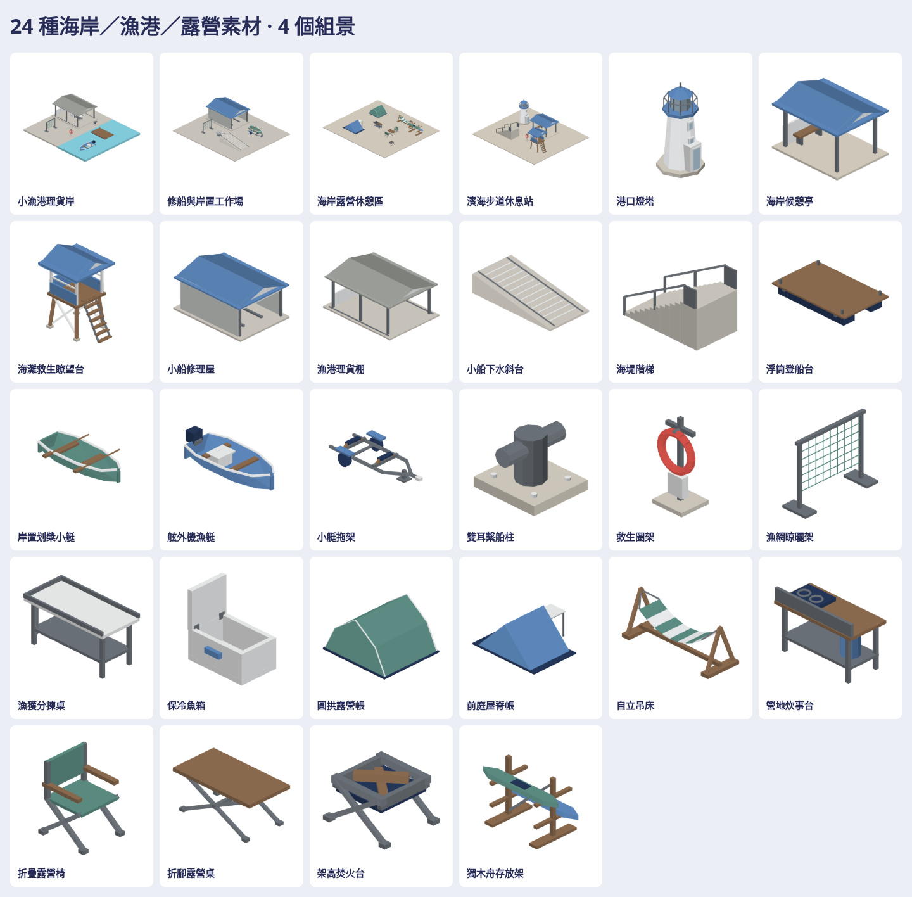

# 海岸小漁港與露營素材

24 件獨立素材（三類各8），另有4組景；共28 native、28 GLB、196張上／下／左／右／前／後／立體透明 PNG。不同組景內重複椅子不另計件，沒有把姿態或色票當新素材。

| 類別 | 8件素材 |
| --- | --- |
| 海岸設施 | 港口燈塔、候憩亭、救生瞭望台、修船屋、理貨棚、下水斜台、海堤階梯、浮筒登船台 |
| 漁港器具 | 划槳小艇、舷外機漁艇、小艇拖架、繫船柱、救生圈架、晾網架、分揀桌、保冷魚箱 |
| 露營家具 | 圓拱帳、前庭屋脊帳、自立吊床、炊事台、折疊椅、露營桌、架高焚火台、獨木舟存放架 |

四組景：小漁港理貨岸、修船岸置工作場、海岸露營區、濱海步道休息站。相同配方與 `placements(for:)` 實際組裝，位置表匯出於 manifest。既有 Station／Detail／Works／Civic／Residential／Park／CommercialKit 已查去重；這批新增海岸／漁港／露營主題，沒有重做已完成的公園套件。

入口：`Map3DCoastalKit.model(for:)`、`Part.connectors`、`placements(for:)`、`Map3DModelPack(coastalKit:)`；只按需產生、不加入standard常駐或地圖。native及接點座標為公尺、x前/y左/z上；所有單件底z=0。小艇與浮台入水需平移至「水面高度−waterline.z」，不能直接把船底當水面。桌面／船架接點見skill與manifest。

先讀私有 MODEL_CATALOG／ASSET_LICENSE及7個實際factory（rowboat、lighthouse、beach shack、canvas shade、hammock、campfire、fish boxes）。小艇變更長寬／船殼截面與艉機，燈塔變八角短塔／門廊，棚屋變新布局，帳與吊床改新支架；其他漁港器具及露營家具是相容的原生新配方，並非24個factory逐一轉檔。完整來源路徑、SHA、原尺寸、新尺寸與改造對照只在私有 `remix-provenance.json`。

沿用遊戲 StationKitBuilder／現有霧面色票、CivicKit封閉圓管、原生loader、StationKit GLB編碼與renderer；無新依賴。沒有搬原始factory、mesh、貼圖、品牌或招牌文字，未送私有原始素材到外部生成服務。來源授權允許修改與遊戲使用，限制原商品包再分發、競爭素材庫與生成模型訓練／微調／評估；私有包保留ASSET_LICENSE原條件，不宣稱CC0或新增對外授權。

大型成品與下載包在[私有批次目錄](https://github.com/a91453/railway-reference-private/tree/codex/coastal-assets-2026-10-23/Railway/game-art-previews/docs/art/coastal-kit-2026-10-23)。開啟預覽器：在該目錄執行 `python3 -m http.server 8080`，瀏覽 `http://127.0.0.1:8080/`。

[重建工具](../../../tools/coastal-kit/README.md) · [接續生成skill](../../../.claude/skills/coastal-kit/SKILL.md) · [驗證紀錄](verification.json)。VERIFIED（Linux／Swift6.4／Chromium）：25項相關XCTest、warnings-as-errors build、4項Node編碼測試、28 native逐頂點讀回、完整GLB重編／SHA、196 PNG完整RGBA解碼／alpha界線／SHA、28模型viewer分類搜尋／七向／旋轉縮放／四底色／下載／390px。人工實際打開分類、組景、七向、下斜視及多底色圖片，修正帳棚雨棚後緣、露營擺放重疊與座板穿船殼並保留先失敗的檢查。單件最高602、組景最高1948三角形。UNVERIFIED：iPhone／iPad Metal與效能、App地圖採用／碰撞／導航／動畫、來源瀏覽器並排；不將WebGL通過當作iPhone Metal、效能或遊戲地圖接入完成。靜態示意資產，不是真實燈塔測繪、海事工程、救生或露營安全規格。
