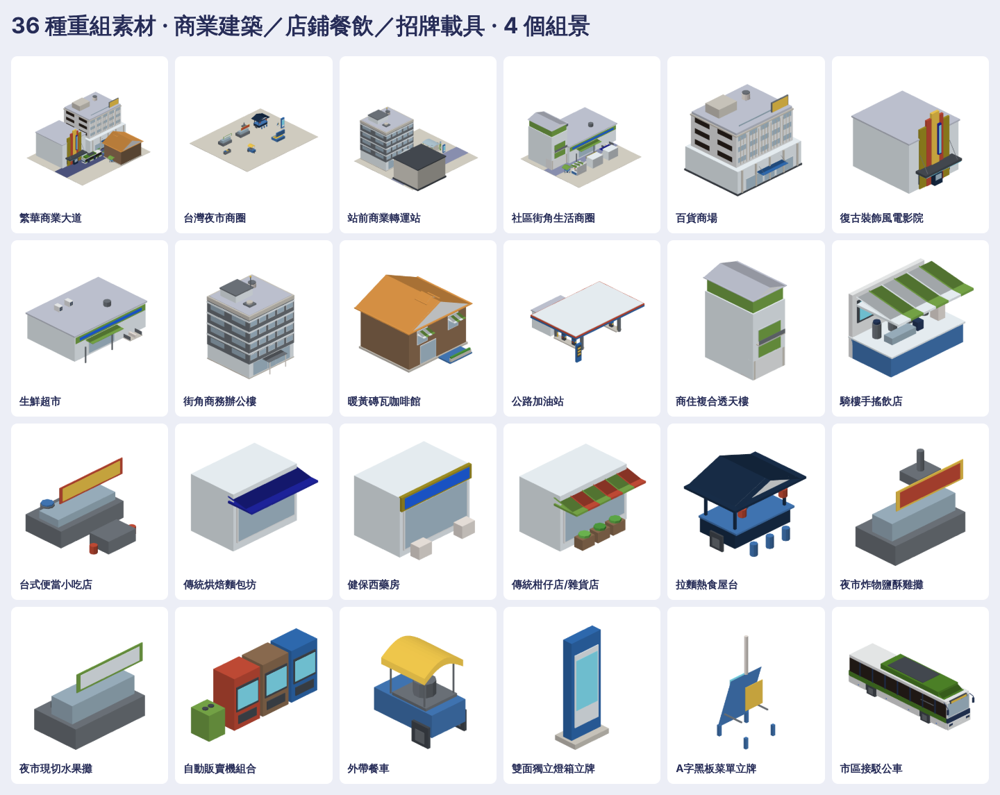

# 商業建築、街邊店鋪餐飲與商圈設施素材（CommercialKit）

36件原生3D素材：商業建築12、街邊店鋪餐飲12、商圈設施與接駁公車12；另附站前商業街、餐飲夜市步行街、百貨廣場與接駁站、商辦轉運節點4個組景。共40個native、40個GLB、280張上／下／左／右／前／後／立體透明圖。

| 類別 | 素材 |
| --- | --- |
| 商業建築 | 百貨商場、複合商辦、電影城、金融銀行、商務飯店、大型超市、量販賣場、3C數碼商城、現代連鎖書店、文創生活館、商務中心、旗艦展售中心 |
| 街邊店鋪餐飲 | 街角超商、連鎖速食、手搖茶飲店、台式麵食館、熱炒海鮮餐廳、精品咖啡館、傳統烘焙坊、藥妝店、日式拉麵店、冰品甜湯鋪、排骨便當專賣、精緻糕點茶屋 |
| 商圈設施與接駁 | 公車站候車亭、站前排班計程車站、雙面商業廣告看板、商圈電子資訊柱、站前接駁公車、商圈立體導覽牌、露天咖啡遮陽傘座、商業街立式招牌柱、商圈投幣自動販賣機、商業街造型街燈、街區景觀植栽花台、商業街休閒長凳 |

入口：`Map3DCommercialKit.model(for:)`、`Part.mount`／`connectors`、`Map3DModelPack(commercialKit:)`。按需產生，不加入standard常駐。地面件底z=0、壁掛件背x=0、吊掛件頂z=0。窗戶均有不透明背板，招牌與桌椅無浮空，全封閉底面。

包含依使用者上傳照片改造成遊戲原生3D風格之「站前接駁公車（transitFeederBus）」，保留雙軸、白綠配色、車頂冷氣機組、輪拱底盤封閉、後照鏡與車窗背板結構。其餘商業建物與店鋪參考私有庫procedural_assets重新規劃尺寸、比例與台灣街景特徵，未保留來源原始貼圖、品牌或商標文字。

大型成品：[私有素材分支](https://github.com/a91453/railway-reference-private/tree/gemini/commercial-assets-2026-10-21/Railway/game-art-previews/docs/art/commercial-kit-2026-10-21)。公開只保留配方、工具、測試、總覽與小驗證JSON。

[重建工具](../../../tools/commercial-kit/README.md) · [Claude延伸指引](../../../.claude/skills/commercial-kit/SKILL.md) · [實際驗證](verification.json)。這是靜態遊戲資產，非實測建築；原生／WebGL檢查不等於真機Metal、來源並排或App地圖已採用。
