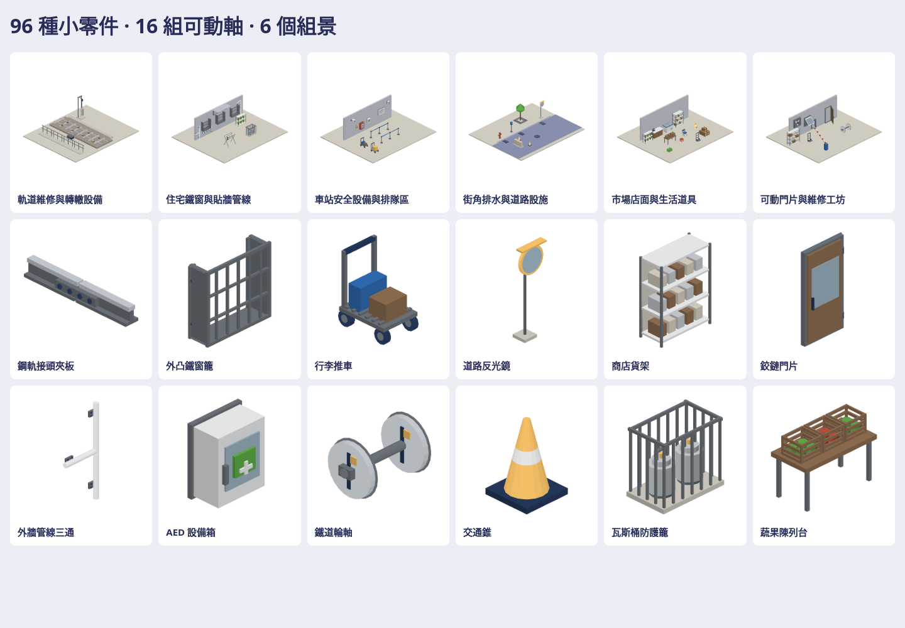

# 台灣場景細節零件

96 種新原生 3D 小零件，六類各 16 種。另有 16 個活動姿態與 6 個組景範例：118 個檢視模型、32 個獨立固定／活動本體，826 張上／下／左／右／前／後／立體透明 PNG。每種零件都有自己的幾何，姿態和分件另計，不充作新零件數。

| 類別 | 內容 |
| --- | --- |
| 鐵道 | 夾板、扣件、混凝土／木枕、護軌、轉轍連桿、轉轍機、絕緣接頭、絕緣子、張力墜砣、直／轉角電纜槽、排水槽、軸計數器、止輪器、維修走道 |
| 台灣建築 | 平面／外凸鐵窗、雨遮支架、管線直／彎／三通、單／集中電表、瓦斯桶與防護籠、磁磚牆角、鐵皮加蓋、電纜橋架、固定環、水龍頭、排風罩 |
| 站內 | 支架／半球監視器、音箱／號角喇叭、對講機、消防箱、AED 箱、排隊柱／帶、行李推車、路網框、嵌頂／吊燈、滅火器、清潔車、失物架 |
| 道路排水 | 直／轉角路緣石、水溝／人孔／設備蓋、集水井、交通錐、反光鏡、護欄端頭、阻隔墩、擋輪塊、消防栓、排水口、樹穴格柵、計費柱、圍籬 |
| 商店生活 | 貨架、冷凍櫃、封／開紙箱、周轉籃、折疊椅、盆栽／曬衣架、洗衣籃、棧板、蔬果台、手推車、櫃檯、米袋、矮凳、包裹組 |
| 可動組件 | 鉸鏈門、捲門片、閘門板、輪軸、往復連桿、橫移門、柵欄、風扇、格柵門、設備箱門、腳輪、尖軌、檢修蓋、電扶梯踏階、月台門、上掀服務窗 |

原生入口：`Map3DDetailKit.model(for:pose:)`、`components(for:)`、`Part.connectors`、`Part.joint`、`Map3DModelPack(detailKit:)`。按需要的零件建模，無須載入整批目錄。這個 PR 提供素材，不改遊戲地圖選型與擺放。

壁掛件固定板貼 x=0；天花板零件從 z=0 向下延伸；地面／屋頂件從約 z=0 放置。公開座標和 native model 一致：x 前、y 左、z 上，公尺。管線與 2 m 線段有端點。可動件分出固定和活動 body，附軸、樞紐、限制、單位；GLB 是靜態網格，沒有 glTF 動畫軌，宿主依 metadata 動畫。檢視頁滑桿只改預覽；PNG 可下載目前動作，GLB／native 為所選清單項目的靜態姿態。

六個組景示範：軌道維修、住宅外牆、站內安全、街角排水、市場店面、維修工坊。牆面、地面與支架使用實體幾何；組景不代表實際車站的工程配置或安全設備規格。

完整 native／GLB／PNG／manifest／可旋轉檢視頁放私有參考庫 `Railway/game-art-previews/docs/art/detail-kit-2026-10-21/`。公開庫只放配方、工具、測試、此總覽與小型驗證紀錄。

重建：`tools/detail-kit/rebuild.sh PRIVATE_OUTPUT_DIRECTORY`；詳見 [工具說明](../../../tools/detail-kit/README.md) 與 [Claude 指引](../../../.claude/skills/detail-kit/SKILL.md)。不新增套件、使用現有 Swift 6.4、Node、Python、Playwright／Chromium。

參考檢查：讀私有庫 `procedural_assets_reference_clean/00_READ_ME_FIRST.md`、`ASSET_LICENSE.txt`、`MODEL_CATALOG.json` 的貨架、紙箱、曬衣架、管線尺寸分類；沒有搬用其 factory、模型、貼圖或原配色。新幾何獨立建置，沿用公開遊戲的 StationKitBuilder、Map3DPalette 與 station-kit 的匯出／渲染器。沒有外部素材或依賴需要新增授權。

**VERIFIED** 與 **UNVERIFIED** 的實際結果見 [verification.json](verification.json)。Metal／真機效能、遊戲內放置、碰撞與活動件接入仍需後續驗證。
