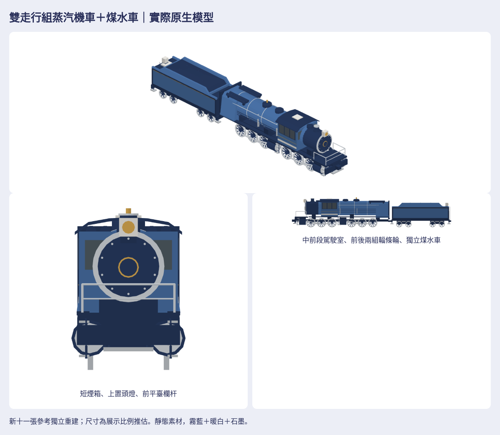

# 第二台霧藍雙走行組蒸汽機車＋煤水車

作者本次十一張新圖逐張查看後獨立建模；沒有套第一台長鍋爐後駕駛室車體，也沒有改它的分支。任務／最新交付與 CI：[issue #1118](https://github.com/a91453/railway-game-ios/issues/1118)。[重建交接](../../../tools/duplex-steam/README.md)。

## 建模前特徵表

| 項目 | 新圖所見／採用 |
|---|---|
|類別／單體或編組|蒸汽機車＋獨立煤水車；機車有前後兩組走行機構。|
|側面輪廓／比例|駕駛室靠中前段，前方短煙箱，後方長鍋爐接寬後火箱；兩組輪位之間留間距。煤水車車身較低且短。|
|正／後／上視|前端圓煙箱門、高置主燈、大方形欄杆平臺；後火箱寬。煤水車中央後梯、抓桿、高位尾燈；中央加高煤艙斜肩，後水箱蓋。|
|頭尾／左右差異|前後輪廓及設備不同；左右管路數量不同，兩側都有連桿、汽缸、側階；不硬鏡像全部設備。|
|門窗／大型設備位置|駕駛室每側三窗、薄框，前向小窗；弧屋頂帶蓋。後鍋爐雙圓頂、火箱肩部各兩長筒，前煙囪。無中間駕駛單元。|
|走行系統|圖示兩組各三個近等大輻條輪，前後各汽缸／連桿；煤水車兩個雙軸轉向架。|
|資料缺口|真實車型、工程尺寸、遮蔽軸與確切鉸接未知。全部尺寸為比例推估，不把照片透視像素當工程尺寸。|

私庫台灣車庫 README／ct273.json、世界車輛目錄及 OpenWorld 規格查無這台的可靠唯一尺寸；CT273 明示 Q 比例、工程尺寸為空，不能拿來認定本台車型。沒有匯入它們的 mesh。既有四節都市車及七節輕軌只比較色票、霧面與細節密度。

## 外觀檢視（代理人結論，未聲稱作者認可）

最終原生模型重新渲染配色、白模、剪影並查看側／正／俯／代表斜視；完整七向及放大正交在私庫。主形體定妥後才加輪組、門窗與設備。

| 檢查 | 結論／證據 |
|---|---|
|已符合|靠前駕駛室、短前煙箱／長後鍋爐與寬火箱，兩組三輪、獨立煤水車順序；上下視可見兩側長筒和煤艙。|
|已符合|圓煙箱門與高主燈、方形前平臺欄杆、雙側汽缸連桿、煤水車斜肩／水箱蓋／後梯；未沿用第一台排障柵和大小輪配置。|
|已符合|玻璃為薄片、框薄且貼合實體駕駛室；霧藍主體、少量暖白／金砂、石墨設備，無紅色、車號、品牌。|
|初版仍不符合→已修|前汽缸偏小、前階位於輪區、前梁未連車架。汽缸加大且前移、同步調整連桿及前階，補前平臺支承與踏階吊架，重新匯出。|
|已符合／保持穩定|前後對照源自保留的真正初版；同相機、同公尺尺度。機車302件原有實體不變，煤水車146件幾何和顏色全部不變。|
|資料不足|隱藏機械、車型、工程尺寸、真實鉸接／動態行程；現階段不宣稱精密復刻或動態機械正確。|
|仍不符合交付項|無；下列真機、動畫與工程驗證限制仍明確保留。|

比例推估 bounds（長×寬×高）：機車 15.350×3.300×4.680m／8,080三角；煤水車9.480×3.040×3.860m／3,048三角；完整編組24.830×3.300×4.680m／11,128三角。實際 min/max、SHA 見私庫 manifest，原生軸向 +x前/+y左/+z上、地面z=0。

## 技術與交付

**VERIFIED（Linux，Swift6.4）**：warnings-as-errors build、20項相關測試；原生讀回；5native／5GLB（含兩件既有比較）、35張七向透明PNG；實際三角形封閉／朝外／正體積、16條玻璃支持射線、輪底貼地、兩組輪位、12條汽缸外觀射線、踏階輪組包絡分離；走道淨空0.14m、踏階至少0.19m；492實體全部經三角接觸圖連回車輪。缺面／反面／浮空玻璃／走道切輪／汽缸移走／浮空安全閥六類故障遭拒。獨立Blender4.3.2匯入、PNG完整解碼／透明／不裁邊、精確組裝車鉤、viewer旋轉／縮放／真實下載、ZIP完整解壓逐檔比對。producer commit與全部原生／GLB重建逐位元組比對。

**UNVERIFIED**：真機Metal、效能、動畫／動態連桿淨空、工程強度／尺寸／型號；Linux WebGL不能代替這些。離線HTML以無網路瀏覽器驗證，作業系統雙擊開檔流程未驗。

**最新提交CI另列**：以本任務draft PR的最新head檢查及#1118交付留言為準；本機VERIFIED不等於CI或真機通過，私有素材庫無CI亦不寫成綠燈。

公開只放配方、必要註冊／測試、重建與驗證工具、文件、本張總覽。完整素材及所有原圖在[私庫批次](https://github.com/a91453/railway-reference-private/tree/codex/duplex-steam-2026-10-23/Railway/game-art-previews/docs/art/duplex-steam-2026-10-23)。該處含獨立單元、編組七向、白模剪影、同尺度比較、真正前版／修訂對照、`viewer-standalone.html`、`index.html`、`asset-package.zip`、來源與SHA記錄。

**這是靜態素材＋素材庫註冊，合併後不會自動替換或新增遊戲中營運的列車。** 尚未綁定車種、動畫或玩法。沒有變更GameCore、存檔、golden／replay fixtures；不啟動TestFlight，不推main，不合併／auto-merge。
