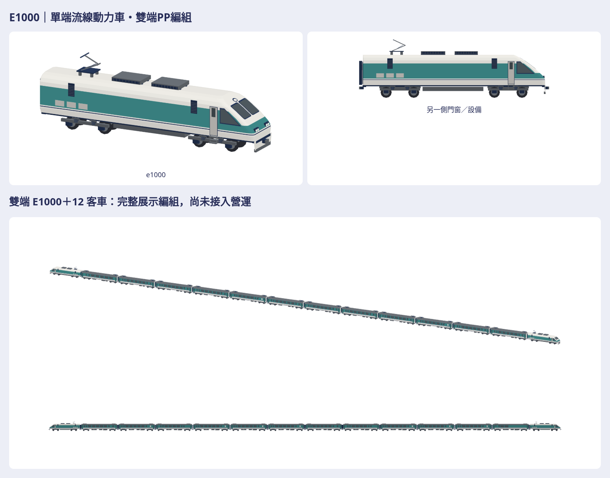

# E1000 原生動力車與雙端 PP 展示

追蹤 [#1294](https://github.com/a91453/railway-game-ios/issues/1294)。使用者明確要求開始製作 E1000 版本；本輪獨立重建單端流線機車近遠景，沿用 PP 四角色原生，不把 E500 車殼、門窗、底盤或屋頂改成 E1000。

PP 公開 #1291／私有 #87 尚未合併，因此本分支 **codex/e1000-pp-2026-10-26** 從固定 PP producer **61c6969c92bf1689f7dc1fcd6242c1dc74112e3a** 開獨立 worktree，以 PP 分支為 draft PR base；私庫 **codex/e1000-pp-assets-2026-10-26** 從 **1f81f7c80ab328975a5c049c836a5bcba7ed55d1** 另開。已 fetch main ddcd8b97、查閱工作登記及認領；不假設 main 已有未合併 PP 配方。PP 合併之後再由後續整合調整 base，本輪不合併或開 auto-merge。

[重建工具](../../../tools/e1000-pp/README.md) · [來源與逐張觀察](reference-record.json)。完整原生／GLB／各單元七向、配色白模剪影、同尺度真前後／風格比較、完整編組、viewer、SHA 與 ZIP 在私庫同名新目錄。公開只放本張總覽與必要程式／工具／測試／文件。

## 來源與特徵

| 項目 | 已確認依據 | 限制／建模決定 |
|---|---|---|
| 車體／含連結器長度 | 運安會第177次事故報告 §1.5.1，16,500／17,211 mm | 原生車體16.5 m、車鉤尖端±8.6055 m；不把車鉤外包當車殼長 |
| 寬／車高／集電舟面 | 同報告2,885／3,904／4,265 mm | 車殼依寬2.885／高3.904 m；另採靜態升弓姿態，整體最高點不是降弓高度 |
| 雙端編組 | 同報告明文12客車，前後各一E1000 | 確認兩端機車與客車數，不把靜態組裝稱為TCMS或推拉控制驗證 |
| 駕駛端 | E1047近照、實車正側照片及使用者E1000模型照 | 圓隆車頂、持續下降鼻面、兩片圓角風擋、橢圓上燈、左右雙燈、窄門和三角側窗 |
| 後端 | 維基文字與使用者產品排列圖：貫通門、風擋 | E1000有後端通道，不能沿用E500「沒有通道」假設；隱藏管線未確認 |
| 屋頂 | 實車斜照與使用者HO側照，一組AM59 EU集電弓與兩個主要電阻器箱 | 先做殼／支座／格柵；未照搬私庫整排側格柵或E500六格長殼；精確接線未驗 |
| 走行 | 官方／二手資料Bo′Bo′，兩組雙軸；照片鋼圈彈簧 | 輪徑1.00 m、台車中心±4.9 m、內軸距2.5 m均為比例推估，沒有工程圖，不稱工程尺寸 |
| 左右設備 | E1047可見側兩處窄進氣口，乘務門與側窗 | 另一側大型包絡採展示補全；不宣稱全部檢修口與隱藏機櫃已確認 |

官方來源：[運安會《0528臺鐵第177次車竹南站重大鐵道事故調查報告》](https://www.ttsb.gov.tw/media/7054/0528臺鐵第177次車竹南站重大鐵道事故調查報告.pdf)，§1.5.1／表1.5-1／表1.5-2；規格位於印刷頁10（PDF頁24）。[E1000彙整](https://zh.wikipedia.org/w/index.php?title=台鐵E1000型電力機車&oldid=94003313)只作二手交叉資料，不把它稱原廠圖。

實際看過 [E1047實車](https://commons.wikimedia.org/wiki/File:E1047_at_Changhua_Station_01.jpg)、[Blair E1000搜尋頁](https://blair-train.blogspot.com/search?q=E1000)取得的7張實車正／側照片及3張銘牌（銘牌不用於造型、不轉印）、使用者原第5／7張E1000 HO照片及編組宣傳圖。來源網址、SHA與用途逐檔記record；原始圖片留在私有研究空間，不放公開庫／交付包，不送外部生成服務。

私庫 `Railway/taiwan-rail-reference-clean/source/rail-3d/assets/garage-blender-v1/e1000.json`／`.webp` 的真預覽與metadata已讀：工程尺寸null、Q比例長9.818 m／60,710三角，與實車尺寸、平側板／兩處窄格柵不同。只觀察，不移植mesh／配色／貼圖。

本輪使用暖白、綠松、藏青與灰色的既有遊戲色票、霧面頂點色；無紅色、品牌、車號、人物或文字貼圖。E500第三版與EMU3000第五版只比較材質／色票／細節密度，完整payload另外保護。

## 真版本與外觀修訂

真正前版為 PP parent **61c6969c** 的 `set-pushPull-head`，1,074三角的舊簡化E1000。由固定 parent worktree擷取並原生讀回，不能事後重造差版。前後使用共同相機、共同中心與公尺尺度。

先定車體長寬高／四向輪廓與單端斜鼻截面，再做Bo′Bo′、乘務門窗、車端、屋頂設備，最後補薄框、格柵與彈簧。第一次原生四向自檢發現風擋過窄且方，改寬並圓角；風擋在每個真鼻面高度轉折分段，逐片貼殼，不能一張面跨過凸殼。上方橢圓燈同樣沿真鼻面映射。遠景集電弓少肘節橫接件的支承反例，已補實體銷軸橫梁；另檢查前鼻主帶面積，保留暖白大鼻面及較寬綠松下帶。近遠均重新出四向配色／白模／剪影後查看。

外觀判定是製作者自檢，沒有使用者認可或相似度分數。已符合：單端連續斜鼻、圓角雙風擋、屋頂兩箱／一弓與實體肘節、後端通道、雙軸台車與八輪、與PP共同軌面及雙端排列。資料不足：輪徑／軸距精密站位、未見側檢修口、隱藏接線／機構及內裝。小型雨刷與管線採簡化／省略，不冒稱工程復刻。

## 編組、軸向與營運

原生公尺 +X前／+Y左／+Z上，輪底Z=0；builder只轉一次，GLB=(x,z,-y)。每件M3DM仍≤15,000三角，完整列車用自含合法單元的M3DAssembly與GLB，不冒充超限單一遊戲原生檔。

展示為前E1000（0°）—12客車—後E1000（180°）；單元、平移、旋轉、bounds、三角與SHA見manifest。12客車使用既有PPC1400、PPT1000、PPH1300、PPM2500角色；參照報告車種層級的順序，但**沒有重建事故列車中的PPT2000子型，不宣稱逐車重現該班列車**，展示PPT均明標PPT1000，不用真車號。這是四角色展示排列，不是歷史班次或車隊調度資料。兩端E1000後端與客車通道相接，頭尾機車外側車頭不接通道。

營運只改既有 `pushPull` 兩個機車近遠payload，保留parent的PPT客車、車數、末節轉向及原生長度布局。<500 m近、500–<900 m遠、≥900 m既有盒形回退；其他列車包、classic、解鎖與fallback保持。公開PP parent及本PR都合併並重建App後，對應pushPull畫面才用新E1000。私庫合併不更新App，已安裝版本不會自行更新。

E500與全部PP客車配方不動，E500＋PP展示仍由原公開#1291／私有#87提供，本輪不覆寫。沒有將E500CK、MINGRI、STAR客車換成PP，GameCore／存檔／golden／replay不動。

## 驗證交接

使用Swift6.4 warnings-as-errors與相關測試；原生讀回真位置／法線／顏色／標記、封閉有向邊與正體積、實際玻璃背襯／向外可見性、8個輪胎連通件貼軌／上方淨空、屋頂／台車取樣接觸圖，以及浮玻璃／埋玻璃／升輪／浮台車、刪面／反面／缺尾機／尾機方向錯誤／車間錯位反例。完整Swift與JS組裝payload須逐bytes相同，車鉤與後端通道接面分開驗。

GLB另用Blender匯入，PNG完整解碼透明留白，viewer實際載入／旋轉／縮放／下載與離線，ZIP完整解壓逐檔比對；source.json核對真正producer來源。每次改模型全量重出。完整payload共存對固定PP parent，僅兩個預期pushPull head改變、其他舊單元保持。

所有實測結果存私庫verification／support-verification／coexistence／package-verification；最新同head CI在draft PR另列，不拿舊提交綠燈或Linux WebGL當Simulator／真機。人工Simulator外觀、Metal／FPS／記憶體、輪轉／門／弓／輪架動畫、推拉控制與全動態碰撞仍UNVERIFIED。未合併／auto-merge／啟動TestFlight。

本版近景5,300／遠景2,640三角；完整雙機12客車展示107,260／51,816三角。這是展示幾何量測，未驗真機場景成本。原生新舊讀回、刪面反面及組裝缺尾機／錯位反例已跑；玻璃向外32／24個有效面取樣、每車8胎及設備支承圖／浮埋玻璃／升輪／浮架反例已跑。保護比對以parent全pack加直接E500/EMU輸出，222個舊完整payload保持，只兩個pushPull head改變，新增兩個獨立E1000。
