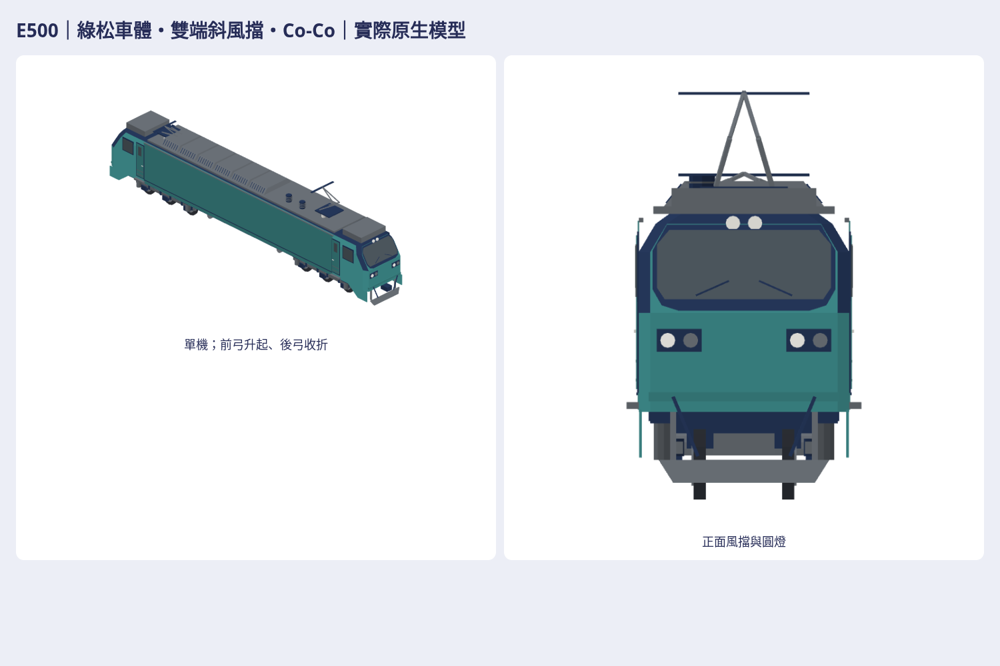

# E500 雙端電力機車原生重建

工作 issue [#1255](https://github.com/a91453/railway-game-ios/issues/1255)，認領記錄 #1041。base `41c00fa5`，獨立 `codex/e500-native-refresh-2026-10-25` worktree。文件 PR #1242 已合併，實際讀取當前手冊、PROMPT、REVIEW_CHECKLIST、EMU3000 案例與 art-style。

本版不是使用者已認可版本。外觀自檢、Linux 技術驗證、同提交 CI、真機 Metal／效能／動畫分開；未經真機驗證。原生配方獨立 [Map3DE500.swift](../../../Sources/GamePresentation/Map3DE500.swift)，[重建工具](../../../tools/e500-refresh/README.md)。唯一公開圖為最終原生總覽；完整交付在私庫，最終連結見 issue／互鏈 draft PR。

## 來源與特徵

| 來源 | 實際判讀／限制 |
|---|---|
| 東芝原廠 [2024 Vol79 No5 f02.pdf](https://www.global.toshiba/content/dam/toshiba/jp/technology/corporate/review/2024/05/f02.pdf)，頁47–48 | 實際讀文、查看 E501 實車照片及編組圖。20,770mm、Co-Co、雙端駕駛、可單機客貨及推拉。本文不把其 E200 對照欄當 E500 尺寸。 |
| [E506 彰化實車照](https://commons.wikimedia.org/wiki/File:TRA_E506_at_Changhua_Station_20240410.jpg) | 實際看前／側／屋頂斜照：大平側板、上斜風擋、圓下角黑罩、雙上燈、雙側成對燈、側門與車下設備。只觀察、不提取圖素／貼圖，不散布原圖。 |
| [E500 公開彙整資料](https://zh.wikipedia.org/w/index.php?title=台鐵E500型電力機車&oldid=94736285) | 寬2.759m、降弓4.280m、輪徑0.924m、軌距1.067m；屬二手資料，未取得完整工程圖。模型升弓高度不是降弓高度。 |
| 使用者七張圖片 | 1張署名 K.Y.Chung／Nanyue Express 的 CC BY-NC-ND 示意、6張模型展示。實際逐張看，作結構比例參考，未自動描圖、移植 mesh 或稱其實車照片。 |
| 私庫 `Railway/taiwan-rail-reference-clean/source/rail-3d/assets/garage-blender-v1/e500.webp`、同 `e500.json` | 逐張看模型預覽、讀 metadata；長9.818m，Q比例且工程尺寸null，側面格柵與實車不符。僅參考，不採 mesh／比例。 |
| 私庫同 source 的 iOS `la-side-e500@2x.png`、`@3x.png` 及 Android `la_side_e500.png` | 三張各自實際看，是簡化側面圖示；不當實車或尺寸證據。 |
| 已接受 Codex E200／EMU3000 | 僅同尺度比較色票、霧面、細節密度，不借用車殼／車頭／門窗／底盤；比較模型是原配方原樣。 |

非 Codex 模型只參考，本版 E500 全新程式建模；原始參考未公開或送生成服務。無 logo、品牌字、車號與個資；綠松車體、深色罩、灰設備及暖白燈，沒有紅色。數據使用事實，無逐字搬入文章。

| 特徵 | 確認／比例推估 |
|---|---|
| 編組 | 交付一輛機車，雙端艙；遊戲既有 E500CK／MINGRI／STAR 牽引客車，不新增貨運玩法或推拉編組。 |
| 四向輪廓 | 長平側板、雙端上半部後斜，俯視端部削角、橫截面上削肩；正面寬單片風擋與圓收黑罩。 |
| 門窗／燈／端部 | 各側兩窄門、兩駕駛側窗；每端雙上燈與兩組雙圓燈、雨刷、連結器、管線、側裙與排障板。位置及小設備比例推估。 |
| 走行 | 2×3軸，共12輪胎；924mm輪徑／1067mm軌距資料可查。轉向架中心±6.1m、各軸±1.65m為比例推估，非工程軸距。 |
| 屋頂 | 前弓升起、後弓收折，絕緣子、模組斜面／格柵、艙頂設備。設備精確站位與升弓高度比例推估。 |
| 左右／隱藏 | 大輪廓對稱，沿縱向保留前後弓狀態與高壓設備區差異；另一側管線、車底及內裝無完整證據，採簡化且不宣稱確認。 |

## 外觀修訂記錄

第一輪真正原生四向配色／白模／剪影已看：長比例、平側板、雙端風擋及六軸已符合；前端下方太空、黑罩下緣太直、屋頂模組過平仍不符合。保存當時真正原生檔及圖；第二輪修幾何：增加前端側裙及斜排障板、獨立貼合圓收黑罩、斜截面屋頂模組。再看近遠四向。最後修格柵支承，重新匯出全部最終視圖。

已符合（自檢）：四向大輪廓、無整排錯誤側格柵、玻璃與成對圓燈可見、兩組三軸、下裙／排障器、屋頂模組與弓形、遊戲色票霧面。

仍簡化：駕駛室內裝、輪架與煞車管線、精密絕緣子及受電弓機構。資料不足：另一側設備差異、精確軸距／前後懸、全部隱藏設備與工程斷面。沒有相似度分數或使用者認可聲稱。

## 實際遊戲替換

原 main 是 `Map3DTrainLocomotive.e500` 的1440三角機車，由 `Map3DTrainSet` 的 `E500CK`、`MINGRI`、`STAR` 共用。原生遠景沒有 E500 專用 LOD。保留該舊配方及其他列車，僅以上三個 set 改用本版獨立 E500，並新增各自 Far set：小於500m近景，500m至既有900m上限遠景，更遠仍既有盒形回退。列車包／classic／解鎖／fallback查找規則不變；`e500ChuKuang` performance alias 仍指 E500CK。一般莒光若實際選到 E200CK，不會被替換。

合併公開 PR 後，重新建置 App 的上述 set 會實際顯示本配方；私庫素材 PR 是下載包，合併私庫不改 App。既有已安裝 App 不會自動更新。這是靜態模型及營運接點，不聲稱輪轉、轉向架、受電弓或門動畫已驗證。

本三 set 使用自身公尺長度 layout，機車不再拉伸到舊19.4m顯示長；客車模型 bytes 保持，依既有 ownLengths 路徑取其長度與原有間距，可能使這三款顯示列長與舊均分格不同。GameCore 與玩法、存檔及 fixtures 無變更。真機沿曲線運行與動態連結仍 UNVERIFIED。

## 技術範圍與交接

VERIFIED／UNVERIFIED 實際結果見私包 `verification.json`、`support-verification.json`、`glb-import-verification.json`、`package-verification.json`，及本 issue 最新交付留言（包含同head CI）。不以本文件代替跑過的記錄。Swift6.4 warnings-as-errors、相關 tests；實際原生逐頂點與法線讀回；封閉／正體積及故障反例；GLB獨立匯入；七向圖全解碼透明留白；viewer真下載；ZIP逐檔解壓；producer真commit來源核對。

真前版：base 41c00fa5 原生 payload，不是倒造。相機與公尺尺度共用；另保留第一輪模型與圖作修訂對照。新模型唯一單元 `(0,0,0)`、旋轉0°，無組裝間距。全包單元、GLB、PNG、viewer以同最終原生為來源，bounds、三角與SHA在manifest，不用配方常數代替輸出量測。

UNVERIFIED：iOS Simulator 人工外觀、真機 Metal／記憶體／FPS、受電弓接觸網、車門／輪組／轉向架動畫、全表面動態碰撞。CI 尚未完成時只寫 pending，不拿舊commit綠燈代替。保持 draft、不合併／auto-merge／TestFlight。

本機量測：近景5744、遠景2968三角；完整單機包絡 X±10.385m、Y±1.540m、Z0–5.370m（包含踏板與升弓，並非車殼寬／降弓高）。近遠景各12輪胎，輪頂到上方實體取樣淨空最小0.106m；32個玻璃面背襯取樣最大距離0.0253m、12個向外可見性取樣。屋頂近景117／遠景27連通實體經65mm取樣支承路徑到車殼。這些為模型量測與取樣容差，不是實車裝配公差。

Linux Swift6.4 warnings-as-errors，28相關測試、1項既有成本測試skip、0失敗。base隔離重建184模型，本版193；除三個預期E500 head外，181原有模型位置／顏色／layer payload全同；9個新模型限三款E500遠景head/car/tail。原生／GLB、取樣支承／可見性／圓燈、PNG／viewer／ZIP的最終結果以交付包證據為準。原生工具只沿用既有合法工具做法，不增加第三方遊戲程式碼或依賴；無需另移植外部開源模型。
