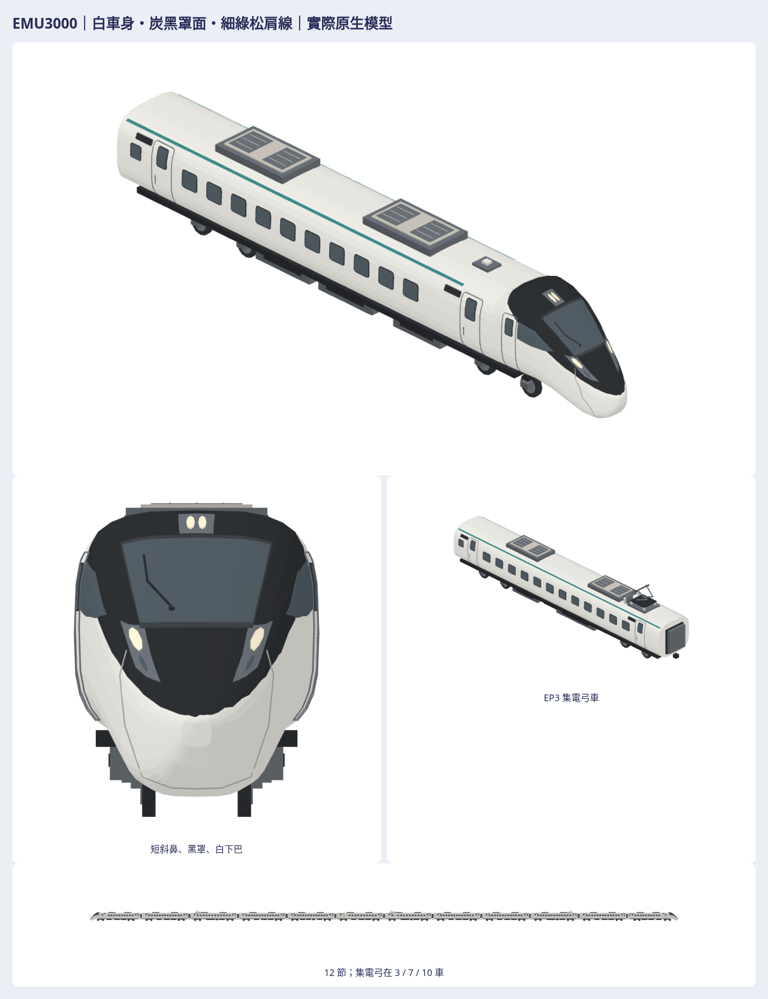

# EMU3000 第四版：依 ED 側圖校正整個車頭

[Issue #1226](https://github.com/a91453/railway-game-ios/issues/1226) · [公開 draft #1229](https://github.com/a91453/railway-game-ios/pull/1229) ↔ [私有 draft #77](https://github.com/a91453/railway-reference-private/pull/77)。實際producer、私庫儲存commit、最新同head CI在PR與交付留言分開記錄。本頁為製作方自檢，未宣稱使用者接受。

使用者最新要求「繼續修車頭修到跟圖片一樣」，本版依新ED側面示意修正艙頂弧線、連續斜鼻、圓收下角、三角司機側窗及前門相對位置；風擋、燈、雨刷及鼻罩縫全部重新貼合最終曲面。暖白／炭黑／細綠松保持。真正已交付第三版 `e25474fffe42a98fd6cbc04b5f287485be72e097` 與私庫 `aef61a87` 完整 `revision-3` 不動，新增最終 `revision-4`。先前只小修下巴的 `f6a010f0` 是真實中途研究稿，未宣稱完整交付或使用者認可，不冒充最新整體修訂。

本PR含真正EMU3000近／遠景營運替換接點，合併後**使用新set**才會顯示；未合併不改main或已安裝App。私有包是同幾何的靜態原生／GLB／預覽，App不讀私有GLB，車門／輪／弓沒有動畫。#1233另保留`emu3000Classic`，列車包解鎖／舊版回退由Claude後續分派，本輪不覆蓋其清單。

## 接手、參考與特徵

已讀AGENTS、CLAUDE、HANDOFF、art-style、diagnosing-bugs、跨AI原生車輛手冊與工具README，沿用自己的`codex/emu3000-native-refresh-2026-10-25` worktrees。先fetch最新main、讀工作登記並更新scope；保留#1227共用builder與#1233 classic接點。原public base85d9aa35／private81e935fd，既有700T／E200／N700S-G與其他非EMU模型不改。

| 類別 | 本輪採用的特徵 | 來源／資料缺口 |
|---|---|---|
| 單體／編組 | ED頭尾，12節6M6T、六EM／一ET／三EP | 維基、私有catalog與原10張示意交叉，EP在3/7/10 |
| 側面 | 艙頂圓隆後接較陡、連續下降的斜面；下角靠近鼻尖圓收，沒有長平前喙 | 新ED圖及原側照實際查看；輪廓位置是**比例推估** |
| 正／俯／斜 | 圓U黑罩、較下方的主風擋、獨立上燈與斜列側燈、白下巴 | 日立實車正面＋模型／CAD交叉；不把單一側圖說成所有視角已確認 |
| 頭尾／左右 | 尾件實際180°、兩下紅標示燈；中間車無駕駛窗燈 | 大多只見一側，另一側鏡像及內構仍資料不足 |
| 尺寸 | ED pitch21.35m、其餘20.3m、寬2.91m、全列245.7m、軌距1.067m | 維基與catalog次級來源；不把透視／插畫像素當工程尺寸 |
| 頭部高度 | 殼身3.49m、端車圓頂約3.68m，外部冷氣最高bounds保持 | 為依圖造型估計；原來源ED3.75／EM3.49高度定義歧義未解，原操作手冊PDF未取得 |
| 門窗／設備 | 三角側窗及乘務門向鼻側移、前客室門配合；薄門縫／完整玻璃跟真正分面 | 各相對位置依新ED；後部窗列、後門與中間車保持，不宣稱車號級工程表 |
| 走行 | 每節兩架各兩軸、8輪胎，輪底z=0；下設備避開輪組 | 走行payload保持；輪徑／軸距／隱藏動力與升弓接觸高度仍是估計 |
| 風格 | 暖白、炭黑、細綠松、灰設備與霧面頂點色 | 已接受700T／E200只比色票、材質與細節密度，不複製車殼／底盤／編組 |

原10張使用者圖都已實際看過；本輪新附EM側、ED側及重附同ED也逐張開啟。EM不含車頭，沒有拿它判斷下巴；新ED是本輪側面主依據。原示意署名K.Y.Chung／Nanyue Express、CC BY-NC-ND4.0，只觀察結構，不描線／取像素／作貼圖／重散布。日立`img_03.jpg`是實車正面、`img_02.jpg`是設計視覺圖，均已查看，後者不稱實車照。來源圖、mesh／貼圖、商標、人物不放公開庫或素材包，也未送外部生成服務。

實際閱讀：[日立設計](https://www.hitachi.co.jp/rd/research/design/product/taiwan_tra/index.html)、[維基EMU3000](https://zh.wikipedia.org/wiki/台鐵EMU3000型電聯車)、私庫`Railway/taiwan-rail-reference-clean/source/memories/tainan-2026-10-16/fleet/catalog.json`。手冊索引頁讀到但原PDF未取得；猜測TrainCollection頁404不當證據。URL、SHA、尺寸、查看狀態在私包`reference-review.json`。沒有新增依賴或外部建模程式碼。

## 曲面與貼合

先定主輪廓／艙頂／斜鼻上下包絡，再重排側窗／前門與大風擋，最後調燈／雨刷／鼻罩縫。舊車頭在前段過早變平，本版斜面持續降到鼻尖；艙頂圓隆、下角約在模型X10.05m／Z0.24m圓收，僅為虛擬模型量測，不是工程尺寸或相似度分數。

原生門葉仍以白殼本身作門葉，封閉薄門縫與玻璃按殼面分段投影。乘務門已進入漸縮艙段，投影工具新增真正縱向三角對角線截面，逐點求實際側面；不能把直車身的固定平面直接搬過來。第三版修好的中間車門不動，全部近遠車門再做實際遮擋檢查。

黑罩直接切入殼面三角，沒有疊片蓋露白；風擋／燈座／玻璃是有背襯的封閉面，鼻縫以真正殼三角射線投影，雨刷帶實體支點。真正前後同相機／公尺尺度在`previews/revision-3-vs-4.png`，車頭放大`chin-before-after.png`；其餘main原版、初稿與700T/E200風格比較也保留。中途小修f6的真模型另列history，不冒充第三版。

## 外觀結論

| 項目 | 製作方自檢 | 證據／限制 |
|---|---|---|
| ED側面圓頂、連續斜鼻與緊湊下角 | 已符合本輪造型目標 | 最終原生側面／白模／剪影、真第三版同相機對照；依圖比例推估 |
| 三角側窗、乘務門與前客室門關係 | 已符合本輪目標 | ED左右與斜視、實際側面投影；另一側精確差異未取得 |
| 正面U罩、風擋／上燈／側燈 | 已符合本輪目標 | 最終原生正／上／斜配色白模剪影，交叉日立實車正面 |
| 玻璃完整、薄門縫、設備支承 | 已符合靜態外觀目標 | 各單元七向、門部放大；技術支持取樣另列，不用測試代替外觀 |
| 中間車／輪組／設備／後部窗列穩定 | 已符合保持範圍 | 12件中間單元原生payload全同；實際頭尾前後稽核保護非前艙與走行 |
| 精確工程截面、另一側、車底內構 | 資料不足 | 不宣稱所有視角或隱藏軸式已確認，不說工程復刻或使用者認可 |
| 實機／效能／動畫 | 資料不足／UNVERIFIED | Linux WebGL不等於Metal或FPS |

## 單元與實際接入

真實12節`ED1–EM1–EP1–EM2–ET1–EM3–EP2–EM4–EM5–EP3–EM6–ED2`，輸出`ed–em–ep3–em–et–em6–ep7–em–em–ep10–em–tail`。ED10暗主窗；EM/ET13；EP3為12；EM6兩留白後10暗；EP7一服務留白後11暗；EP10為13。非12節保留遊戲1–16節選擇，僅遊戲排列；背景TRA班表EMU800分類不改。

原生公尺`+X前/+Y左/+Z上`、輪底0，helper x前/y上/z右經`.flat`只轉一次；GLB為`(x,z,-y)`。8角色各近遠合法M3DM v1與GLB，完整12節用自含合法單元M3DAssembly JSON及GLB，不造超過15k上限的M3DM。tail已180°、組裝只平移，不再轉；共同基準、各節translation／gap、實際bounds與三角在manifest／組裝JSON。

原main85d9aa35單元與完整顯示排列保持；舊renderer20m pitch／19.4m顯示長以`scale_x`明列，新編組scale1，並非舊App截圖。`history/first-pass`是真未提交初稿，不偽稱Git發版。

## 技術／CI與交付

[重建工具README](../../../tools/emu3000-refresh/README.md)。所有最終模型變更後全量重出與親自查看；程式／模型／PNG／viewer／ZIP以實際已提交producer匯出，打包逐檔對`git show`。最新CI、外觀自檢、技術結果分開，不用舊版綠燈代替。

- **VERIFIED／Swift6.4 Linux**：warnings-as-errors；50相關測試零失敗（49通過、1原成本量測skip）。新ED側形回歸在真第三版先紅10項，修後綠；實際殼面切片量圓頂／斜鼻、司機側窗及下角。舊門遮擋與埋入玻璃變異保持；真GameWorld→TrainMotion→frame檢查12角色、公尺尺度、近遠景與原節數。
- **VERIFIED／原生幾何**：逐頂點讀回／法線、封閉有向邊／正體積、原生與GLB同幾何、Swift/JS組裝逐bytes；缺面／反面／偏移組裝等變異拒收。
- **VERIFIED／靜態支持與保持範圍**：16單元實際側門玻璃射線、同深度異色面，玻璃背襯距離／8輪胎貼軌及上方淨空／屋頂取樣支持；浮玻璃／升輪拒收。12件中間原生payload不變、端車差集限前艙／前門／顯示牌，走行／下設備／連結器及總bounds保持；168非EMU模型bytes相同。
- **VERIFIED／匯出**：獨立Blender匯GLB、168七向及所有PNG完整解碼／透明／不裁邊、24件viewer實際旋轉／縮放／原生GLBPNGZIP下載比SHA；ZIP全解壓逐檔bytes。離線同HTML以setContent實測。
- **UNVERIFIED**：真機Metal、FPS/GPU/記憶體、門輪弓動畫、全表面動態碰撞、真接觸網／工程內構、file://直接導覽。取樣支持與容差不等於完整碰撞證明。

近景頭尾8676、整列74104；遠景頭尾3532、整列33112三角，較第三版整列約增0.7%，中間車不加三角。本專用近景上限8800／遠景3600，不提高410通用2k／4k預算；500m切遠景、900m後原盒形。沒有真機FPS證據。

完整私包`Railway/game-art-previews/docs/art/emu3000-refresh-2026-10-25/revision-4/`：原生／GLB／七向、單元／編組、白模剪影、風格／真前後、history、viewer、來源／SHA／ZIP及verification。公開僅配方、必要接點、工具、測試、文件與這一張總覽。Mac／實機接續查LOD、彎道、雙向、門邊及成本；保留其他人的builder／classic清單。GameCore／存檔／golden／save／replay／玩法不動，不推main／合併／auto-merge／TestFlight。
