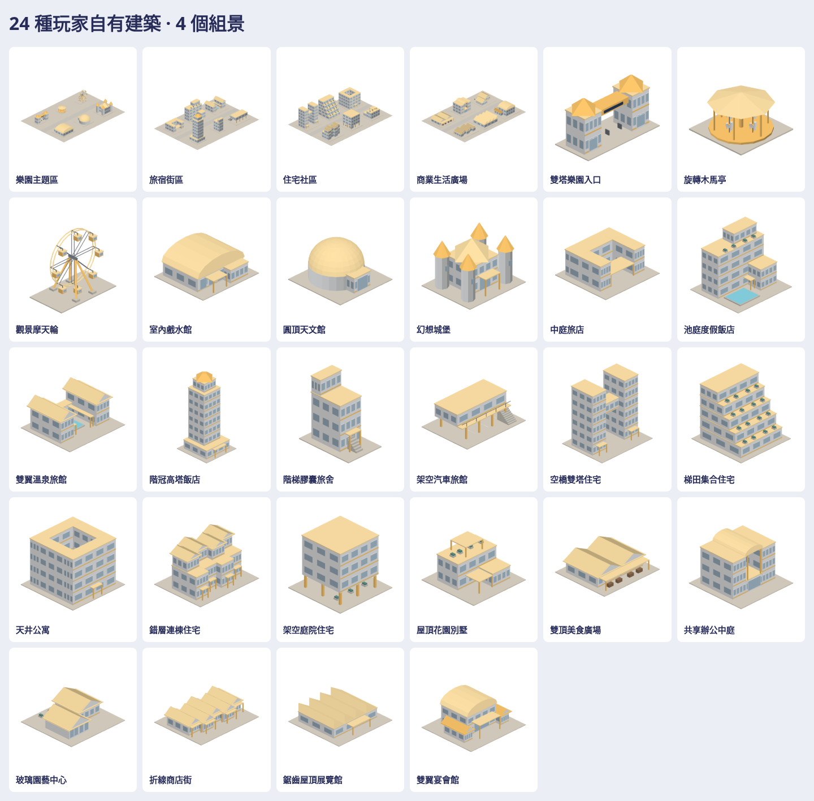

# EstateKit：自有建築與遊樂設施

24 件不同素材，另有 4 個原生組景。遊樂園、飯店／旅宿、住宅、商業各 6 件；不以樓層、座艙、馬匹或配色灌水計數。暖黃色識別沿用 player / playerRoof，其餘採既有白牆、淡藍窗與霧面頂點色。



| 分類 | 六種素材 |
| --- | --- |
| 遊樂園 | 雙塔樂園入口、旋轉木馬亭、觀景摩天輪、室內戲水館、圓頂天文館、幻想城堡 |
| 飯店／旅宿 | 中庭旅店、池庭度假飯店、雙翼溫泉旅館、階冠高塔飯店、階梯膠囊旅舍、架空汽車旅館 |
| 住宅 | 空橋雙塔住宅、梯田集合住宅、天井公寓、錯層連棟住宅、架空庭院住宅、屋頂花園別墅 |
| 商業 | 雙頂美食廣場、共享辦公中庭、玻璃園藝中心、折線商店街、鋸齒屋頂展覽館、雙翼宴會館 |

四個組景各含該類六件，對向入口面向中央步行空間，基地不交疊。遊樂設施為靜態外觀；組景是擺設範例，不是可通行室內、經營規則或真實工程設計。各建築以全新比例、量體配置與封閉幾何生成，並未搬入原 factory、貼圖、標誌或品牌。沒有改既有住宅、商務飯店、百貨或車站，也沒有自動加入地圖。

28 個模型各有 native、GLB、上／下／左／右／前／後／立體 7 張透明圖，共 196 張。大型輸出與 viewer 位於私有庫新目錄：

- [完整批次、viewer、來源對照與各分類預覽](https://github.com/a91453/railway-reference-private/tree/codex/estate-assets-2026-10-23/Railway/game-art-previews/docs/art/estate-kit-2026-10-23)
- [下載 ZIP](https://github.com/a91453/railway-reference-private/raw/refs/heads/codex/estate-assets-2026-10-23/Railway/game-art-previews/docs/art/estate-kit-2026-10-23/estate-kit-2026-10-23.zip)（須有私有庫權限）
- [逐件來源路徑、SHA 與重組方式](https://github.com/a91453/railway-reference-private/blob/codex/estate-assets-2026-10-23/Railway/game-art-previews/docs/art/estate-kit-2026-10-23/provenance.json)

## 使用與重建

[estate-kit skill](../../../.claude/skills/estate-kit/SKILL.md) 記錄接點、構造及續作方式。使用 `Map3DEstateKit.model(for:)`、`Map3DModelPack(estateKit:)` 按需取用。內部 builder 是 x 前／y 上／z 右；原生與接點是 x 前／y 左／z 上，公尺。mount=(0,0,0) 向下，貼地；approach 是前側基地邊緣 z=0.16 的接近點，並非門洞或遊戲道路接入點。`placements(for:)` 是組景與 manifest 的同一份資料，角度俯視順時針。

```sh
export PATH=/path/to/swift-6.4/usr/bin:$PATH
tools/estate-kit/rebuild.sh /path/to/private/Railway/game-art-previews/docs/art/estate-kit-2026-10-23
python3 tools/estate-kit/bundle.py /path/to/private/Railway/game-art-previews/docs/art/estate-kit-2026-10-23
```

最後一行在公開 producer commit 乾淨後執行，使 ZIP 的 source.json 指向確切 commit，working_tree_dirty=false。viewer：在私有批次目錄執行 `python3 -m http.server 8000`，瀏覽 `http://localhost:8000/`；支援中文搜尋、四類與組景篩選、旋轉、縮放、七向、四底色、PNG／GLB／native 下載。

## 驗證範圍

**VERIFIED（Linux）**：Swift 6.4 warnings-as-errors、26 個相關 XCTest、4 個 GLB Node tests、28 模型逐頂點 native 讀回與完整 GLB 轉換、196 張透明圖解碼／SHA／非空／未裁邊、28 模型瀏覽器操作，以及實際開圖檢查。最大單件 3,176 三角形，最大組景 11,740，均低於 loader 的 15,000 上限。獨立從目前 build 再匯出的 56 個 native／GLB 檔案完全相同。

實際結果見本目錄 verification.json；私有批次保留完整 manifest、圖片解碼、瀏覽器與 ZIP 雜湊紀錄。自動驗證不能替代人工開圖。照片材質未使用，因此不宣稱照片逐層相關係數驗證。

**UNVERIFIED**：iPhone／iPad Metal、裝置效能、碰撞、室內導航、遊樂設施動畫、經營規則及實際遊戲地圖接入。完整 Swift suite 交 CI，不以 Chromium WebGL 成功代替裝置結果。

續作以此 skill、原生配方與新批次為入口。私有 REFERENCE_ASSET_LICENSE.txt 保留參考資產實際條件，沒有授予資產包開源或再次散布的權利；專案本身依 LICENSE.md 保留所有權利。
