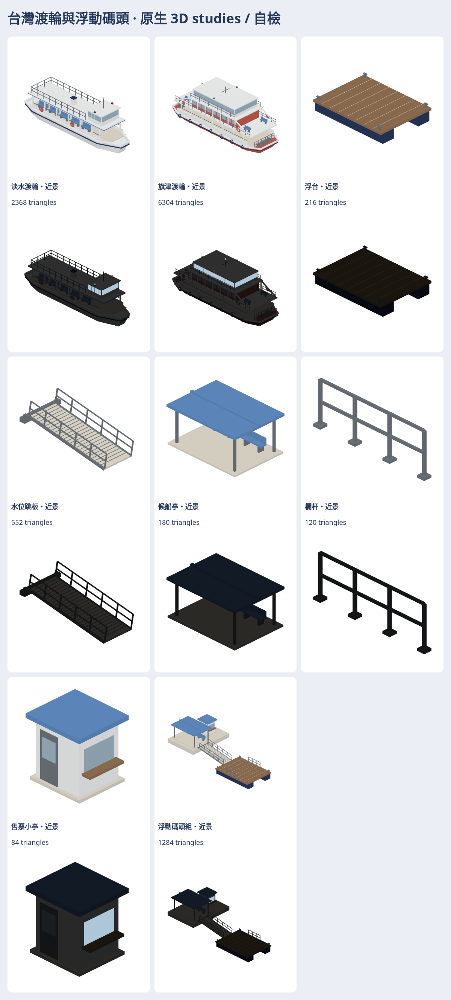

# 台灣渡輪與碼頭原生 3D studies

決策579；只有素材，**還沒接營運**。淡水渡輪、旗津雙頭渡輪，以及浮台／水位跳板／候船亭／欄杆／售票小亭與組景，每款近遠景，共16模型。公開庫只放配方、producer、自檢工具與本張總覽。

[配方與重建](../../../tools/ferry-studies/README.md)（從此目錄應使用[repo工具入口](https://github.com/a91453/railway-game-ios/tree/codex/ferry-studies-579/tools/ferry-studies)）。[完整私有素材、SOURCE、viewer與自檢記錄](https://github.com/a91453/railway-assets-private/tree/codex/ferry-studies-2026-11/game-art-previews/docs/art/ferry-2026-11)。

近景三角：淡水2368、旗津6304、碼頭組1284；LOD1504／2344／684。所有單檔≤15000。native公尺制x前/y左/z上。船底與舷邊採封閉solid；欄杆、座椅、艙室、救生圈與燈以實體支承連到甲板。跳板分固定／活動三角範圍，viewer只旋轉活動範圍；不把碼頭整體旋轉。

還不像的地方：淡水駕駛艙與支柱太方，未做照片的弧角、斜柱、前端登船構造；旗津橋艙／斜肩過於整齊，缺上層空調、救生筏筒、機車與完整內裝，水下深度簡化；碼頭是比例推估的通用套件，未重建某一座實際碼頭。原表「長」不保證等同LOA；兩船其餘細部與碼頭尺度皆在SOURCE標比例推估。無業者商標或公司名；沒有加船名文字。

VERIFIED（本機Linux）：Swift6.4 `swift build --build-tests -Xswiftc -warnings-as-errors`；25相關XCTest；4Node編碼測試；4項配方幾何測試；16原生模型Swift逐頂點／色值／glow讀回；GLB重編比對；224張512px RGBA解碼與SHA／透明非空不裁邊。目視七向、日夜總覽與四底色／小尺寸／灰階圖，僅記自檢。

UNVERIFIED：作者外觀接受、iPhone／iPad Metal、效能／碰撞／浮力／營運接入；file://由受管Chromium政策封鎖，未能驗證本機直接雙擊開檔。交付viewer自含所有native與renderer，無fetch；在關網的嵌入HTML頁面另驗互動，詳細結果在私庫browser-verification.json。GLB標準viewer的發光與動畫未驗證。

沒有改GameCore、存檔、golden、SaveFixtures、ReplayFixtures，未合併／auto-merge／main push／TestFlight。下一步是作者看外觀後按具體偏差修訂，不代表營運採用。
