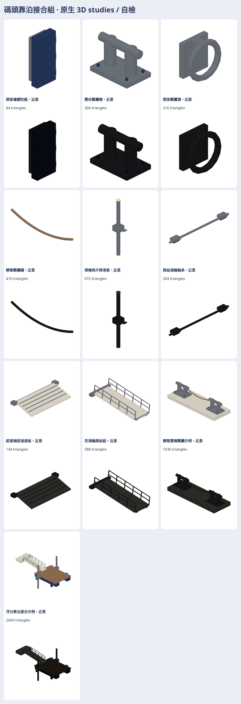

# 碼頭靠泊接合組 studies

承接渡輪／碼頭決策579，補壁掛橡膠防舷、雙柱繫纜樁、繫纜環、靜態纜繩、導樁滑套、跳板滾輪、過渡板、含輪跳板，加雙樁繫纜／浮台水位兩組例子，各近遠景共20模型、280張日夜七向圖。

**只是studies，還沒接營運；外觀待作者看過，目前只有自檢。**

[producer與重建](../../../tools/ferry-berthing-studies/README.md) · [私庫完整素材／viewer／SOURCE](https://github.com/a91453/railway-assets-private/tree/codex/ferry-berthing-assets/game-art-previews/docs/art/ferry-berthing-2026-11)

浮台仍為8×6m、甲板.65m，岸hinge(-10,0,1.65)、跳板6.1m；加入輪半徑.06／輪心下垂.18後，新跳板坡角按輪底接觸重算，**應整件替換舊跳板，不可直接把輪塞到舊版下面**。水位slider±.30m聯動浮台／滑套、跳板與端板，岸與導樁固定。獨立滑套安裝面z.57，需按接點對浮台，不可原點直接疊放。單件最高672三角，靜態繫纜例1036、浮台組景2660；全單檔≤15000。

來源：海科館碼頭圖文／照片核繫纜與防舷角色、桃園農業局浮動碼頭介紹核平台／橋／導樁／滑車、Trelleborg導樁滾輪頁只讀原理；本專案先前producer與station-kit供封閉幾何／native／GLB／renderer。未搬照片、私庫原始factory／模型或品牌。所有尺寸／行程是比例或設計推估，非工程圖面測量，未驗適用旗津大型渡輪的繫泊荷載。

還不像：滑套與支架是通用示意，輪軸軸承／螺栓／橡膠截面未按原廠細圖；靜態繩沒有打結與張力，未裝真船；過渡板鉸件簡化。尚未做旗津機車登船通道／活動柵門、救生梯，這批也不包含完整船或渡輪營運。

VERIFIED（Linux）：Swift6.4 warnings-as-errors build；8配方測試、4Node；20模型真正Swift loader每頂點／色值／glow讀回、GLB byte重建、280PNG真正RGBA／SHA／透明非空不裁邊；關網HTML20模型／七向／日夜、12份Python對JS姿態109728座標零差、固定body保持、slider改像素、390px。31個CoastalKit／StationKit／ModelFile／DetailKit相關XCTest通過，完整證據詳私庫validation.log／README。

UNVERIFIED：作者外觀接受、Metal/iPhone/iPad效能、真實潮汐／摩擦／承重／碰撞／營運；file://被受管Chromium ERR_BLOCKED_BY_ADMINISTRATOR封鎖，只另驗同份HTML關網互動，直接雙擊未驗。GLB無標準動畫軌。輪底接觸在展示五水位點的多邊形誤差<2mm，不代表輪子滾動、結構或無障礙認證。

五方：玩家看得出靠泊／登船接合；交通迷分清導樁與繫纜點、事實與推估；開發獨立工具不動權威；美術沿用霧面色票並待作者看外觀；音樂無交付。GameCore、存檔、golden、fixtures、standard與其他分支不動；兩庫draft、不合併／auto-merge／推main／TestFlight。下一步作者看外觀，整合者按接點選用並另驗動態淨空與實機。
