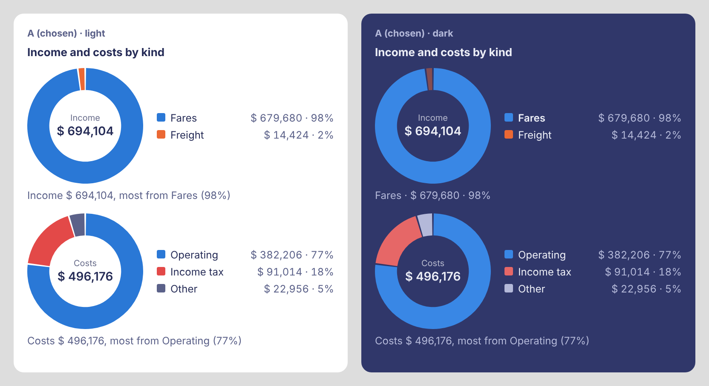
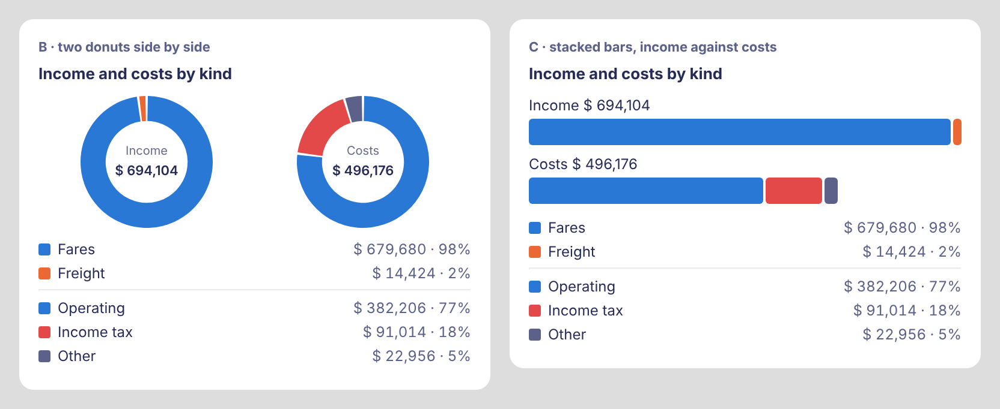

# 收支組成甜甜圈圖（決策 480）的預覽

[決策 480](../../decisions/480.md)。數字是 `-screenshot-scene freight`（貨運的示範場景）的一週報表：收入是票價與貨運，支出是營運成本、營利事業所得稅和併成「其他」的小類。

圖是用瀏覽器照 App 的版面與色票（`Theme`）畫的示意，不是模擬器截圖；Linux 沒有 iOS 模擬器，App 的樣子要在實機看。

## 選定：A，一圈一列，旁邊列出每一塊

左邊淺色，右邊深色（點住「票價收入」時：其他塊變淡，圈下面寫名稱、金額、百分比）。

## 其他做法

- **B 兩個甜甜圈並排**：省高度，但手機上每個圈只有約 110 點，中間的總額要縮小；兩組圖例疊在下面，要來回對。
- **C 收支對照的堆疊長條**：收入和支出用同一把尺，看得出賺多少；但作者要的是甜甜圈，而且兩條長條的小塊（2%）幾乎看不到。
