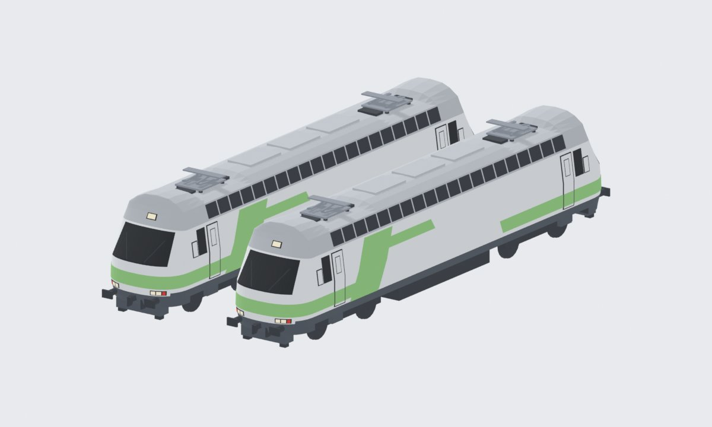
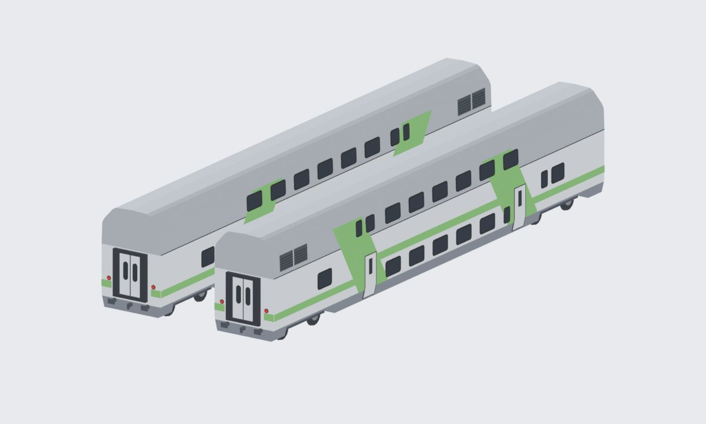

# 芬蘭城際列車：Sr2 電力機車與雙層客車（決策 864）

羅瓦涅米地圖兩條線（凱米耶爾維線、羅瓦涅米—穆羅拉）的城際與夜車：Sr2 電力機車拉六節雙層客車。遊戲角度、平光、色票平塗，不畫公司標誌、文字、車號與門旁插圖。

- 做的：本地工作室。Sr2：Antigravity（Gemini 4 Argon）做、Codex 對照片審，第 4 輪通過（素材庫 #47）；客車：Antigravity（Gemini 4 Hydrogen）做、Codex 審，第 6 輪通過（素材庫 #41）。
- 重檔（GLB、七向圖、各輪紀錄、比對用照片與來源）：`a91453/railway-assets-private-2`，`game-art-previews/docs/art/finland-sr2-loco-2026-11/`（revision-4）與 `finland-ic-double-deck-2026-11/`（revision-6）。照片只在那裡，不進這個 repo。
- 轉進遊戲：`tools/train-models/glb_to_swift.py`，材質順序寫在 `Sources/GamePresentation/Map3DFinlandSr2.swift`、`Map3DFinlandDoubleDeck.swift`。

## 還有哪裡不好

1. Sr2 的車高 4.31 m 當成到降下集電弓頂（照片量不出來，素材庫 README 寫明是假設）。
2. 每班都畫成 Sr2 加六節二等客車：真車另有 Sr3 拉的班、4–7 節不等、夜車掛臥鋪車與汽車搬運車，這些車還沒做。
3. 還沒在 iPhone 上看過放在羅瓦涅米地圖上的樣子。
