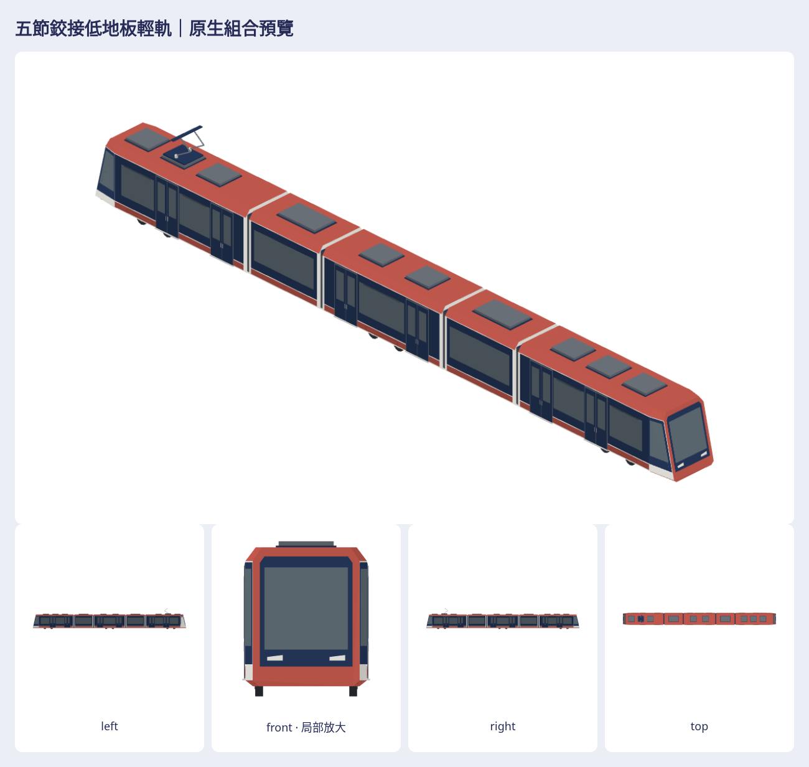

# 五節鉸接低地板輕軌：新參考原生素材

本批為作者五張新附圖的五節低地板輕軌，使用遊戲珊瑚橘、暖白細邊、灰藍窗與霧面頂點色。不是既有電車換車頭／換色。五個可組合單元和完整靜態編組已加入原生素材庫，**尚未綁營運車種，因此合併不會自動替換路網列車**。不更動既有車、GameCore、存檔、golden／replay、玩法或動畫。

- 工作 issue：[#991](https://github.com/a91453/railway-game-ios/issues/991)。公開及私有 draft PR 會在 issue 記錄互鏈；兩庫 base 均為 main，沒有依賴未合併 #988。
- [重建、軸向、尺寸與各節組裝](../../../tools/five-section-lrt/README.md)；[交接 §7.3](../../HANDOFF.md#73-3d-的後續)。
- [私有完整素材目錄](https://github.com/a91453/railway-reference-private/tree/codex/five-section-lrt-2026-10-22/Railway/game-art-previews/docs/art/five-section-lrt-2026-10-22)：8 native／8 GLB、56七向透明PNG、完整編組／各節、白模／剪影、固定尺度比較與實際模型修訂前後、兩種viewer、provenance／SHA／驗證紀錄及ZIP。
- [可下載 ZIP](https://github.com/a91453/railway-reference-private/raw/refs/heads/codex/five-section-lrt-2026-10-22/Railway/game-art-previews/docs/art/five-section-lrt-2026-10-22/asset-package.zip) · [離線 viewer HTML](https://github.com/a91453/railway-reference-private/raw/refs/heads/codex/five-section-lrt-2026-10-22/Railway/game-art-previews/docs/art/five-section-lrt-2026-10-22/viewer-standalone.html)。私有下載需要帳號權限；下載HTML後可離線使用，並非GitHub可直接執行的網站。

## 參考判讀與特徵

五張inline圖片已逐一目視：第1張沿縱向看鼻端與車頂；第2、3張相對端斜視；第4、5張較低角度兩側。看得到四個鉸接、兩端斜鼻、各長節兩組雙門與短節大窗、單端集電弓。無可下載的本地原圖檔，未假造像素測量、圖片SHA、工程尺寸或相似度分數。參考為透視圖，與輸出的正交／代表性斜視角度不同；不能拿透視像素直接當公尺。

| 特徵 | 本次結構／相對比例 |
| --- | --- |
| 類別／編組 | 五節鉸接低地板輕軌；長端—短懸浮—中央長節—短懸浮—長端 |
| 側面／正面／俯視 | 低裙板、直窗帶、平頂斜肩；風擋後傾；兩端同時向上後退、橫向收窄 |
| 公尺展示尺度 | 全長34；殼寬2.65、屋頂3.25、設備3.38、最高集電弓4.545；含薄門檻實際寬2.784 |
| 各節長與端部 | 車殼9／4.1／7／4.1／9；間距.20×4；端部收束長1.30；全部為比例規格 |
| 走行補全 | 端節與中央節各一組雙軸架，合計6軸；輪徑.58、軸距1.50；輪底z=0 |
| 門窗 | 每側6組雙門，分配2／0／2／0／2；短節大窗、端部窄斜窗、單片正面風擋 |
| 屋頂設備 | 各節3／1／2／1／3個低矮設備面；僅trailing一具集電弓；有支持底座與絕緣座 |
| 左右／頭尾 | 乘客門窗左右對稱；兩個外端朝外，尾端集電弓不同；中間3節沒有駕駛窗／頭燈 |
| 不清楚處 | 圖片遮住輪架、底部機械與內裝；三架六軸是補全假設，未宣稱真車認證 |

尺寸來源優先查私有 `taiwan-rail-reference-clean/source/rail-3d/integration/FORMATIONS.md`、`formations.js`，其引述高雄市政府車輛介紹的五節／約34m，寬2.65m作展示尺度。各節、鼻長、門位和輪架數仍是依圖推估／假設。`garage-blender-v1/caf.json` 是另一套Q比例與四門群，與新圖不符，不套用。未搬用任何私有mesh或貼圖，也未把私有參考送外部生成服務；全部幾何重新編寫，舊車只比色票／材質與密度。

## 外觀驗收（與技術測試分開）

人工查看最終原生模型渲染、七向、放大鼻端、白模／剪影、同公尺舊車比較及四種底色／灰階／模糊。第一版短節偏長，鼻側玻璃跨非共面車殼造成白色破口；已改長短節比例，並用實際車殼三角面裁切、分片厚玻璃重新建構。修訂前後使用真正兩份native、同相機／聯集bounds，保存在私有 `previews/before-after.png`；沒有用最終版偽裝修訂前。

| 驗收項目 | 狀態 | 對照位置與限制 |
| --- | --- | --- |
| 類別／五節主輪廓 | 已符合 | 參考2–5；overview、audit與白模；維持低地板、長短節與四鉸接 |
| 胖窄、高短與各節比例 | 已符合（比例推估） | 第一版8.2/5.2/6.4改為9/4.1/7；audit固定.030m/pixel；無工程精度宣稱 |
| 前後懸、端部／風擋傾角 | 已符合（可見輪廓） | 參考1–3與detail-front／top；斜鼻1.30m，後傾且收窄，非直面盒頭 |
| 輪徑／軸距／輪架配置 | 資料不足 | 圖片輪組被裙板遮住；採3架6軸、輪徑.58m、軸距1.50m；實際模型與該假設一致 |
| 車頂肩線、窗帶／腰線 | 已符合 | 平頂斜肩延續到車鼻；深帶與淺細裙線連續；前後無厚灰外掛框 |
| 門窗節奏 | 已符合 | 參考2–5；兩側各2/0/2/0/2雙門，短節大窗、端節兩個主窗和斜窗 |
| 大型設備／集電弓 | 已符合（可見配置） | 參考1–5；10個淺設備面、僅一端集電弓；具底座支持，內部功能資料不足 |
| 頭尾、左右、單元排列 | 已符合 | 五個獨立單元；外端駕駛、中央無駕駛設備；trailing設備不同，不是換燈色假尾車 |
| 浮空／穿模／缺面／反面／閃爍 | 已符合（本批檢查範圍） | 原生七向與局部視檢無已知主要缺陷；封閉邊、96個主要玻璃三角支持、三種突變檢查作佐證 |
| 遊戲配色、霧面、密度 | 已符合 | style-comparison同公尺鏡頭，art-checks四底／灰階／模糊；完整編組4500三角，無貼圖或寫實材質 |
| 輪架內部／車底／內裝工程還原 | 資料不足 | 只補封閉車底、輪架與連接器；不宣稱已還原照片看不見的內部構造 |

外觀結論：可見的主要輪廓、門窗節奏、五節編組及設備已依參考完成，人工檢查無已知未修正的主要偏差；隱藏輪架與工程細節仍資料不足。這是本次製作檢查，沒有宣稱作者已接受成品。

## 技術驗證

**VERIFIED（Linux、Swift6.4.0、Chromium WebGL2、Blender4.3.2）**：warnings-as-errors完整build-tests；24項相關XCTest；M3DM原生讀回逐頂點／法線；五單元逐頂點組裝；原生／GLB一致及獨立Blender完整匯入；五單元有向焊接邊零缺口／反向；96個主要玻璃三角的非玻璃支持面最遠約9mm；缺面／反面／浮空玻璃突變均拒收；56七向RGBA與全部PNG完整解碼、不裁邊；viewer載入、七向、拖曳旋轉、縮放、逐件native／GLB／PNG下載、390px與離線內嵌模式。完整ZIP解壓、CRC與逐檔bytes、producer commit來源綁定的結果記於私有`package-verification.json`。

| 模型 | 三角形 | 實際外廓長×寬×高 m |
| --- | ---: | --- |
| leading | 1320 | 9.105×2.784×3.380 |
| suspendedFront | 288 | 4.310×2.684×3.160（最低z=.22） |
| middle | 1156 | 7.210×2.784×3.380 |
| suspendedRear | 288 | 4.310×2.684×3.160（最低z=.22） |
| trailing | 1448 | 9.105×2.784×4.545 |
| formation | 4500 | 34.000×2.784×4.545 |

短節高度3.16是其外廓max−min，實際頂同為z=3.38，不能因懸浮短節沒有輪子而將其下移.22m。組裝已驗證維持共同軌面基準。

**UNVERIFIED**：iPhone／iPad真機Metal載入與外觀、效能、動畫、物理、路網車種接入、工程尺寸及不可見細節。Linux WebGL／Blender不代表這些通過。受管Chromium禁止file://，單檔以瀏覽器斷網內嵌HTML模式實測，作業系統雙擊未直接測。公開PR最新提交CI以Checks為準，不把本機24項通過當成遠端CI通過；私有庫沒有配置CI檢查。未啟動TestFlight／合併／auto-merge。
