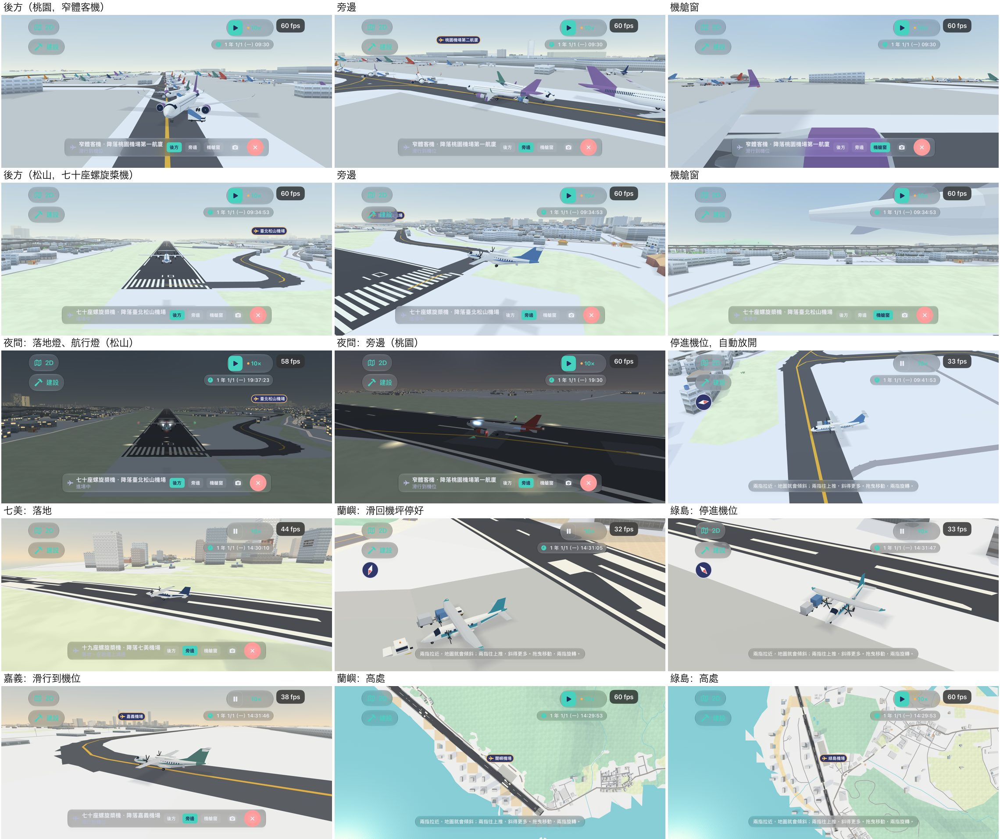

# 跟著飛機看：截圖與各輪發現（決策 702，2026-11-12）



程式是 `Sources/GamePresentation/FollowAircraft.swift`（跟隨、三個視角的位置、燈）與 `Map3DAircraft.swift`（航班的編號與階段、跑道的地面高度、小機場進出機位）。這裡只放一張總覽圖；每一張原圖、各輪的圖與幀數讀數在私有素材庫 `a91453/railway-assets-private` 的 `game-art-previews/docs/art/follow-air-2026-11-12/`。

圖都是這台 Mac 的 iPhone 18 Pro 模擬器（iOS 27.2，橫放、深色）拍的，沒有開 CI 的截圖 run。重拍：

```sh
xcodebuild build-for-testing -project RailwayGameApp/RailwayGame.xcodeproj -scheme RailwayGame -destination 'id=<模擬器>'
xcodebuild test-without-building … -only-testing:RailwayGameUITests/WebsiteScreenshotTests/testFollowAircraft -resultBundlePath out.xcresult
xcrun xcresulttool export attachments --path out.xcresult --output-path shots
```

- `testFollowAircraft`：`TEST_RUNNER_FOLLOW_AIR_SHOTS=day,night,jet,jet-night,run` 挑要拍的段落（松山的降落日／夜、桃園的窄體機日／夜、讓遊戲跑到停進機位）。
- `testSmallAirportsIn3D`：`TEST_RUNNER_SMALL_AIRPORTS=airportQimei,…` 挑機場。
- `testFollowAircraftFrameCost`：幀數讀數。
- 夜間的燈要 `-screenshot-device-tier 1`（測試已帶）：模擬器的 GPU 沒有等級，預設不畫光暈。

## 各輪看到的與改的

| 輪 | 看到的毛病 | 改法 |
| --- | --- | --- |
| 1 | 三張圖一模一樣，都是後方：測試用啟動參數指定視角，之後在跟隨列上點別的視角點不動（啟動參數蓋過存下來的設定） | 測試改成在跟隨列上點，和玩家一樣。不是 App 的毛病 |
| 2 | 旁邊視角太近，七十座機佔滿畫面；七十座機的窗外被螺旋槳的槳葉擋住半個畫面；夜裡完全沒有燈 | 旁邊的距離照機身長放大；螺旋槳機的座位移到機翼後面；夜裡沒有燈是模擬器不畫光暈（加裝置等級參數），不是燈沒做 |
| 3 | 窄體機的後方視角貼在機尾上，垂直尾翼塞滿畫面；落地後沿跑道慢慢滑的那兩分多鐘，跟隨列一直寫「落地，在跑道上減速」 | 後方的距離改成機身長的 2.3 倍；減速完就寫「滑行到機位」 |
| 4（小機場） | 七美、綠島：遊戲一跑，跟著的飛機不見了，只剩空跑道；蘭嶼：七十座機降在 1.1 km 的跑道上；蘭嶼、綠島：落地後在跑道盡頭消失 | 飛機沿跑道的實際地面高度走（原本在跑道底下）；七十座的跑道門檻 1,000 → 1,200 m；沒有滑行道資料的小機場，機位直接接到跑道，飛機在跑道上掉頭滑回機坪 |
| 5 | 見「還有哪裡不好」 | |

## 效能

`WebsiteScreenshotTests.testFollowAircraftFrameCost`：這台 Mac 的 iPhone 18 Pro 模擬器（iOS 27.2），松山，畫質「高」，一班降落落地前 7 秒；打開幀數的細節讀數。「跟著」是後方視角，「沒跟」是同一個場景的地圖鏡頭（600 m）。

| 狀態 | 鏡頭 | fps | CPU ms | main ms | draws | 三角形 |
| --- | --- | --: | --: | --: | --: | --: |
| 暫停 | 沒跟 | 60 | 1.2 | 1.8 | 74 | 178,400 |
| 暫停 | 跟著（後方） | 60 | 1.4 | 2.3 | 163 | 286,446 |
| 遊戲在跑（10×） | 沒跟 | 29 | 1.4 | 22.8 | 73 | 176,992 |
| 遊戲在跑（10×） | 跟著（後方） | 28 | 1.7 | 22.9 | 72 | 161,614 |

- **跟隨本身幾乎不花**：每幀多算一架飛機的位置與十來個光暈，CPU 多 0.2–0.3 ms，在量測的雜訊邊緣。
- **多出來的是看得遠**：後方視角是平視，暫停那一格看到地平線，draws 從 74 變 163、三角形多 11 萬（遠處的街區）。這不是飛機特有的，列車的後方視角也一樣；但飛機在空中、鏡頭站得更遠，實機上會比列車重。
- **遊戲在跑時 28–29 fps 是 Debug 的模擬佔住主執行緒**（main 約 23 ms），跟與不跟一樣。別的截圖裡同樣情況是 33–45 fps，每次開 App 讀到的不同。
- 模擬器用的是 Mac 的 GPU，**不代表實機：實機 UNVERIFIED**，留給 FPS-DEVICE；掉幀時先減什麼，在決策 702「下一步」第 2 項。

圖在私庫 `app/follow-air-cost-*.jpg`。

## 還有哪裡不好

- **機艙窗只是一個鏡頭**：沒有窗框、沒有機艙；噴射機的窗外下半是引擎與機翼的大色塊，直放時更擠。
- **螺旋槳機的窗外看不到螺旋槳**：為了不被槳葉擋住，座位在機翼後面，只看得到頭上的機翼。
- **夜裡機身還是暗的**：有燈了，但客艙窗不亮，機身只是一個灰影；落地燈沒有照在跑道上。
- **後方視角在滑行時很單調**：兩三分鐘都是機尾與黃線；可以考慮滑行時自動拉高一點。
- **在跑道上掉頭像原地轉**（小機場）。
- **綠島跑道旁那棟高樓**：旁邊視角會穿過它；離島不該有這種樓，是地圖蓋房子的規則。
- **白天的 HUD 在亮底上很淡**（跟隨列、左上的 2D／建設鈕）：玻璃材質在淺色地面與天空上對比低，不是這張單改的，GLASS-POLISH 可以一起看。
- **機場標記會壓到左上的按鈕**（旁邊視角時標記剛好飄到「建設」鈕後面）：決策 699 的標記，沒有避開 HUD。
- **只在模擬器、iPhone 橫放看過**。
