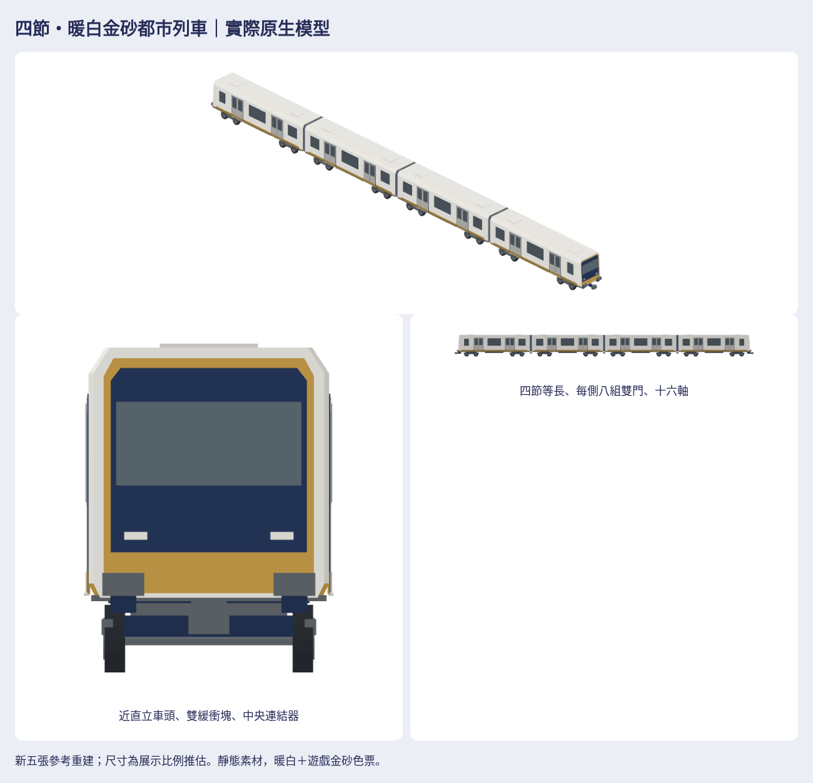

# 四節暖白金砂都市列車

作者新五張圖是四節等長的傳統轉向架都市列車，與前批五／七節鉸接輕軌不同。新配方獨立建立近直立兩端、橫向風擋、雙緩衝塊／中央連結器、每節每側兩組雙門與三個分離窗位、每節兩組雙軸轉向架。暖白搭配既有金砂色票，無紅色漆、真實品牌或照片貼圖。

## 門板修訂（作者回報後）

原門板過暗、門玻璃狹窄，本輪只改門：淺暖灰門葉、較細中縫、.57×1.11m玻璃，上緣對齊側窗；金砂腰帶接續門板。位置、開口寬度、兩組雙扇結構不變。`doors-before-after.png`為實際模型同相機、同尺度的門局部／整車側面／斜視，局部.0045m/pixel。基準為已提交producer08e50f65／私庫3246cad。`door-verification.json`逐三角證明四車除門範圍外的位置、法線、顏色、順序完全相同；未宣稱作者已認可新版。

## 外觀結論

**依五張可見參考的主要特徵已符合，工程還原資料不足；尚未取得作者對本版的外觀認可。** 第一版車身偏長、風擋偏高，已從每節13m展示比例修為12m，風擋修成寬扁約2.21:1；輪頂與底架原有重疊已修為20mm淨空，補上架體與連結器支承。最終圖、白模／剪影和配色圖都由同一原生模型產生。

| 對照項目 | 判讀 | 證據／限制 |
| --- | --- | --- |
| 車類、四節等長、輪組與軸數 | 已符合可見結構；隱藏軸細節為補全 | 參考4／5完整斜視、2／3側面；每節兩架、常規雙軸，共16軸 |
| 長寬高、前後懸、端長、軸距／輪徑 | 視覺比例已修正；工程資料不足 | 同相機`metro-before-after.png`；單車12m、架心距7.70m、輪徑.76m均推估 |
| 近直立車頭、寬扁風擋、低倒角肩線 | 已符合可見特徵 | 參考1、4、5；`metro-cab-before-after.png`與front-detail；前後外端相反方向，內端無駕駛面 |
| 窗帶高度、兩組雙門／側、三個分離窗位 | 已符合 | 參考2／3對照`metro-audit.png`左右；外端窄窗、中間寬窗、內端小窗 |
| 屋頂、車底大型設備 | 可見部分已符合；遮蔽部分資料不足 | 每車兩片低檢修蓋，無可見集電弓；底部箱體採簡化展示假設，不宣稱真實供電方式 |
| 頭尾、左右、單元排列及連接 | 已符合 | 四單元只按中心x平移；兩端駕駛室朝外，三組風琴，內車無燈／緩衝塊 |
| 浮空、缺面、反面、明顯穿模／閃爍 | 最終七向及斜視未見；技術檢查通過 | 有向封閉邊、玻璃穿過背框至車殼支持、輪頂淨空；Linux WebGL觀察，不代表所有GPU |
| 遊戲配色與密度 | 已符合既有palette／霧面頂點色規則 | `style-comparison.png`同相機尺度；四底色、灰階、模糊檢查；無紅色漆 |

原始五張是透視與局部圖，不能產生精確同相機工程對照；作者inline原圖無本地檔，沒有虛構圖片SHA或相似度分數。模型正交稽核各列.035m/pixel，修訂前後與風格比較固定同一相機／公尺尺度；hero和前端局部另行取景，不能當同比例圖。真實型號與底部細節不足不影響靜態遊戲素材使用，但不能當特定製造商的工程模型。

## 最終交付與重建

完整成品放[私有素材目錄](https://github.com/a91453/railway-reference-private/tree/codex/four-car-metro-2026-10-23/Railway/game-art-previews/docs/art/four-car-metro-2026-10-23)，需登入具有權限的GitHub帳號：

- [單檔離線viewer](https://github.com/a91453/railway-reference-private/raw/refs/heads/codex/four-car-metro-2026-10-23/Railway/game-art-previews/docs/art/four-car-metro-2026-10-23/viewer-standalone.html)：下載後開啟；旋轉、縮放、原生／GLB／PNG下載。
- [完整ZIP](https://github.com/a91453/railway-reference-private/raw/refs/heads/codex/four-car-metro-2026-10-23/Railway/game-art-previews/docs/art/four-car-metro-2026-10-23/asset-package.zip)：四獨立單元、完整編組、兩件既有比較，共7原生／7GLB、49七向圖、白模／剪影、同尺度比較、viewer與SHA／來源紀錄。
- 私有`previews/doors-before-after.png`（本輪門板）、`metro-units.png`、`metro-directions.png`、`metro-audit.png`、`metro-before-after.png`、`metro-cab-before-after.png`；原始49透明七向圖在`views/`。
- [原生配方](../../../Sources/GamePresentation/Map3DFourCarMetro.swift)、[重建／尺寸／單元排列與組裝](../../../tools/four-car-metro/README.md)、[交接](../../HANDOFF.md#73-3d-的後續)。

完整編組實際bounds **50.130 × 2.802 × 3.694m，7912三角**；每節原生1996／1960／1960／1996三角。殼長12m，中心x=18.45／6.15／−6.15／−18.45m，殼間距.30m。輪底z=0；原生+x前／+y左／+z上，只平移，不再旋轉或鏡射。

**目前是已註冊的靜態素材庫，尚未指派營運車型。合併不會自動替換路網列車。** 後續整合需按12.3m節距與新車種另行決定，不改GameCore、存檔、golden／replay或既有玩法。

## 技術結論

**VERIFIED（Linux）：** Swift6.4.0 warnings-as-errors build含tests、20個相關測試；七件原生逐頂點／色彩／法線讀回；四單元逐頂點組裝；GLB精確轉換與Blender4.3.2獨立匯入；四單元封閉有向邊、116主要玻璃三角背框與車殼支持（最大33mm）、20mm輪頂淨空；前端及中間車各缺面／反面／整片玻璃浮空突變拒收。49透明七向與全106張PNG完整解碼、不裁邊。資料夾／斷網內嵌viewer七件載入、旋轉、縮放、逐件下載、390px；ZIP另做完整解壓、CRC與逐檔bytes比對，source-record綁實際producer commit。

**UNVERIFIED：** 真實工程尺寸與被遮擋設備、iPhone/iPad真機Metal／效能／動畫／營運指派。受管Chromium不開file://，離線單檔以斷網內嵌HTML驗證，OS雙擊未實測。最新CI以公開draft PR的實際head checks為準，不能把本機通過當CI已通過。
