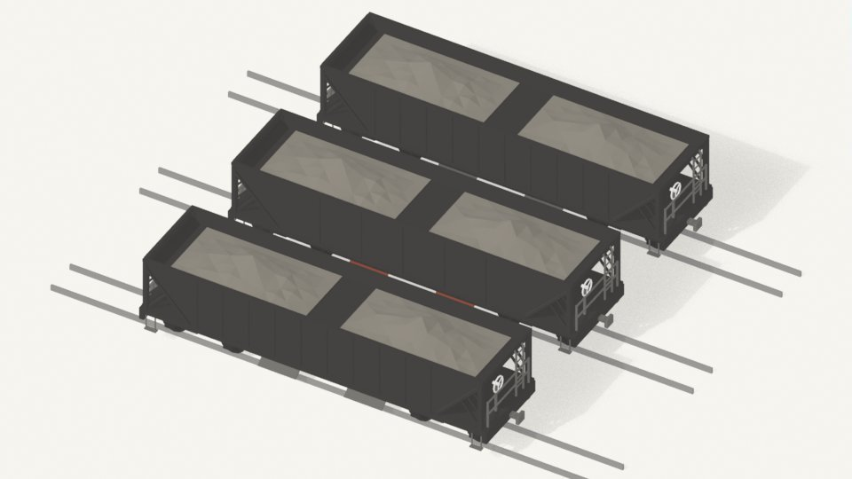

# 台鐵石斗車（決策 837 的後來）

由上至下：黑色卸料門的石斗車、尾車（後端左側紅尾燈）、鐵鏽紅卸料門的那款（35B1000）。俯角約 40°，平光、色票平塗，不畫路徽、車號與文字。砂石列車（`FREIGHTBULK`）的車廂從決策 837 的「平車載半高開頂櫃」替身換成這款。

- 做的：本地工作室（Claude 做、Codex 對照片審），五輪，第 5 輪由規劃接受（2026-11-18）。
- 重檔（6 個 GLB、七向圖、各輪紀錄、比對用照片與來源）：`a91453/railway-assets-private`，`game-art-previews/docs/art/freight-hopper-2026-11/`（revision-5）。照片只在那裡，不進這個 repo。
- 轉進遊戲：`tools/train-models/glb_to_swift.py`，材質順序寫在 `Sources/GamePresentation/Map3DFreightWagons.swift` 的 `Map3DFreightHopper`。

## 還有哪裡不好

1. 砂石在遊戲大小（約 4.86 px/m、俯角 40°）像兩塊平的灰色矩形，看得出是載貨的黑色敞斗，看不出碎石顆粒。規劃接受，不再加輪；以後要改，改 `stone` 堆腳的直邊（不規則外緣、保留約 0.27 m 冠高），不換色票。
2. 實車多半一節一堆（玉里照片）；這版兩堆是審查要求的。
3. 手煞車輪位置從斜拍估的（±0.1 m）；兩型高度一樣、卸料門開門槓桿沒做。
4. 還沒在 iPhone 上看過。
