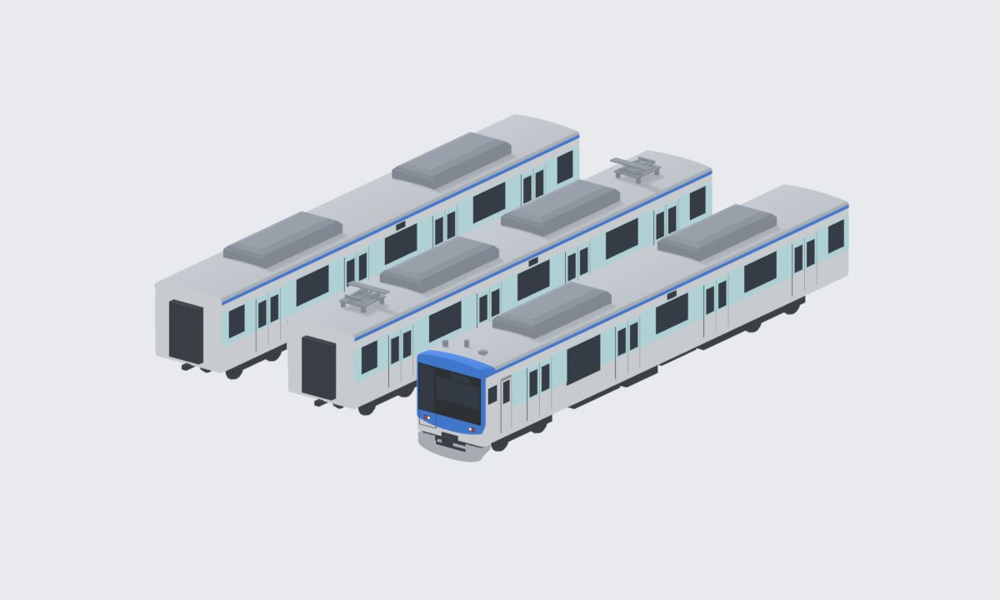

# 福岡空港線列車（決策 893）

左起：無集電弓中間車、集電弓中間車、駕駛室車斜前。白車身、窗帶高度的淺天藍腰帶（連續過客門）、車頂邊緣一條藍線；平車頭，藍色頂蓋、黑面罩裡左窄右寬兩片窗、藍色下半弧形下緣。遊戲角度、平光、色票平塗，不畫鐵道公司標誌、文字、車號。

- 做的：本地工作室（Claude 做、Codex 對照片審），任務 `fukuoka-airport-line-r1`，第 2 輪通過（素材庫 `a91453/railway-assets-private-2` #137）。
- 重檔（6 個 GLB、七向圖、各輪紀錄、比對用照片與來源）：`a91453/railway-assets-private-2`，`game-art-previews/docs/art/fukuoka-airport-line-2026-11/`（revision-3）。照片只在那裡，不進這個 repo。
- 轉進遊戲：`tools/train-models/glb_to_swift.py`，材質順序寫在 `Sources/GamePresentation/Map3DFukuokaAirportLine.swift`。
- 用在：福岡空港線、箱崎線（6 節）。車庫在「日本」類。

## 還有哪裡不好

1. 腰帶 `skyBlue` #BFE3E5 比照片淡、偏青綠一點（協調者定的色）。
2. 尾燈鏡片是遊戲慣例的 lantern 紅，不是日間照片上沒點亮的暗灰。
3. 較高的第一片側窗在另一端駕駛室車會落在另一側（兩端共用一個模型轉 180°）。
4. 冷氣照派工單的顏色與高度，照片上較深較矮；車頂面與中間車側面沒有照片可對。
5. 還沒在 iPhone 上看過放在福岡地圖上的樣子。
