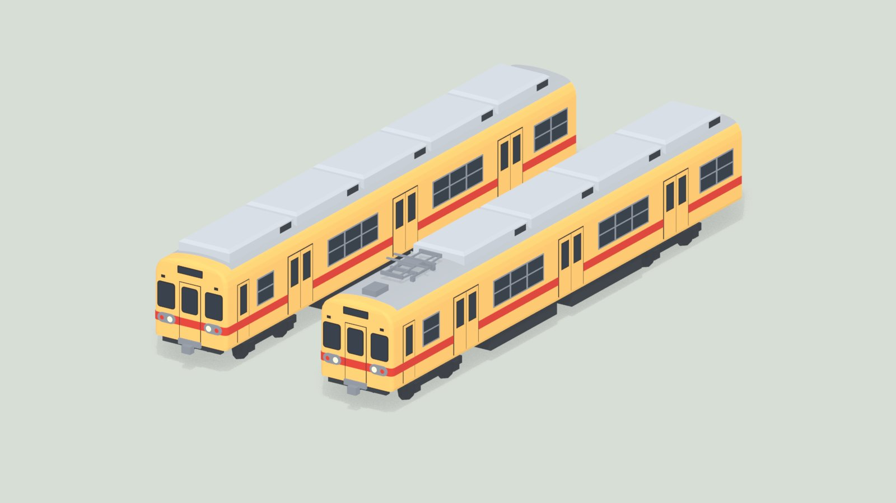

# 福岡貝塚線列車（決策 893）

左：無馬達車；右：馬達車（菱形集電弓）。黃車身、腰部一條紅帶（門處中斷、繞過車頭）；平車頭三片窗，紅帶上左右各一個銀框橢圓燈座（內側頭燈、外側尾燈）；車頂淺色冷氣箱。遊戲角度、平光、色票平塗，不畫鐵道公司標誌、文字、車號。

- 做的：本地工作室（Claude 做、Codex 對照片審），任務 `fukuoka-kaizuka-line-r1`（素材庫 `a91453/railway-assets-private-2` #131）。
- 重檔（4 個 GLB、七向圖、各輪紀錄、比對用照片與來源）：`a91453/railway-assets-private-2`，`game-art-previews/docs/art/fukuoka-kaizuka-line-2026-11/`（revision-3）。照片只在那裡，不進這個 repo。
- 轉進遊戲：`tools/train-models/glb_to_swift.py`，材質順序寫在 `Sources/GamePresentation/Map3DFukuokaKaizukaLine.swift`。
- 用在：遊戲裡還沒有貝塚線可買（第二批 NISHITETSU-KAIZUKA），先放在車庫的「日本」類；開賣時在 `Map3DRealTrains.formation` 加一格（2 節）。
- 紅帶和尾燈同色（`lantern` #E0392C）：燈照材質格位點亮，夜裡只亮尾燈，紅帶不亮（`Map3DFukuokaTrainsTests`）。

## 還有哪裡不好

1. 車頭踏板是 `steel`（協調者定），照片是黃的。
2. 沒做雨刷、扶手、車側指示燈與小顯示器、車頭爬梯踏桿；側門窗是直角。
3. 尺寸照照片量，沒有圖面；側面門窗位置誤差估 ±10 cm。
4. 還沒在 iPhone 上看過。
