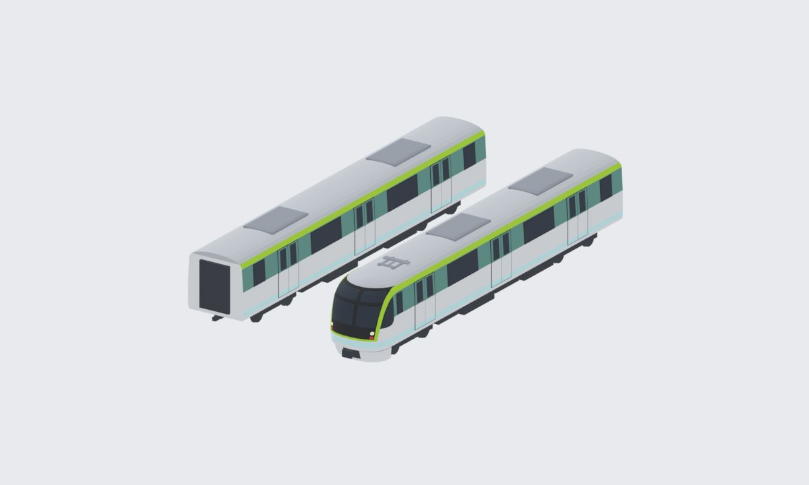

# 福岡七隈線列車（決策 893）

左：中間車；右：駕駛室車斜前（車頂前段一組降下的集電弓）。白車身、綠窗帶（含門板上半）、窗帶上緣一條黃綠線（約 0.18 m）、車身下緣淺藍帶；後傾圓弧車頭，黑面罩外一圈黃綠 U 形框、淺藍橫帶。遊戲角度、平光、色票平塗，不畫鐵道公司標誌、文字、車號。

- 做的：本地工作室（Claude 做、Codex 對照片審），任務 `fukuoka-nanakuma-line-r1`，審查第 2 輪通過（素材庫 `a91453/railway-assets-private-2` #144）。
- 重檔（4 個 GLB、七向圖、各輪紀錄、比對用照片與來源）：`a91453/railway-assets-private-2`，`game-art-previews/docs/art/fukuoka-nanakuma-line-2026-11/`（revision-4）。照片只在那裡，不進這個 repo。
- 轉進遊戲：`tools/train-models/glb_to_swift.py`，材質順序寫在 `Sources/GamePresentation/Map3DFukuokaNanakumaLine.swift`。
- 用在：福岡七隈線（4 節）。車庫在「日本」類。軌距 1.435 m。

## 還有哪裡不好

1. 降下的集電弓是扁的（6 cm 高）、沒有凹座；最高點對齊營運方的 3.145 m。
2. 車頭前後位置約 0.1 m 定不下來；面罩上緣在中心線高約 5 cm。
3. 車身側面只有窗帶那一段內傾，照片像是整面略內傾。
4. `paleBlue`（遊戲裡就是 `skyBlue` #BFE3E5）比車側照片亮，遊戲大小下緣那條線很淡。
5. 頭燈做成亮的，比實車顯眼。
6. 還沒在 iPhone 上看過放在福岡地圖上的樣子。
