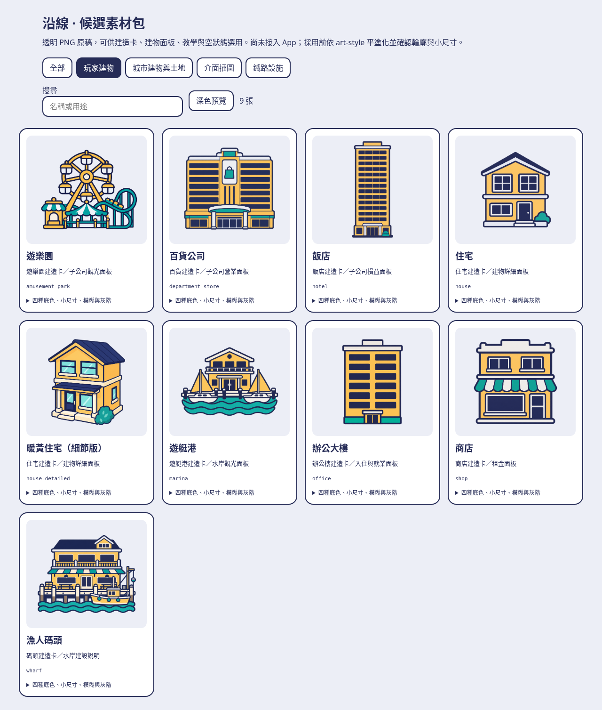
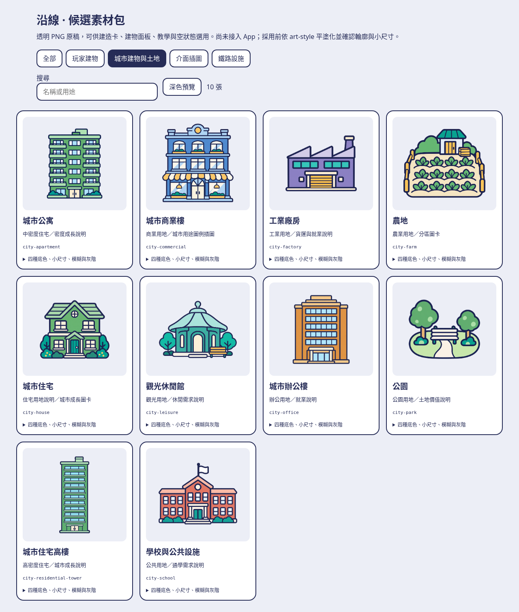
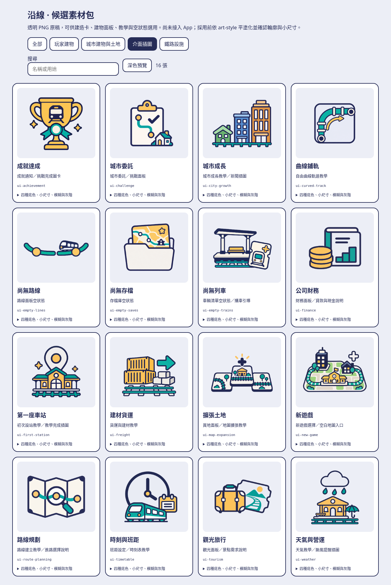
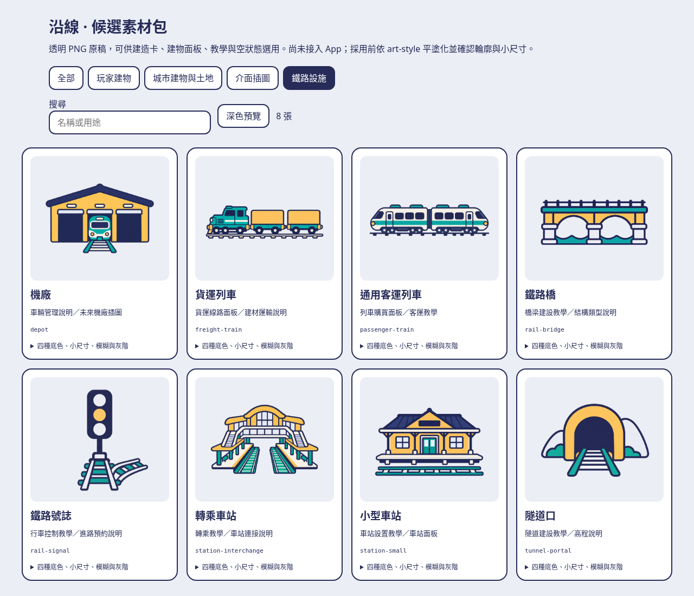

# 沿線：2026-10-13 候選圖片素材包

依 `main` **c89c724** 的 UI_THEME、art-style 與既有建物種類生成 **43 張透明 PNG 原稿**。用途是建造卡、建物詳細面板、教學與空狀態的候選插圖。

以藏青粗外框、暖黃玩家建物與既有土地用途色為方向。生圖原稿仍可能含高光、色階、透視、窗格或層數誤差，**尚未接入 App，也不是可直接替換地圖 glyph 的正式素材**。採用時依 art-style 保留選定輪廓、改成平塗 SVG，再確認深淺色與實機效果。原始 PNG 未裁切、縮放、描圖或改色。

- [離線素材檢視頁](index.html)：下載此目錄後開啟，可分類、搜尋、切換深淺色，展開 120／64／44／28 點、四種底色、模糊與灰階預覽。沒有外部資源或網路請求。
- [manifest.json](manifest.json)：每張圖的用途、完整生成 prompt、原始尺寸、透明範圍、SHA-256 與候選狀態。
- 對齊依據：[UI_THEME](../../UI_THEME.md)、[art-style](../../../.claude/skills/art-style/SKILL.md)、`PlacedBuildingKind`（決策 92、111、173）、城市用途色（決策 126）。

## 素材清單

### 玩家建物

[四種底色／尺寸／模糊／灰階檢查](previews/checks-player-building.png)

| 名稱／檔名 | 建議用途 |
| --- | --- |
| [遊樂園](png/amusement-park.png) `amusement-park.png` | 遊樂園建造卡／子公司觀光面板 |
| [百貨公司](png/department-store.png) `department-store.png` | 百貨建造卡／子公司營業面板 |
| [飯店](png/hotel.png) `hotel.png` | 飯店建造卡／子公司損益面板 |
| [住宅](png/house.png) `house.png` | 住宅建造卡／建物詳細面板 |
| [暖黃住宅（細節版）](png/house-detailed.png) `house-detailed.png` | 住宅建造卡／建物詳細面板 |
| [遊艇港](png/marina.png) `marina.png` | 遊艇港建造卡／水岸觀光面板 |
| [辦公大樓](png/office.png) `office.png` | 辦公樓建造卡／入住與就業面板 |
| [商店](png/shop.png) `shop.png` | 商店建造卡／租金面板 |
| [漁人碼頭](png/wharf.png) `wharf.png` | 碼頭建造卡／水岸建設說明 |

### 城市建物與土地

[四種底色／尺寸／模糊／灰階檢查](previews/checks-city-building.png)

| 名稱／檔名 | 建議用途 |
| --- | --- |
| [城市公寓](png/city-apartment.png) `city-apartment.png` | 中密度住宅／密度成長說明 |
| [城市商業樓](png/city-commercial.png) `city-commercial.png` | 商業用地／城市用途圖例插圖 |
| [工業廠房](png/city-factory.png) `city-factory.png` | 工業用地／貨運與就業說明 |
| [農地](png/city-farm.png) `city-farm.png` | 農業用地／分區圖卡 |
| [城市住宅](png/city-house.png) `city-house.png` | 住宅用地說明／城市成長圖卡 |
| [觀光休閒館](png/city-leisure.png) `city-leisure.png` | 觀光用地／休閒需求說明 |
| [城市辦公樓](png/city-office.png) `city-office.png` | 辦公用地／就業說明 |
| [公園](png/city-park.png) `city-park.png` | 公園用地／土地價值說明 |
| [城市住宅高樓](png/city-residential-tower.png) `city-residential-tower.png` | 高密度住宅／城市成長說明 |
| [學校與公共設施](png/city-school.png) `city-school.png` | 公共用地／通學需求說明 |

### 介面插圖

[四種底色／尺寸／模糊／灰階檢查](previews/checks-ui.png)

| 名稱／檔名 | 建議用途 |
| --- | --- |
| [成就達成](png/ui-achievement.png) `ui-achievement.png` | 成就通知／挑戰完成圖卡 |
| [城市委託](png/ui-challenge.png) `ui-challenge.png` | 城市委託／挑戰面板 |
| [城市成長](png/ui-city-growth.png) `ui-city-growth.png` | 城市成長教學／新聞插圖 |
| [曲線鋪軌](png/ui-curved-track.png) `ui-curved-track.png` | 自由曲線軌道教學 |
| [尚無路線](png/ui-empty-lines.png) `ui-empty-lines.png` | 路線面板空狀態 |
| [尚無存檔](png/ui-empty-saves.png) `ui-empty-saves.png` | 存檔庫空狀態 |
| [尚無列車](png/ui-empty-trains.png) `ui-empty-trains.png` | 車輛清單空狀態／購車引導 |
| [公司財務](png/ui-finance.png) `ui-finance.png` | 財務面板／貸款與現金說明 |
| [第一座車站](png/ui-first-station.png) `ui-first-station.png` | 初次設站教學／教學完成插圖 |
| [建材貨運](png/ui-freight.png) `ui-freight.png` | 貨運與建材教學 |
| [擴張土地](png/ui-map-expansion.png) `ui-map-expansion.png` | 買地面板／地圖擴張教學 |
| [新遊戲](png/ui-new-game.png) `ui-new-game.png` | 新遊戲選擇／空白地圖入口 |
| [路線規劃](png/ui-route-planning.png) `ui-route-planning.png` | 路線建立教學／進路選擇說明 |
| [時刻與班距](png/ui-timetable.png) `ui-timetable.png` | 班距設定／時刻表教學 |
| [觀光旅行](png/ui-tourism.png) `ui-tourism.png` | 觀光面板／景點需求說明 |
| [天氣與營運](png/ui-weather.png) `ui-weather.png` | 天氣教學／颱風提醒插圖 |

### 鐵路設施

[四種底色／尺寸／模糊／灰階檢查](previews/checks-railway.png)

| 名稱／檔名 | 建議用途 |
| --- | --- |
| [機廠](png/depot.png) `depot.png` | 車輛管理說明／未來機廠插圖 |
| [貨運列車](png/freight-train.png) `freight-train.png` | 貨運線路面板／建材運輸說明 |
| [通用客運列車](png/passenger-train.png) `passenger-train.png` | 列車購買面板／客運教學 |
| [鐵路橋](png/rail-bridge.png) `rail-bridge.png` | 橋梁建設教學／結構類型說明 |
| [鐵路號誌](png/rail-signal.png) `rail-signal.png` | 行車控制教學／進路預約說明 |
| [轉乘車站](png/station-interchange.png) `station-interchange.png` | 轉乘教學／車站連接說明 |
| [小型車站](png/station-small.png) `station-small.png` | 車站設置教學／車站面板 |
| [隧道口](png/tunnel-portal.png) `tunnel-portal.png` | 隧道建設教學／高程說明 |

## 接入時的約束

目視檢查四種底色與灰階後，住宅、商店、辦公樓等簡單輪廓適合 64 點以上；遊樂園、碼頭、轉乘站等細節較多，建議用 120 點以上。橫向列車與「尚無路線」要留較寬的圖卡，縮成 28 點正方形會失去細節。這是候選選用建議，不是實機驗收。

1. 玩家建物主色保持暖黃 `#FFC86B`；城市自己的住宅綠、商業藍、辦公橘、工業紫、公共紅、觀光綠松保持現有定義。插圖的窗格數不定義 GameCore 的樓層、容量或 footprint。
2. 工具列、面板、表單的按鈕仍用 SF Symbols；地圖的小圖示仍用現有單色 `MapGlyph*`。本包的多色大圖不能拿來替換 10–16 點的 glyph。
3. 站長、AppIcon 與 BrandMark 沿用已定稿素材。這批沒有生成角色變體。鐵路與城市場景是裝飾示意，不代表實景地圖或軌道幾何。
4. 放入 Asset Catalog 前先檢查輪廓、四種底色、灰階、小尺寸與配色；依 art-style 重畫為受支援的平塗 SVG。只新增 imageset 不需改 Xcode project；新增 Swift 檔才需以固定版本 XcodeGen 重新產生。

## 來源與額度

全部原稿由本工作階段以 `image_gen` 生成。沒有複製、描摹或搬入私有參考庫與商業遊戲圖片；既有 [Phase 8 素材盤點](../../research/PHASE8_ASSET_INVENTORY.md) 用於了解類別與用途。沒有為素材新增依賴、遊戲規則、存檔版本或 ARCHITECTURE 決策。

工具與使用者皆看不到剩餘生圖額度；`quota_remaining` 保持 `null`。此次 43 張皆成功，工具未回報額度限制，這輪在完整用途素材包完成後停止。無法確認是否已接近上限，不宣稱已精確用到「快沒額度」。

## 驗證

- **VERIFIED — Linux**：所有 PNG 可完整解碼、RGBA 有透明與不透明像素、至少 1024×1024；manifest 記錄完整 alpha 範圍、可見範圍（alpha > 64）與是否碰邊，以及尺寸、檔案大小、SHA-256 與檔案數。生圖可能留下低透明度的邊緣雜點，原稿保留，不把它宣稱為已清理的正式輸出。
- **VERIFIED — Linux／Chromium**：43 張原稿在檢視頁皆可解碼；四種分類、搜尋、深淺色切換、展開尺寸檢查可操作，390 px 寬沒有橫向溢出，沒有外部網路請求或 JavaScript 錯誤。四組總覽與尺寸／模糊／灰階檢查圖已輸出並目視查看。
- **UNVERIFIED**：正式 Asset Catalog 編譯、SwiftUI 顯示、TestFlight 實機與嚴格平塗 SVG 規格。本次沒有改 App／Swift package，也沒有執行不相關的 Swift 測試。
