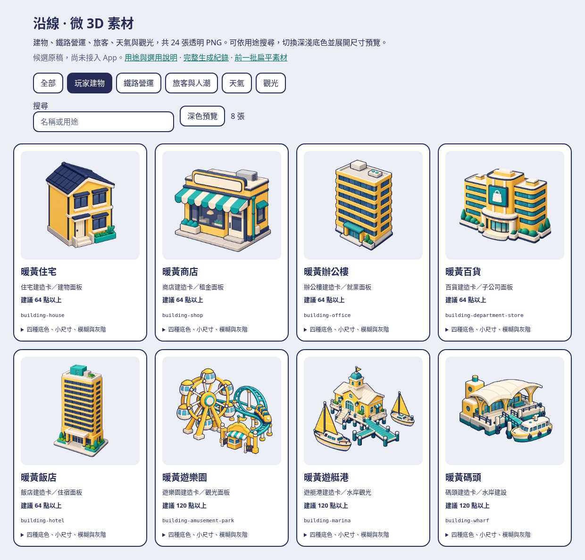
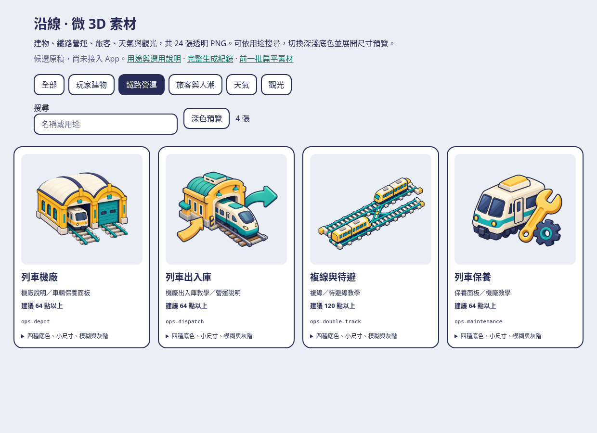
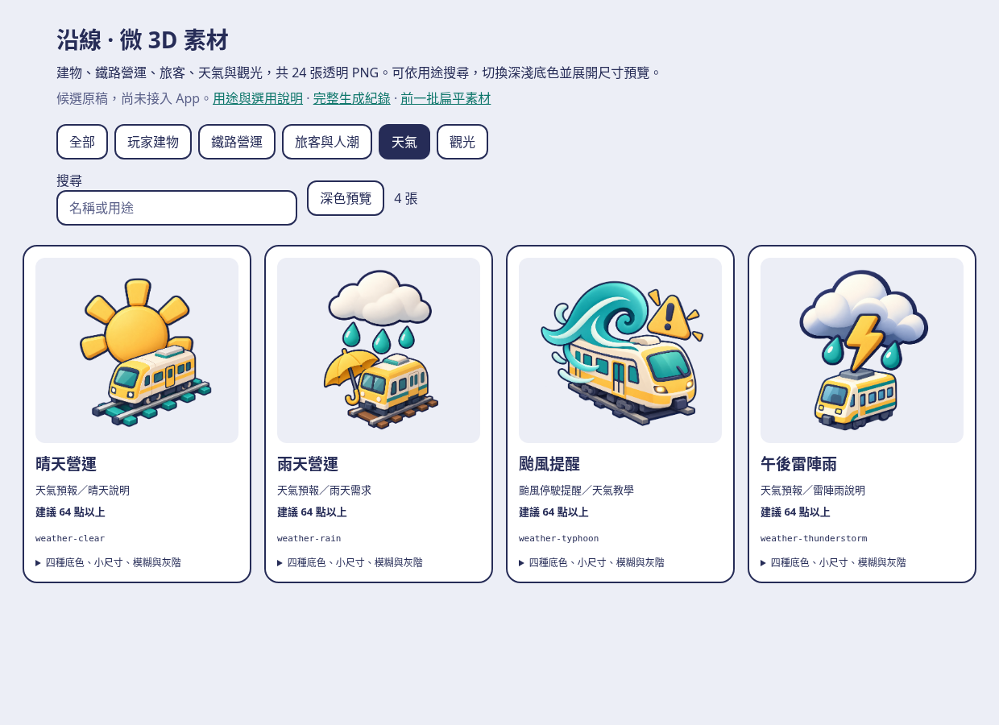
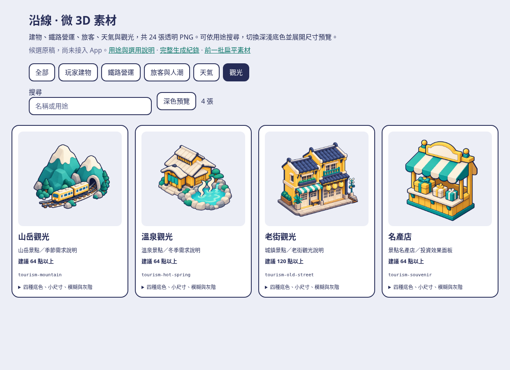

# 沿線：2026-10-14 微 3D 候選素材

接續 [前一批 43 張扁平素材](../generated-2026-10-13/README.md)，新增 **24 張原始透明 PNG**。沿用工作登記 #231 中作者較新的「微 3D」偏好：淺厚度、輕微等角透視與柔和光影，配色以暖黃、藏青、綠松和淺底為主。既有 art-style 的角色與 glyph 規範照舊；這批是面板候選插圖。

- [離線檢視頁](index.html)：五類、名稱／用途搜尋、深淺色切換、四種底色、120／64／44／28 點、模糊與灰階。
- [完整清單](manifest.json)：用途、題材、完整 prompt、建議最小尺寸、RGBA／留白量測、SHA-256。

## 用途與素材

### 玩家建物

[四底色／尺寸／模糊／灰階](previews/checks-building.png)

| 名稱 | 用途 | 建議尺寸 |
| --- | --- | --- |
| [暖黃住宅](png/building-house.png) | 住宅建造卡／建物面板 | 64 點以上 |
| [暖黃商店](png/building-shop.png) | 商店建造卡／租金面板 | 64 點以上 |
| [暖黃辦公樓](png/building-office.png) | 辦公樓建造卡／就業面板 | 64 點以上 |
| [暖黃百貨](png/building-department-store.png) | 百貨建造卡／子公司面板 | 64 點以上 |
| [暖黃飯店](png/building-hotel.png) | 飯店建造卡／住宿面板 | 64 點以上 |
| [暖黃遊樂園](png/building-amusement-park.png) | 遊樂園建造卡／觀光面板 | 120 點以上 |
| [暖黃遊艇港](png/building-marina.png) | 遊艇港建造卡／水岸觀光 | 120 點以上 |
| [暖黃碼頭](png/building-wharf.png) | 碼頭建造卡／水岸建設 | 120 點以上 |

### 鐵路營運

[四底色／尺寸／模糊／灰階](previews/checks-operations.png)

| 名稱 | 用途 | 建議尺寸 |
| --- | --- | --- |
| [列車機廠](png/ops-depot.png) | 機廠說明／車輛保養面板 | 64 點以上 |
| [列車出入庫](png/ops-dispatch.png) | 機廠出入庫教學／營運說明 | 64 點以上 |
| [複線與待避](png/ops-double-track.png) | 複線／待避線教學 | 120 點以上 |
| [列車保養](png/ops-maintenance.png) | 保養面板／機廠教學 | 64 點以上 |

### 旅客與人潮

[四底色／尺寸／模糊／灰階](previews/checks-passenger.png)

| 名稱 | 用途 | 建議尺寸 |
| --- | --- | --- |
| [月台排隊](png/passenger-queue.png) | 月台人潮／車門擁擠說明 | 120 點以上 |
| [旅客轉乘](png/passenger-interchange.png) | 旅程追蹤／轉乘說明 | 120 點以上 |
| [無障礙乘車](png/passenger-accessibility.png) | 無障礙車站／旅客服務說明 | 120 點以上 |
| [通勤旅客](png/passenger-commute.png) | 需求教學／居民與就業說明 | 64 點以上 |

### 天氣

[四底色／尺寸／模糊／灰階](previews/checks-weather.png)

| 名稱 | 用途 | 建議尺寸 |
| --- | --- | --- |
| [晴天營運](png/weather-clear.png) | 天氣預報／晴天說明 | 64 點以上 |
| [雨天營運](png/weather-rain.png) | 天氣預報／雨天需求 | 64 點以上 |
| [颱風提醒](png/weather-typhoon.png) | 颱風停駛提醒／天氣教學 | 64 點以上 |
| [午後雷陣雨](png/weather-thunderstorm.png) | 天氣預報／雷陣雨說明 | 64 點以上 |

### 觀光

[四底色／尺寸／模糊／灰階](previews/checks-tourism.png)

| 名稱 | 用途 | 建議尺寸 |
| --- | --- | --- |
| [山岳觀光](png/tourism-mountain.png) | 山岳景點／季節需求說明 | 64 點以上 |
| [溫泉觀光](png/tourism-hot-spring.png) | 溫泉景點／冬季需求說明 | 64 點以上 |
| [老街觀光](png/tourism-old-street.png) | 城鎮景點／老街觀光說明 | 120 點以上 |
| [名產店](png/tourism-souvenir.png) | 景點名產店／投資效果面板 | 64 點以上 |

## 採用與視覺限制

全部 24 張可見內容均未碰邊，但生圖未逐張達成 prompt 要求的 14% 留白（最窄約 1.36%）；實際留白逐張記在 manifest。面板採用時以 object-fit: contain 並由容器補留白，不以原始畫布作點擊區。

原始 PNG 保留生圖工具輸出的完整位元組，未裁切、縮放、換色或描圖。實際圖片可能偏離 prompt 的精確色碼、層數、人物站位或軌道幾何；插圖是用途示意，不定義容量、樓層或行車規則。正式採用前須確認個別輪廓、透明邊緣與實機尺寸。

複線插圖的線路只作裝飾；正式教學須配合遊戲實際進路與方向箭頭，不以插圖替代可操作的鋪軌預覽。旅客與無障礙圖是候選用途，並不代表新增無障礙遊戲規則。複雜景物及多人物建議 120 點以上，28 點僅作退化檢查。地圖 glyph、工具列 SF Symbols、站長與 AppIcon 不以這批大圖取代。

微 3D PNG 與原本嚴格平塗 SVG 有不同用途。未把這批匯入 Asset Catalog；接入時依目標畫面確認採 PNG 或依 art-style 另製平塗 SVG，並完成 Asset Catalog／SwiftUI 與實機驗證。

## 選用理由與來源

- 玩家：八種玩家建物有一致的暖黃插圖；近期的旅程、人潮、機廠與天氣功能有對應題材可選。
- 開發：素材只新增在獨立目錄，原始檔與 prompt／雜湊可追溯；不占用 App 實作 session 的檔案。
- 美術：沿用作者較新的微 3D 偏好；保留 [扁平原稿](../generated-2026-10-13/README.md)（檢視頁已搬到私有庫）作另一種方向比較，深色底與小尺寸也可檢查。

來源對照：PlacedBuildingKind → 八種建物；機廠與高鐵機廠研究 → 四張營運插圖；決策 220／169 的旅程追蹤與車門擁擠 → 人潮與轉乘；決策 175 → 天氣；AttractionCatalog／景點 JSON → 山岳、溫泉、城鎮與名產店。沿用既有 PHASE8_ASSET_INVENTORY.md 了解用途。全部圖片由本工作階段以 image_gen 原創生成，沒有複製或描摹參考庫或商業遊戲素材；沒有新增依賴或遊戲規則。

## 驗證

- **VERIFIED — Linux**：24 PNG 完整解碼、RGBA 透明度範圍 0–255、尺寸至少 1024×1024；與原始生圖輸出逐位元組一致。manifest 記錄尺寸、位元組、SHA-256、alpha 與可見留白範圍。

- **VERIFIED — Linux／Chromium**：24 張可解碼，五類篩選、名稱／用途搜尋、深淺色切換及展開檢查可操作；390 px 寬且展開檢查時沒有橫向溢出，沒有外部請求或 JavaScript 錯誤。五組總覽與五組四底色／尺寸／模糊／灰階檢查圖已輸出，檢查圖及手機深色版已目視查看。

- **VERIFIED — Linux**：manifest 數量、檔案大小與 SHA-256 一致，素材與檢視頁／README 的本地連結存在，git diff --cached --check 通過。

- **UNVERIFIED**：App／Asset Catalog 編譯、SwiftUI 顯示與 TestFlight 實機；這輪只新增 docs 素材，不執行無關的 Swift／iOS 測試。

工具不提供剩餘生圖額度，不推算餘額。

## 搬到私有庫

2026-10-21 起，這個資料夾的其他預覽圖（含檢視頁）在私有庫 a91453/railway-reference-private 的 `Railway/game-art-previews/docs/art/generated-2026-10-14-micro3d/`，內容完整、連結照舊；這裡只留本說明與被程式或文件直接引用的圖。上面連到已搬走檔案的連結請到那裡看。
