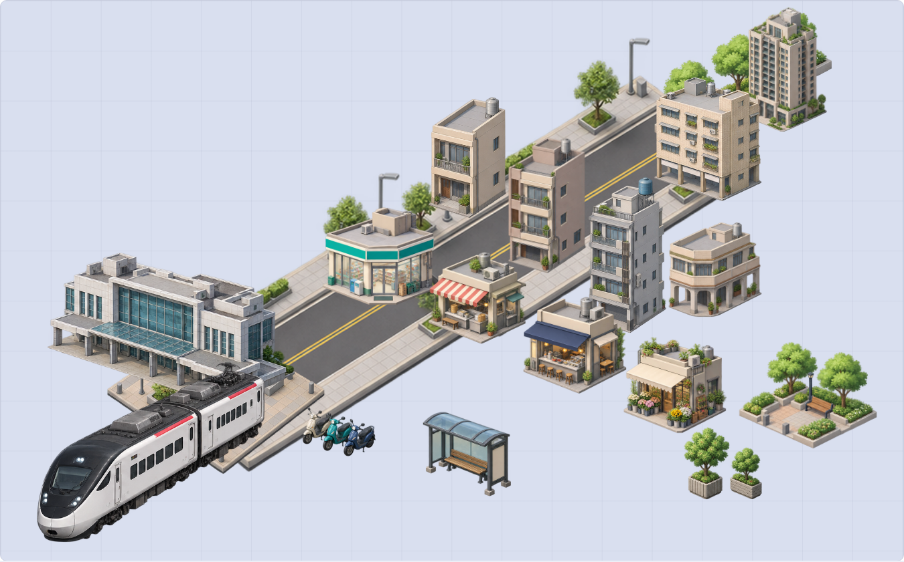

# 台灣鐵道與城市場景素材

**18 張透明 PNG 素材表，共 156 個圖像項目**。作者要求先推送現有鐵道素材，再補住宅、商業及能組合遊戲場景的圖片；全部收錄於此目錄。

[開啟本地檢視與組景頁](index.html) · [逐格座標、生成描述與 SHA-256](manifest.json)

[全部 156 個項目總覽](previews/all-156-items.png) · [四底色／尺寸／模糊／灰階](previews/style-checks.png) · [手機深色預覽](previews/gallery-mobile-dark.png)

## 原生 3D 與七方向圖片

已新增 [156 個原生程序化模型、GLB 及 1,092 張上下左右前後／立體透明 PNG](native3d/README.md)。[可旋轉檢視頁](native3d/index.html) 支援六方向、拖曳與縮放；[總覽](native3d/previews/overview.png) 與 [方向對照](native3d/previews/directions.png) 可直接查看。新模型重新組合量體、屋頂與設備，換成遊戲的霧面色票；不直接搬私有原模或貼原圖片。

## 原圖片素材清單

| 素材表 | 分類 | 排列 | 項目 |
| --- | --- | --- | ---: |
| [台鐵現代列車](png/01_TRA_modern_3x2.png) | 鐵道 | 3 × 2 | 6 |
| [高鐵與捷運](png/02_HSR_MRT_3x2.png) | 鐵道 | 3 × 2 | 6 |
| [車站與月台](png/03_stations_3x3.png) | 鐵道 | 3 × 3 | 9 |
| [軌道與鐵道配件](png/04_tracks_props_4x3.png) | 鐵道 | 4 × 3 | 12 |
| [台鐵經典列車](png/05_TRA_classic_3x2.png) | 鐵道 | 3 × 2 | 6 |
| [更多捷運與輕軌](png/06_more_transit_3x2.png) | 鐵道 | 3 × 2 | 6 |
| [台灣透天住宅](png/07_residential_low.png) | 住宅 | 3 × 3 | 9 |
| [台灣中層公寓](png/08_residential_mid.png) | 住宅 | 3 × 3 | 9 |
| [高層住宅社區](png/09_residential_high.png) | 住宅 | 3 × 3 | 9 |
| [傳統住宅與老街](png/10_traditional_houses.png) | 住宅 | 3 × 3 | 9 |
| [商店與站前店家](png/11_retail_shops.png) | 商業 | 3 × 3 | 9 |
| [餐飲與市場](png/12_food_market.png) | 商業 | 3 × 3 | 9 |
| [商辦百貨與旅館](png/13_office_commerce.png) | 商業 | 3 × 3 | 9 |
| [公共建築](png/14_public_services.png) | 公共建築 | 3 × 3 | 9 |
| [工業倉儲與物流](png/15_industrial_logistics.png) | 工業物流 | 3 × 3 | 9 |
| [公園與綠地模組](png/16_parks_greenery.png) | 公園綠地 | 3 × 3 | 9 |
| [街景與屋頂配件](png/17_street_props.png) | 街景配件 | 4 × 3 | 12 |
| [道路與站前鋪面](png/18_roads_plazas.png) | 道路鋪面 | 3 × 3 | 9 |

## 檢視與組景

下載此資料夾後，直接以瀏覽器開啟 `index.html`，不需伺服器、網路或安裝套件。

- 「素材表」可看原圖；展開每張下方的檢查，可比對第一個物件在四種底色、120／64／44／28 px、模糊及灰階的效果。
- 「單件預覽」可依分類與名稱搜尋；點物件可檢查該物件在四種底色與小尺寸的效果。
- 「組合場景」點物件加入，拖曳移動，選取後調大小、複製、刪除及前後順序。方向鍵移動，Delete 刪除。「載入站前示範」可看列車、住宅與店家搭配；[示範配置](example-scene.json) 也可匯入。匯出 JSON 可保存，之後可匯入同一頁。
- 頁面只顯示與組合來源圖片，沒有改動或另製裁切 PNG。配置 JSON 保存素材 ID、原圖路徑、矩形與位置，圖片保留在 `png/`。

## 遊戲端使用

`manifest.json` 的 `assets[].frames[]` 含 `x`、`y`、`width`、`height`，原點在 PNG 左上角。用原圖及該矩形取樣，就能單獨顯示每個物件。`grid_column`、`grid_row` 用來對照原始素材表；**不要直接等分裁切**，有些車頭、屋頂及樹木越過名義格線。座標是從透明度分析取得的包圍矩形，未更改 PNG 像素。`pivot` 為底部中間的擺放起點，比例沒有統一成公尺，需依實際場景調整。

`neighbor_pixels` 記錄包圍矩形內其他大物件的像素數，非零時先看邊緣；`canvas_edge` 提醒物件靠近畫布邊界。`clip_polygon` 是以框內座標表示的凸包遮罩；檢視頁用它避免相鄰車頭等碎片混入，同樣沒有修改 PNG。遊戲端若只用矩形而不套用遮罩，仍會看到這些碎片。PNG 仍可能有零星半透明殘色與光暈，原圖完整保留供美術挑選，並不把透明通道等同於完成去背。

全部是**單一等角視角靜態圖**，適合 2D 組景、面板與美術規劃，不是可旋轉 3D 模型。道路、月台及軌道未經接縫與軌距校準，不保證無縫拼接。真實車型是造型原型，圖片不定義工程規格、編組、實際樓數或遊戲規則。

## 畫風、來源與取捨

既有 6 張鐵道素材依作者本對話要求保留真實車型的辨識特徵、略作遊戲化。新增城市素材採 F 台灣版＋的霧面等角方向，取台灣透天、騎樓、陽台、水塔與店面等內容，配色參考 `Map3DPalette` 的住宅、商辦、清水模、道路、綠地色。生成結果仍比原生程序模型細緻；並排查看後作為獨立靜態素材交付，沒有替換正式地圖美術。

來源對照：

| 來源 | 本次使用 |
| --- | --- |
| 本對話先前 6 張 image_gen 原創結果 | `01`–`06` 鐵道 PNG，逐位元組保留 |
| 本對話新增 12 張 image_gen 原創結果 | `07`–`18` 城市 PNG，完整 prompt 記錄於 manifest |
| `Sources/GamePresentation/Map3DScene.swift` 的 Map3DPalette | 住宅、商辦、牆面、街景的配色與類型 |
| [F 台灣版＋](../3d-style-2026-10-13/README.md)、[既有微 3D 素材](../generated-2026-10-14-micro3d/README.md) | 風格、留白、四底色與尺寸檢查方法 |

沒有複製商業遊戲素材，沒有把私有參考庫圖片或模型上傳生成服務；沒有引入外部授權素材或依賴。本次不是新 Stage，沒有新增 GameCore、App、存檔、ARCHITECTURE 決策或 golden schema。

五方取捨：玩家可用鐵道與城市物件組景；鐵道迷保留車型輪廓、技術資料仍以正式來源為準；開發有原圖、逐格座標與雜湊，檔案隔離於獨立目錄；美術用同一等角方向並保留半寫實列車與霧面城市的差異供選擇；音樂無影響。其他方向保留在既有 F 台灣版＋與微 3D 目錄作比較。

## 驗證與採用狀態

- **VERIFIED — Linux**：18 PNG 完整解碼、RGBA、透明像素、原始檔逐位元組一致、SHA-256／尺寸／大小／項目數、逐格座標位於原圖內；相鄰物件的片段以繪製遮罩排除，原始檔不變。
- **VERIFIED — Linux／Chromium**：18 張原圖解碼、156 個單件預覽、分類／搜尋、四底色、深淺介面、拖曳／縮放／複製／圖層、20 物件示範、JSON 匯出／匯入往返、無效匯入不改場景、390 px 無橫向溢出，沒有外部請求與 JavaScript 錯誤。詳見 [驗證紀錄](verification.json)。
- **VERIFIED — Linux／Chromium**：使用 art-style 的 `preview.cjs`（暫存副本只調本機 Chromium 路徑、PNG 包裝的本機 URL），18 張素材表的第一個物件完成四底色、120／64／44／28 px、模糊與灰階檢查，檢查圖及全部項目總覽、組景、手機深色畫面已目視查看。生成原圖不變。
- **UNVERIFIED**：原生 App／Asset Catalog／Metal 的採用、真機效果與效能。交付的是完整靜態素材包及組景預覽；正式 App 的使用由對應接入工作驗證。
