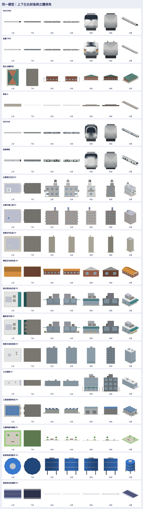

# 原生 3D：156 個模型與七方向圖片

依作者要求，把前批 156 個題材改成專案原生程序化 3D：**156 個原生模型、156 個 GLB、936 張六面正交 PNG、156 張立體 PNG**，合計 1,092 張透明圖片。這些圖片由同一個有真實深度的模型渲染；不是把不同角度的生成圖片拼成模型，也沒有將原圖片貼到方塊上。

[開啟可旋轉檢視頁](index.html) · [完整模型與圖片清單](manifest.json) · [全部模型總覽](previews/overview.png) · [六方向對照](previews/directions.png)



## 查看與下載

在本素材包的上一層啟動本機伺服器：

```sh
cd docs/art/generated-2026-10-21-scene-kit
python3 -m http.server 8080 --bind 127.0.0.1
```

開啟 `http://127.0.0.1:8080/native3d/index.html`。可依分類／名稱／ID 選模型，按上、下、左、右、前、後、立體查看，拖曳旋轉、滾輪或拉桿縮放，下載 GLB、原生檔及目前視角 PNG。右側保留前批圖片概念作對照。

`views/<原素材 ID>/` 中有 `top.png`、`bottom.png`、`left.png`、`right.png`、`front.png`、`back.png`、`isometric.png`，全部為 **384 × 384、RGBA 透明背景**。方向以模型本身定義，不是世界地圖的東西南北。薄路面的側視、建物的實心底面是實際幾何的樣子；六個方向都經過非空與不碰邊檢查。

## 原生程式直接建置

這批程序化幾何位於 `Sources/GamePresentation/Map3DSceneKit*.swift`，使用既有 `Map3DMesh`、屋頂／圓柱工具及 `Map3DTrainBuilder`，回傳專案既有的 `Map3DModelPack.Model`。不需要 GLB 解析器或貼圖依賴。

```swift
if let asset = Map3DSceneKit.asset(id: "07_residential_low-04") {
    let model = Map3DSceneKit.model(for: asset)
    let pack = Map3DModelPack(sceneKit: [asset])
    let modelIndex = pack.index(of: asset.id)
    // model.vertices 是原生 Map3DVertex；modelIndex 可供既有模型實例索引使用。
}
```

`Map3DModelPack(sceneKit:includeStandard:)` 預設包含既有標準列車與街景，也可傳 `false` 只建指定素材。標準模型包與地圖既有的選型／放置規則保留；這個 PR 交付原生建置入口、實際模型及圖片，沒有自動把 156 個模型全部載入或放到實際地圖。

原生模型以公尺計，**+x 前、+y 左、+z 上**；GLB 轉成 **+x 前、+y 上、−z 左**。模型原點、包圍盒與尺寸在 manifest。地鐵入口的樓梯確實低於街面；一般建物有底面，屋頂、水塔、陽台、騎樓與設備均有實際幾何。列車保留輪廓與配色辨識，兩節為縮短的素材編組，不當作實際營運編組或工程規格。原生檔顏色已烘入頂點，不需要另給路線色。

全批共 **72,954 個三角形**，單件最多 **2,742 個三角形**；這是模型檔的數量，並非遊戲實機的幀率量測。所有模型都低於既有原生讀取器的 15,000 面限制。

## 視覺重組與參考

遵循本專案 art-style §7 與作者最新要求：能參考私有模型，但成品不能跟原件一樣。這輪選擇**從原生幾何重建**，沒有直接搬入私有 GLB、節點、UV、彩色貼圖、照片、招牌或臉。

- 量體重新組合：窄透天、退縮騎樓、多翼公寓、住宅雙塔、商場裙樓、獨立店鋪、公共建築與物流設施使用不同的樓層、足跡、入口與屋頂配置。
- 改成 F 台灣版＋的霧面頂點色，顏色取 `Map3DPalette`。前批半寫實圖只提供題材與辨識方向，新的原生模型在材質、窗格節奏、設備與細節密度上都有明顯差異。
- 列車沿用專案自己的斷面掃掠建法，依題材修改車長、車鼻、車寬、門窗、設備與配色；700T 另改成較短圓鼻，不沿用 N700ST 的肩翼與高座艙輪廓。
- 道路使用專案道路配色；騎樓是有柱子的實際退縮空間；下視圖有底面，不靠雙面材質假裝封口。

| 查閱來源 | 取用及改動 |
| --- | --- |
| 私有 `Railway/procedural_assets_reference_clean/00_READ_ME_FIRST.md`、`source/preview/city/catalog.json` | 檢查建物／店面／倉儲的尺寸與分類；例如 brick-tenement、corner-bodega、warehouse。新模型改變量體、樓數、外牆節奏、設備位置與配色，不搬原模型或原紋理 |
| 私有 `source/preview/city/assets/proceduralBuilding-BkVu4oGo.js` | 查閱程序化建築與淡灰階材質的做法；本輪不用該貼圖／材質程式，採原生平塗頂點色 |
| 私有 `Railway/taiwan-rail-reference-clean/source/rail-3d/README.md` | 核對車種／編組資料與實際幾何是不同層，原模型未取用 |
| 私有 `Railway/town-scene-reference-clean/00_READ_ME_FIRST.md` | 查閱城鎮素材分類與缺件說明；未搬該包 GLB、音訊或第三方依賴 |
| 本專案 `Map3DTrainBuilder`、`Map3DMesh`、`Map3DShapes`、`Map3DPalette`、`Map3DProp` | 直接重用原生幾何基礎，重新配置模型；新建的底面補齊既有地圖用基本形狀不需要的下視面 |

沒有把私有內容傳給外部生成服務，沒有新增套件或修改 GameCore／存檔。因為沒有匯入私有原始幾何，成品也不包含可還原該庫模型的加工腳本。可重建本批原生模型的公開工具只用本專案的新幾何與既有原生程式。

## 重建與驗證

使用專案要求的 Swift 6.4、Node、已安裝的 Chromium／Playwright：

```sh
tools/scene-kit/export.sh "$PWD/docs/art/generated-2026-10-21-scene-kit/native3d"
node tools/scene-kit/render.mjs docs/art/generated-2026-10-21-scene-kit/native3d
node tools/scene-kit/verify.mjs docs/art/generated-2026-10-21-scene-kit/native3d
node tools/scene-kit/browser-check.mjs docs/art/generated-2026-10-21-scene-kit/native3d
```

`CHROMIUM_PATH` 可指定已安裝的瀏覽器路徑。工具不下載瀏覽器或套件，不需要 GPU 雲端服務。原生模型用既有 `Map3DModelFile` 讀回，GLB 是相同頂點的座標旋轉與封裝；PNG 從相同原生模型渲染，可重現。

- **VERIFIED — Linux／Swift 6.4**：warnings-as-errors 完整建置；原生素材與模型讀取器共 13 個測試通過，涵蓋題材完整性、六面法線、底面、尺寸、可重現性、原生模型包入口及 156 個檔案逐頂點讀回。
- **VERIFIED — Node**：4 個 GLB 匯出測試；156 組原生／GLB 完整頂點轉換、SHA-256、provenance、accessor 邊界及無外部貼圖／buffer。
- **VERIFIED — Chromium WebGL 2**：1,092 張 RGBA 圖片全部非空、不碰邊；156 模型可互動載入；六方向、拖曳、縮放、PNG／GLB 下載、原圖對照、搜尋與 390 px 畫面通過，無 JavaScript 錯誤、缺失資源或外部請求。總覽、方向、底視與手機預覽已目視查看。詳見 [verification.json](verification.json)。
- **UNVERIFIED**：iPhone／iPad Metal 的實際顯示與效能、實際地圖採用後的擺放與比例；WebGL 圖片不是 Metal 實機截圖。
