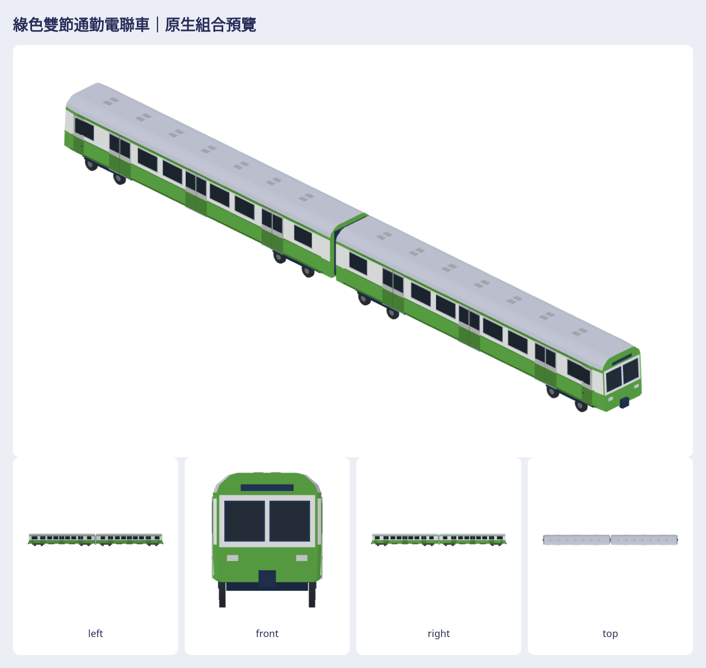

# 綠色雙節通勤電聯車

原生配方：[Map3DGreenCommuter.swift](../../../Sources/GamePresentation/Map3DGreenCommuter.swift)；重建與組裝：[tools/green-commuter/README.md](../../../tools/green-commuter/README.md)。公開庫只放原生配方、必要註冊、測試、工具、這張總覽與交接；完整單元／編組 native、GLB、35 張七向圖、viewer、白模／剪影、風格對照、SHA 與 ZIP 在私有 `Railway/game-art-previews/docs/art/green-commuter-2026-10-22/`。

## 參考特徵與量尺

已目視檢查使用者本輪五張圖：圖 1、2 是兩側近正交局部，圖 3、4 是相反方向斜視全編組，圖 5 是沿車頂看前端。它是兩節長車身、傳統雙軸轉向架的通勤電聯車，不是上一台三節低地板電車。圖中兩個外端為近直立駕駛面、左右雙風擋與上方窄目的地幕；各單元每側三組雙扇乘客門，駕駛端有一扇獨立窄側門，內端是短連接處。綠色下半身、淺色窗帶、深色窗玻璃、綠色細檐與灰色圓肩屋頂是主要辨識特徵。屋頂有重複的小蓋板，沒有可確認的集電弓，因此沒有自加。

| 部位 | 本模型 | 依據／限制 |
| --- | --- | --- |
| 尺度 | 每節名義車身 19.30 m，中心距 19.72 m；完整外廓約 39.392 × 2.968 × 3.646 m | 專案 `Map3DTrains` 既有 20 m 車廂間距、2.9 m 車身寬；外廓含門框與連接器，不是實車工程尺寸 |
| 車體 | 平直長側面、頂部圓肩與中央平頂；內端直立，外端最後約 1.1 m 略收至較窄的平鈍駕駛面 | 圖 1–5；參考前端並非流線長鼻 |
| 走行 | 每節兩組雙軸轉向架，轉向架中心在單元 x=±6.80 m，各自軸距約 2.04 m；輪半徑約 0.38 m | 依側視圖的四個輪位與專案展示比例推估，不能當真車軸距 |
| 門窗 | 每側三組雙扇乘客門、駕駛端一扇窄側門；淺色帶內六組主要窗區；前端兩片風擋 | 圖 1、2 的門窗節奏及圖 3–5 的端面 |
| 車頂 | 灰色圓肩、規律成對的小型檢修蓋板；無集電弓 | 圖 3–5；設備用途無法確定，因此只作蓋板 |

精確製造型號、電氣設備、車端內部連接構造、實際長寬高與營運編組未在圖中給出。本模型是依參考的遊戲比例重建，不用透視圖像素宣稱工程尺寸。

## 外觀檢查

同一份原生模型輸出私有 `previews/clay-{left,front,isometric}.png`、`silhouette-*`、`overview.png`、`directions.png`、`units.png`、`style-comparison.png` 及每件模型的七向 PNG。斜視參考圖是透視相機，原生 viewer 的 `isometric` 是正交相機；這項視角差異保留明記。因聊天附圖沒有可讀的本地檔案，沒有原圖逐像素疊圖，也沒有把私有原圖加入任何 ZIP。

| 狀態 | 具體核對 |
| --- | --- |
| 已符合 | 圖 3、4 的兩節長車體、近直立雙端駕駛面與窄節間；見 `units.png`、編組立體與前／後視。內端沒有多餘駕駛窗。 |
| 已符合 | 圖 1、2 的每節三組乘客雙門、靠駕駛端窄側門、長矩形側窗、淺色窗區／綠下半身；見編組左／右正交圖。 |
| 已符合 | 圖 3–5 的灰色圓肩屋頂、重複小蓋板與每節兩組雙軸轉向架；見俯視、斜視、下視。 |
| 仍不符合 | 參考屋頂比遊戲色票更深；這裡採 `Map3DPalette.roof` 的較淺霧面灰。車底設備和輪框只保留能辨識的主塊，較參考簡化。 |
| 資料不足 | 製造型號、工程尺寸、轉向架設備、不可見的內端細部與屋頂蓋板用途，均不作真車宣稱。 |

車長、車寬、輪徑、車頭長度及門窗節奏已人工對照；沒有捏造相似度分數或宣稱作者已認可。同尺度風格圖拿新前端單元與專案既有 `commuter-cab` 在同公尺相機下比較，沒有各別縮放。

## 使用與來源

`Map3DModelPack.standard` 新增 `green-commuter-leading`、`green-commuter-trailing`、`green-commuter-formation`。兩單元原點各在車體中心，完整組合中心 x=+9.86／−9.86 m，皆不旋轉；外端駕駛面朝 ±x，內端有支持的連接面。原生 +x 前、+y 左、+z 上，z=0 為軌面。這是**靜態素材**，未接入 GameCore 車種、車門動畫、輪軌物理或列車控制。

來源是使用者五張聊天附圖的目視判讀、專案 `Map3DTrains` 與 `Map3DPalette`／`Map3DTrainStyle.glass`。私有庫的前一批綠色電車和專案既有通勤車只作風格比較；未複製參考圖片、mesh 或貼圖，未使用真實品牌。Linux Swift 6.4、原生讀回、GLB、PNG 和 viewer 驗證與美術判讀分開記錄；真機 Metal 外觀、效能與動畫未驗證。
