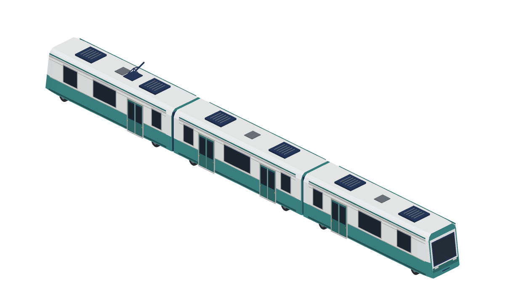

# 綠色三節低地板電車

> **最新配色修訂**：本台已與另外兩台一起改為遊戲配色；幾何完全不變。[三台最新總覽、對照與素材包](../train-colors-2026-10-22/README.md)。下方原批的結構與來源紀錄保留作歷史，最新配色／匯出以整合包為準。

原生配方：[Map3DGreenTram.swift](../../../Sources/GamePresentation/Map3DGreenTram.swift)；重建與組裝：[tools/green-tram/README.md](../../../tools/green-tram/README.md)。公開庫只放配方、工具、驗證與本張總覽；完整單元／編組與既有輕軌對照的 `.m3dmodel`、GLB、35 張七向 PNG、互動 viewer、來源與 ZIP 在私有素材庫 `Railway/game-art-previews/docs/art/green-tram-2026-10-21/`。

## 參考判讀與尺寸

已逐張檢查使用者在聊天附上的四張圖。圖 1 是前右斜上視、圖 2 是一側近正交、圖 3 是車端斜上視、圖 4 是另一側近正交。它們描繪三節低地板輕軌車組；兩個短而略傾斜的駕駛端、一個無駕駛台的中節、兩道黑色柔性節間、白頂與白色車頂眉帶、綠色側板、深藍玻璃、單端集電弓、屋頂設備和裙板下的小輪組都應保留。兩側門窗順序不同；車端各有大風擋與兩盞低位頭燈。

| 部位 | 本模型 | 依據與限制 |
| --- | --- | --- |
| 三節車體 | 每節名義長 10.88 m，中心距 11.04 m，全長 32.990 m | 專案 `Map3DSceneKitTransport.swift` 的輕軌示意尺度為每節約 11 m；不是工程數據 |
| 車體與輪組 | 主殼寬 2.58 m、含門邊飾條最大寬 2.686 m，屋頂高 3.18 m，兩個小輪軸位置在各節 ±3.92 m、輪半徑約 0.32 m | 從圖片形狀與現有模型比例推估；看不到底盤精確構造 |
| 端部 | 頭節朝 +x，尾節駕駛端朝 −x；駕駛端從完整車身寬度分兩級橫向收至約 91%，端面隨高度後收約 0.35 m | 圖 1、3 的短鈍車頭與斜風擋；不是尖鼻高速列車 |
| 門窗 | 頭／尾節各一組雙扇門；中節兩組；兩側都有門窗 | 圖 2、4；玻璃與門板都有車身支持面 |
| 屋頂 | 每節兩箱深色設備；只有尾節有集電弓 | 圖 1、3、4；設備確切用途無法判斷，因此不命名為真車系統 |

軸距、輪徑、底盤、接點精度、車端燈具樣式與車輛品牌不能從四張低解析度透視／近正交圖確定。長寬高都是遊戲展示尺度；未把透視像素冒稱工程尺寸，也未寫入真實品牌與商標。

## 外觀驗收

判讀以同一份 Swift 模型的白模輪廓與著色渲染為準。使用者指出第一版外觀不好看後，對照 `previews/before-after.png` 的同公尺尺度、同鏡頭三視圖：原版整片飽和綠側壁缺少層次，車頭平鈍，綠色門板與深色玻璃混成一大片。現在車頭從完整寬度經兩道截面收至約 91%，端面更後傾；車側改用專案 `tileWhite` 淺色窗區、`crown` 綠色下裙、`park` 淺綠窗框及 `Map3DTrainStyle.glass` 深藍玻璃，門板與窗帶分層。新截面逐段三角化，白色肩線繞過端部。最終私有 `previews/clay-*.png`、`silhouette-*.png`、`overview.png`、`directions.png`、`units.png`、`style-comparison.png` 和 `views/green-tram-formation/` 供檢查。使用者原始聊天圖片無可讀取的本地路徑，因此私有包沒有複製原圖，未製作宣稱像素對齊的拼圖。

| 狀態 | 項目與對照 |
| --- | --- |
| 已符合 | 三個車節與兩個柔性連接、兩端獨立駕駛窗、中節無駕駛窗；見私有 `units.png` 與完整組合左右視圖 |
| 已符合 | 短鈍且前端橫向收束的車頭、後傾端面、白頂眉帶、淺色上側壁與綠色下裙、深色窗門；見 `before-after.png` 前視／立體與最終前視，對照使用者圖 1、3 的結構，配色依遊戲美術重設 |
| 已符合 | 集電弓只在一端、各節車頂設備與裙板下的小輪組；見俯視、左右視與下視，對照使用者圖 2、4 |
| 資料不足 | 工程軸距、輪徑、底盤構造、真實端部燈配置；依圖像比例和專案 11 m 示意車尺度處理 |
| 仍不符合 | 參考圖的上側壁是綠色，新版為了符合專案既有淺色輕軌車美術改成淺灰白；這是有意的配色差異，見 `before-after.png` 左視與參考圖 2、4 |

就可辨的三節數量、短車端、低裙板、門窗節奏及單端集電弓，未再發現主要輪廓錯置。仍是人工判讀，沒有像素對齊參考或作者驗收；同鏡頭前後圖只證明本次修正，不能替代和原圖的精確比對。

## 使用與交接

`Map3DModelPack.standard` 可用 `green-tram-head`、`green-tram-middle`、`green-tram-tail`、`green-tram-formation` 載入。單元座標以各車中心為原點，完整編組把頭／中／尾中心放在 x = +11.04／0／−11.04 m，皆不旋轉。節間外廓淨距約 0.08 m，總長約 32.990 m；兩端轉向不共用同一片貼圖。這是**靜態素材**，未綁定 GameCore 車型、列車長度／班次、輪軌物理或動畫。現行遊戲把一節列車按約 20 m 的近景車廂間距擺放，若要讓這個三節低地板車在路線上行駛，須另設計編組與軌道採樣方式，不能直接把三個約 11 m 單元映射到一般列車車廂。

來源記錄：使用者四張附圖只作目視依據；私有 `Railway/generated-3d-assets-2026-10-21/trains-pr901/` 的輕軌示意素材只查風格及來源，沒有複製圖、mesh 或貼圖；使用公開庫既有 `Map3DSceneKitTransport.swift` 的 11 m 示意尺度與 `Map3DPalette`／`Map3DTrainStyle.glass` 色票。Linux 的 Swift 6.4 warnings-as-errors、原生讀回、GLB、PNG、viewer 和相關 XCTest 是技術驗證；真機 Metal 畫面與效能仍未驗證。
