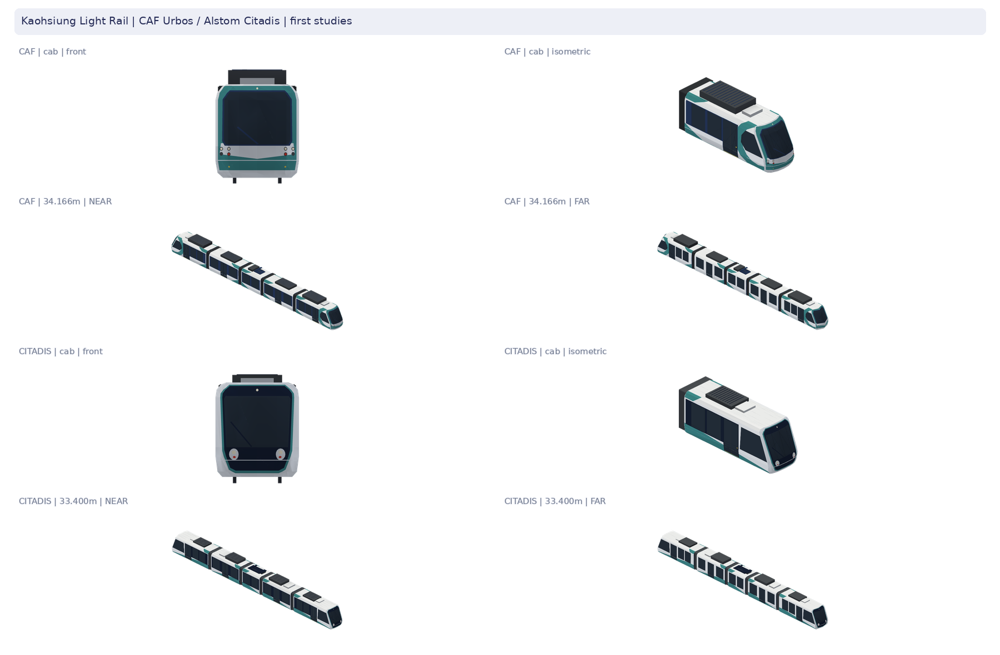

# 高雄輕軌：CAF 與 Citadis 兩套原生 studies

本輪兩款同時製作，各五個不同角色、各自近遠景及完整靜態車組。沒有獨立車型前版，這是首次交付；本機試作不是假造的前版。原有綠色三節／五節示意車、其他輕軌與高雄捷運紅橘線均為保護對象，沒有套殼或取其零件。

## 查證與名稱對照

| 項目 | 第一階段採購車 | 第二階段採購車 |
|---|---|---|
| 正式車系 | CAF Urbos 3；CAF 高雄專用 EPD 稱 Urbos 100 | Alstom Citadis 305；製造商稱 Citadis X05 |
| 製造商／數量 | 西班牙 CAF，9 列、45 模組 | 法國 Alstom，15 列、75 模組，11＋4 擴充 |
| 可查核識別 | T01–T09／KLRT-01–09；單元 011–015 至 091–095 | KLRT-10–24；連續範圍依車隊總數及端點實拍／公開車隊影片交叉推定，完整官方逐車名冊 **UNVERIFIED**，不據此分配遊戲車次 |
| 投入載客 | 2015-10-16 C1–C4 試營運；一期完整通車與收費另有日期 | 2020-11-02 先在既有一期路段載客；2021-01-12 南環延伸通車，不能把兩日期混為首次載客 |
| 全列長／寬／降弓高 | 34.166／2.650／3.600 m | 33.400／2.650／約3.600 m；市府介紹取整約34m |
| 原資料模組稱呼 | C1–S1–R–S2–C2；CAF EPD Mc–S–T–S–Mc | M1–SC1–NP–SC2–M2 |
| 走行 | C1、C2 動力；R 拖車；S1、S2 懸浮、無台車 | M1、M2 動力；NP 拖車；SC1、SC2 懸浮、無台車 |
| 供電 | 中央 R 單臂弓、兩端 C 的 ACR 儲能箱 | 中央 NP 標準弓＋E-collect；SC1／SC2 Ecopack；Autonomy／Ecoswitch／Pegasus |
| 一般塗裝辨識 | 圓收大風擋、白色下鼻橫橋、綠色 U 帶與側面弧帶、每側四個小燈 | 較直立的高黑面罩、窄綠外緣、白頰、左右白色直立燈座 |

來源優先：[運安會 CAF 技術報告](https://www.ttsb.gov.tw/media/5181/0527高雄捷運公司輕軌第t05編組前鎮之星站重大鐵道事故調查報告.pdf)、[CAF 高雄 EPD](https://environdec.com/library/epd749)、[土木水利一期車輛概述](https://www.ciche.org.tw/wordpress/wp-content/uploads/2018/03/DB4501-P082-%E9%AB%98%E9%9B%84%E7%92%B0%E7%8B%80%E8%BC%95%E8%BB%8C%E6%8D%B7%E9%81%8B-%E7%80%8F%E8%A6%BD.pdf)、[市府 Citadis 外觀介紹](https://mtbu.kcg.gov.tw/Activities/C002100?PageType=1&id=9d430f60-418d-47f7-9fe7-e8a140d75d14)、[市府二階儲能／集電設備](https://mtbu.kcg.gov.tw/Activities/C002100?PageType=1&id=d306a750-6725-4513-9c51-ab5aa2d369c5)、[Alstom 載客時序](https://www.alstom.com/press-releases-news/2021/1/alstom-introduces-citadis-x05-trams-kaohsiung)。兩個工程階段是採購來源，不是列車現今的運用分界。二階車早已能在一期路段載客，不製造兩款各跑半圈的契約。

實拍原圖：[Blair CAF](https://blair-bus.blogspot.com/2015/01/blog-post.html)、[Blair Citadis](https://blair-bus.blogspot.com/2022/02/citadis-x-05-305.html)、[2427junction CAF](https://2427junction.com/taiwankaohsiungcar2.html)、Alstom 原始照片。均實際下載，在本機開啟原圖／原圖縮圖表；不是搜尋摘要。逐檔 URL、作者、日期、授權、SHA 與查看狀態見 [sources.json](sources.json)。原照片只在本機做觀察與旁置比較，沒有照片貼圖／第三方幾何／商標文字，也不將私有來源送外部生成服務。

## 單元與共同軌面

原生公尺 +X 前／+Y 左／+Z 上，軌面 Z0；builder 只轉軸一次。每個 model 本地 +X 指其正向；尾端 C2／M2 在 assembly 轉180°，不另造反向檔再重轉。其餘四段0°。

| CAF 單元 ID（另有 -far） | 車殼長m | X平移m | 角色／左右門窗 |
|---|---:|---:|---|
| klrt-caf-c1 | 7.783 | +13.1915 | 駕駛動力端；每側一組雙扇門、兩客室窗及駕駛側窗；ACR |
| klrt-caf-s1 | 6.100 | +5.6500 | 懸浮、每側一組門及兩窗；屋頂空調 |
| klrt-caf-r | 4.000 | 0 | 中央拖車、每側兩窗無門；單臂充電弓 |
| klrt-caf-s2 | 6.100 | −5.6500 | 另一懸浮模組，側面分色方向獨立鏡向，無輪 |
| klrt-caf-c2 | 7.783 | −13.1915 | 另一駕駛動力端、ACR；180°，不重複擁有關節 |

| Citadis 單元 ID（另有 -far） | 車殼長m | X平移m | 角色／左右門窗 |
|---|---:|---:|---|
| klrt-citadis-m1 | 7.850 | +12.775 | 駕駛動力端；每側一門、兩客室窗及駕駛側窗；空調 |
| klrt-citadis-sc1 | 5.850 | +5.325 | 懸浮、一門兩窗；第一組 Ecopack |
| klrt-citadis-np | 3.600 | 0 | 中央拖車、兩窗無門；標準弓＋獨立 E-collect |
| klrt-citadis-sc2 | 5.850 | −5.325 | 懸浮、一門兩窗；第二組 Ecopack，側分色／設備鏡向 |
| klrt-citadis-m2 | 7.850 | −12.775 | 另一駕駛動力端；180°，尾端不重複擁有關節 |

每列四個600mm車殼間隙，由前四單元各自擁有的一個完整風琴覆蓋；不加普通客車連結器，不補懸浮段輪組。相鄰模組各由自己的台車／相鄰支承在實車上承載；本模型只表現靜態外部風琴，不是關節承載工程復刻。全部模組各有獨立近遠原生與GLB；整列使用合法 M3DAssembly，沒有超限單檔M3DM。

**尺寸可信度分開**：整列長、寬、地板350mm、模組角色及供電位置取官方／工程資料。各殼長、關節600mm、台車中心及輪徑／軸距、曲率和精確設備站位是依圖、實拍與總長約束的建模推估，未取得廠商尺寸工程圖。CAF 每端輪架中心本地X−1.65m、軸距1.80m、輪徑0.60m；Citadis X−1.73m、軸距1.60m、輪徑0.59m；中央架X0。均標推估，不冒稱工程量測。軌距1.435m已確認。

CAF ACR 報告完整箱3.211×1.845×0.750m；模型表現3.211×1.845×0.450m的**可見頂罩**，不把內部／車頂內的箱體補成外掛高盒。Citadis 外罩尺寸亦為估計；內部48個Neo-Elit與管線不逐件補造。兩車集電裝置均為行駛間降弓靜態姿態，沒有新增架空線或動畫。

## 特徵與逐視角外觀自檢

| 部位 | CAF | Citadis |
|---|---|---|
| 主曲面、肩部 | 寬圓鼻橫向收束、上風擋後仰；側弧帶直接切殼 | 獨立較直立的黑鼻與較方肩線，不套 CAF 車殼 |
| 風擋／鼻下 | 大塊深玻璃，白橋、綠 U 分開 | 高玻璃、黑下鼻、窄綠框、白頰分開 |
| 燈 | 小圓燈兩列，外側下燈不誤塗紅 | 白色圓收燈座內的上下小燈，無品牌 |
| 門窗 | 四門分配1/2/4/5段，中央無門；獨立窗列 | 相同門總數但獨立窗寬、窗下緣與駕駛窗 |
| 屋頂、下包覆 | C端ACR、S空調、R單臂弓；裙板遮輪上部 | SC Ecopack、M空調、NP兩種集電設備；獨立走行尺寸 |
| 關節 | 四套低灰風琴，不複製輪架 | 四套不同折數／高度風琴，不混用CAF幾何 |

最終原生配色、白模、剪影、遊戲尺度與實拍逐視角旁置紀錄及技術數值見 [verification.json](verification.json)。採既有霧面頂點色：tileWhite、shopAwnings[0]綠松、深玻璃、低彩度硬體；保留各車的一般塗裝邊界，沒有彩繪車。相片中的珍珠綠光澤與玻璃反射不烘成照片材質。

- **CAF 已符合（製作者自檢）**：五段長短與四門角色、中央拖車、雙端ACR、綠白前鼻／側弧帶及分立燈窗可識別，近遠都保留。
- **Citadis 已符合（製作者自檢）**：高黑面、白頰、雙燈座、四門角色、SC儲能與中央E-collect獨立成立。
- **仍不符合工程復刻範圍**：兩款曲面與燈腔深度採霧面低模簡化，沒有內裝、隱藏管線、精密懸吊與開啟的緊急連結器。這些不是已驗的工程結構。
- **資料不足**：CAF 有較完整俯斜／屋頂與關節實照；Citadis 有屋頂集電設備特寫、斜視及官方配置圖，但完整正俯實拍、隱藏底箱與兩端所有不對稱設備不足，不能用官方示意圖冒充實車俯拍。兩款左右側透視並非完整工程側視。
- 本輪沒有使用者對明確producer的外觀接受。製作者看圖與CI不代替接受。

## 原營運與保護範圍

基準為開工 main `7fd5c47bea80884992f86d457a8617755a47d4a4`。實際路徑為 `Map3DRealTrains.formation` 的 krtc/C→greenTram、cars2，`Map3DTrainSet.set(forKey:count:locked:)` 在解鎖時再映到列車包 fiveSectionLRT；鎖定時回退greenTram。淡海／安坑及玩家同類C接點也可能走相同映射。這兩者均不是本輪CAF／Citadis獨立車型。

原五節素材 recipe producer `21a5b7ba`、原三節綠車色修producer `2a947503` 均可查；素材與使用者接受缺精確對應的部分明標 **UNVERIFIED**，main不代表接受。原有兩套的升弓姿態與本輪降弓不能混稱真前後改版。交付的「既有風格比較」在共同公尺框比較真正基準輸出，明標為其他模型，沒有叫作本款前版。

原greenTram不使用ownLengths，既有雙節素材組成每個顯示car後由沿線畫段長縮放（Map3DTrains）；fiveSectionLRT也以既有切片機制分成兩個顯示car；沒有本款五個關節各自的運動契約。greenTram500m後走既有回退，既有五節的遠景策略保持；本輪新far只提供靜態studies，不會自動加入營運LOD。

高雄紅／橘線已使用獨立 `set-kaohsiung*` 三車＋遠景，真接受producer `bd57e163`（後續營運整合#1488），不與C線混同。保護全部既有735個原生實際payload與所有頂點欄位FNV，包含此六車、兩套舊輕軌、其他輕軌／共用車及其燈。全包未改main實出已有33個gate差異（32舊鎖＋TEMU2000整列被當單車預算）；本輪不改他車、鎖或gate，詳見驗證紀錄。

合併本PR後，**兩款均不會自動出現在遊戲**：只追加studies，沒有可靠CAF／Citadis配屬／選用契約，沒有用車號奇偶或隨機一半選車。也沒有玩家單獨選這兩款的介面。本輪不改GameCore、存檔、Golden／Replay／Save fixtures、購車／解鎖／班表、轉彎控制或關節動畫。靜態車組、既有彎道顯示、新關節動畫三者分開。

## 重建與交付

重建、驗收命令見 [tools/kaohsiung-light-rail](../../../tools/kaohsiung-light-rail/README.md)。公開／素材互鏈draft、實際producer、素材commit與最新head結果記於 verification；來源與工具先提交，再從producer獨立checkout重出核bytes，不把文件head冒充producer。

完整素材分別放 phase1／phase2 的 revision-1，含原生單元與組裝、GLB、限量透明PNG、自含可旋轉縮放下載viewer、單元配置、bounds／面數／SHA。公開只留這張包含兩款的總覽。兩款首次交付均無真正前版；未新增ZIP／history／備份。

| 獨立狀態 | CAF | Citadis |
|---|---|---|
| 素材技術 | 以各自status／verification最終證據為準 | 同左，獨立記錄 |
| 使用者外觀接受 | UNVERIFIED，accepted_producer=null | UNVERIFIED，accepted_producer=null |
| 營運接入 | UNVERIFIED，studies而已 | UNVERIFIED，studies而已 |
| 裝置 | UNVERIFIED | UNVERIFIED |

Linux原生／Blender／Chromium檢查不代表人工Simulator外觀、iOS Metal、真機FPS／記憶體、彎道關節、坡度、裝置下載、Safari或任何動畫已驗。抽樣射線不是完整動態碰撞證明。不推main、不合併／auto-merge／TestFlight。
