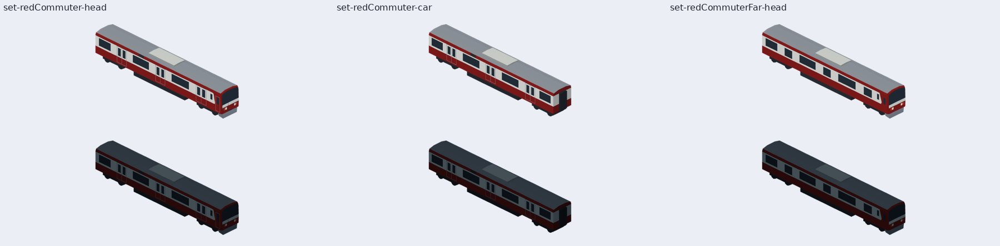

# 京急新1000形（決策 956）

總覽（遊戲的匯出與模型光，`tools/train-models/render.mjs`，上排白天、下排夜晚）：左起駕駛室車、中間車、駕駛室車的遠景版。紅車身、白窗帶、每側三扇門、兩台轉向架八個車輪、車頭兩片前窗與兩組燈（白頭燈＋外側紅尾燈）、灰車頂與灰白冷氣。色票平塗，不畫車號與文字（舊版車頭的「1000」歸到白帶）。

- `compare-now.jpg`：和遊戲之前的簡化車頭 `e752e7a2b5` 並排（上：舊，帶貼圖、抬高 0.675 m；下：這次的，同鏡頭同比例）。
- `compare-old.jpg`：和作者舊版精細車 `54af03fae6`／`a78b3de843` 的七視圖並排。
- 做的：Mac 本地工作室，任務 `keikyu-new1000-r1`，三輪、第三輪通過（素材庫 `a91453/railway-assets-private-2` #424）。
- 重檔（4 個 GLB、七向圖、編組圖、遊戲大小圖、建置與檢查腳本）：素材庫 -2 `game-art-previews/docs/art/keikyu-new1000-2026-11/revision-3/`。
- 轉進遊戲：`tools/train-models/glb_to_swift.py`，材質順序寫在 `Sources/GamePresentation/Map3DRedCommuter.swift`。
- 用在：四節以上的無型號通勤 EMU；車庫在「日本」類。
- 來源與授權：作者舊版 SwiftRailMac 的模型（作者自己的內容），不用加資料來源頁。

## 接回時比的四樣

1. 顏色：8 格都是遊戲色票（決策 891 的紅、白、灰白、鋼灰，列車玻璃、深灰、頭燈、尾燈）。
2. 窗格的主方向：側窗橫長雙窗、門窗直長，和舊版一致。
3. 每個面的特徵：側面紅下身、白窗帶、門上白下紅；車頭前窗＋白帶＋兩組燈；通道端深色通道幌。
4. 各段高度比：車輪與轉向架 0–1.00 m、紅下身到 1.915、白窗帶到 3.24、窗上紅帶到 3.54、冷氣到 3.904。

## 還有哪裡不好

1. 沒有集電弓（舊版精細車有，這張單沒做）。
2. 長度照舊版 20 m 級，真車是 18 m 級（派工單決定不裁短）。
3. 還沒在 iPhone 上看過。
