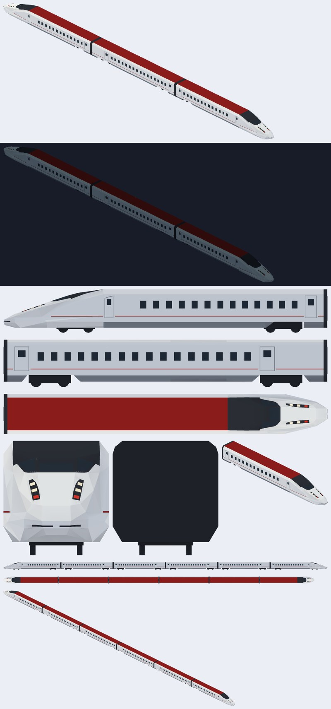

# 九州新幹線 800 系「つばめ」（決策 978）

總覽（遊戲的匯出與模型光，`tools/train-models/run.sh`、`render.mjs`）：

1. 最上面兩排：車頭、中間車、車尾（車頭轉 180°）相接的斜看，上排白天、下排夜晚。
2. 車頭的側面、中間車的側面。
3. 車頭的俯視。
4. 車頭的正面、中間車的端面、車頭的斜看。
5. 六節相接的側面（`--assembly-spec`，車頭＋四節中間車＋車尾，連結面相接、零車距，共 154.7 m）。
6. 遊戲大小（每公尺 4.86 像素，六節 752 像素）的俯視，與六節的斜看。

白車身、整片紅車頂、窗下一條紅細線、灰裙板、深色轉向架、兩節之間一圈深色的全周幌；車頭是長鼻、黑色駕駛室窗罩、車鼻兩肩各一個直立燈罩（上兩顆白頭燈、最下面一顆紅尾燈）、鼻尖下一條黑線。色票平塗，不畫文字與標誌。

- 來源：作者舊版 SwiftRailMac 的模型（作者自己的內容），舊版型錄的「800系『つばめ』」：車頭 `d7f7f5e4`、中間車 `652fb052`。不用加資料來源頁。原始 GLB 與貼圖不進這個公開庫。
- 對照的真車照片：Wikimedia Commons 的七張（CC BY-SA，作者與授權記在私有素材庫 `game-art-previews/docs/art/kyushu-shinkansen-6car-2026-11/SOURCE.md`），只拿來比形狀與顏色，不當貼圖、不放進這個公開庫。尺寸照日文 Wikipedia「新幹線800系電車」的規格（2026-11-25 讀）。
- 轉換：`tools/texture-palette/kyushu_800.py` 把貼圖切成色票面（車頭 1,509 面、中間車 1,523 面），再由 `tools/train-models/glb_to_swift.py` 寫成 `Sources/GamePresentation/Map3DKyushu800Mesh.swift`。材質順序寫在 `Map3DKyushu800.swift`。
- 用在：九州新幹線（`kyushushinkansen`）車次是奇數的列車，六節（偶數的是決策 977 的 N700 系八節）；車庫在「日本」類。
- 決策：`docs/decisions/978.md`。
- 和舊版同一節並排的對照圖（舊版的縮圖帶原貼圖）只給作者與工作室看，不放進這個公開庫；這裡的總覽圖只有轉好的模型。

## 這台車憑什麼被認出來

1. 白車身上整片紅車頂（從遊戲的俯視看，紅車頂佔了大半）。
2. 長鼻與蓋到車頂的黑色駕駛室窗罩。
3. 車鼻兩肩的直立燈罩。
4. 窗下一條紅細線，一個一個獨立的小窗。
5. 六節。

## 看了三輪，作者再看一輪

| 輪 | 看到的毛病 | 改法 |
| --- | --- | --- |
| 1 | 車窗是扁的（車身放回真車尺寸後，舊貼圖的方窗被拉長壓低），真車是直立的小窗 | 每格窗收窄加高（約 0.5 × 0.64 m） |
| 2 | 車頭側面看，灰裙板從車鼻底下就開始，像白車鼻坐在一個灰盒子上；真車的車鼻到鼻尖都是白的 | 灰裙板從駕駛室門起，車鼻底下那一段留白 |
| 3 | 用遊戲大小（每公尺 4.86 像素）看：紅車頂、白肩、黑窗罩、節與節之間的黑縫都認得出來；紅細線與小窗小於一個像素，看不到 | 不改：線與窗照真車的寬度，不為地圖大小加粗（近看與車庫看得到）；記在「還有哪裡不好」第 3 點 |
| 4（作者看） | 先前只把車鼻多拉長三成，作者說車頭太尖、太醜，並定案：尺寸用真車尺寸，車頭不可單獨拉長或改造型，整節等比放大可以 | 頭車整節等比放大到 27.35 m，車鼻不單獨拉長、不改形；照真車照片修圓的版本給作者看過，沒有採用 |
| 5（作者看對照圖） | 整節放大與「只加長直線車身、多插兩格窗」並排給作者看，作者說用對遊戲最好的 | 量頭車的窗距、窗寬、門寬哪一種最接近中間車：三項都是整節放大比較接近（決策 978 第 3 點的表），留整節放大 |
| 6（作者問真車的窗） | 真車每排座位一格窗、窗距約 1 m（中間車一側 17–20 格）；舊版中間車只有 14 格、窗距 1.13–1.22 m，比頭車與真車疏 | 中間車的窗帶多排兩格：16 格 |
| 7（作者看） | 第一版把窗帶收回原長，窗比頭車窄（0.46–0.49 m）；作者說 16 格、車門稍微移動 | 窗帶乘 0.9，窗 0.48–0.51 m、窗距 1.04–1.08 m，和頭車一樣；後面那扇門往車端移 0.52 m，門後的空牆 4.3 m 收成 3.8 m |
| 8（對真車照片） | 兩節車身相隔 0.60 m，中間只有舊版 1.20 m 寬的通道幌，四周看得穿；真車兩節之間是和車身齊平、從屋頂到裙板底的深色外幌。作者先說車端保持舊版原樣，後來交代照最接近真車的做 | 每個連結端補一圈深色的全周幌，從車端輪廓延伸到離連結面 2 cm，兩節的幌相隔 4 cm；用既有的 `dark` |
| 5（作者看） | 門只剩門上的小窗浮在牆上，門框不見（作者在 N700S 發現，這台也有） | 照舊版貼圖的位置補回每扇門的門框（約 5 cm 的線，`steel`），門板另成一個材質格位 |
| 6（作者問） | 紅線過門接成連續，作者問真車是不是這樣；重看真車側面照片，線到門框前就停、過了門再接上 | 紅線改回在門的地方斷開，和舊貼圖、真車一樣 |

接回時另外照真車照片改的：車端的牆塗深色，兩節之間補一圈深色的全周幌（真車兩節之間是全高的黑色外幌）。

## 接回時比的四樣

1. 顏色：8 格都是遊戲既有的色票（門板那一格和車身同色）（白 `tileWhite`、深紅 `trainRed`、鋼灰、列車玻璃、深灰、頭燈、尾燈），沒有新增顏色。舊貼圖的車頂約 #7D0000，真車是深的漆紅，`trainRed` #8C1C1C 在兩者之間。
2. 窗格的主方向：側窗是一排直立的小窗；門有門框與門上的小窗，門板是車身色。
3. 每個面的特徵：側面窗帶在上、紅細線在窗下、灰裙板在底；車頂整片紅、兩肩白；車頭長鼻、黑窗罩、兩個直立燈罩；通道端是深色。
4. 各段高度比：車輪與轉向架到 1 m 上下、灰裙板 0.42–0.92 m、紅線 1.4 m、窗 2.0–2.7 m、車頂 3.65 m（照真車的屋頂高，舊版 3.96 m 壓成 3.65 m）。

## 還有哪裡不好

1. 沒有集電弓（舊版這兩節本來就沒有；真車第 2、5 節各一組）。
2. 車頂是平的一片紅，沒有空調與高壓線的蓋板。
3. 紅線下面沒有金線；紅線約 5 cm，在地圖上的遊戲大小看不到。
4. 黑窗罩和裡面的前窗、側窗白天幾乎同色，分不出窗框。
5. 燈罩是三顆分開的燈，真車是一整片長形燈罩；白天也看得到紅色尾燈那一格。
6. 車鼻是舊版的形：稜角的楔形、鼻尖薄，真車是圓鼓的圓頭。作者交代車頭不單獨改造型（2026-11-25），所以留著。頭車整節放大後，客室門 1.01 m，比中間車的 1.12–1.16 m 窄約一成；窗與窗距在中間車的窗重排之後兩節一致。
7. 灰裙板比真車的深（真車是近白的蓋板與深色的格柵）。
8. 沒有遠景版（一節一千面上下，遠低於遠景一節的預算，所以不另做）。
9. 還沒在 iPhone 上看過。
10. 兩節之間：每個連結端有一圈深色的全周幌，從車端的輪廓整圈延伸到離連結面 2 cm，兩節的幌相隔 4 cm；真車的外幌是有摺的橡膠幌，這裡是平的一圈，轉彎時兩節的幌不會跟著彎。
