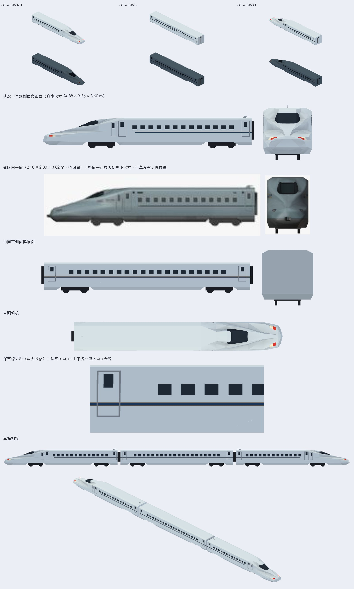

# 九州新幹線 N700 系（決策 977）

總覽（遊戲的匯出與模型光，`tools/train-models/run.sh`、`render.mjs`、`overview.py`）：

1. 最上面兩排：車頭、中間車、車尾（車頭轉 180°）的斜看，上排白天、下排夜晚。
2. 車頭的側面與正面；下面一排是舊版同一節（帶貼圖）的側面與正面，並排對照。
3. 中間車的側面與端面、車頭的俯視。
4. 深藍線近看：深藍 9 cm，上下各一條 3 cm 的金線。
5. 三節相接的側面與斜看（`--assembly-spec`，車頭＋中間車＋車尾，連結面相接、零車距；遊戲裡是八節，中間六節都是同一節中間車）。

顏色照真車（作者 2026-11-25 定）：很淡的白藍車身一路到裙板、窗下一條深藍線、線的上下各鑲一條金色細線；深色轉向架與通道幌，車頭一片前窗、鼻端兩組燈（外側白頭燈、內側紅尾燈）。色票平塗，不畫文字與標誌。

車頭的形狀是舊版的：整節車一起放大到真車尺寸（長 × 1.19、寬 × 1.2、高 × 0.94），車鼻沒有另外拉長或改形。因為舊版比真車窄而高（2.80 × 3.82 m，真車 3.36 × 3.60 m），正面看起來比舊版寬一點、矮一點。

- 來源：作者舊版 SwiftRailMac 的模型（作者自己的內容），舊版型錄的「N700系『みずほ』『さくら』等」：車頭 `bc97d3e5`、中間車 `fd0310c2`。不用加資料來源頁。原始 GLB 與貼圖不進這個公開庫。
- 轉換：`tools/texture-palette/kyushu_n700.py` 把貼圖切成色票面（車頭 1,726 面、中間車 1,420 面；車門照舊貼圖的外框切出鐵灰色的門縫線），再由 `tools/train-models/glb_to_swift.py` 寫成 `Sources/GamePresentation/Map3DKyushuN700Mesh.swift`。材質順序寫在 `Map3DKyushuN700.swift`。
- 用在：九州新幹線（`kyushushinkansen`）的列車，八節；車庫在「日本」類。
- 決策：`docs/decisions/977.md`。

## 接回時比的四樣

1. 顏色：7 格都是遊戲的色票。車身白藍 `kyushuWhiteBlue` #D8E5EB、深藍 `kyushuNavy` #214168、金 `kyushuGold` #897455 是這次照真車照片量了新登記的三格；其餘是既有的列車玻璃、深灰、頭燈、尾燈。
2. 窗格的主方向：側窗是一排小方窗，和舊版貼圖一致；門只留門上的小窗，門板是車身色。
3. 每個面的特徵：側面窗帶在上、深藍線（鑲金邊）在窗下、裙板是車身色；車頭長鼻、一片前窗、兩組燈；通道端是深色通道幌。
4. 各段高度比：車輪與轉向架到 0.4 m 上下、白藍車身到車頂 3.60 m（照真車高度，舊版 3.82 m 壓成 3.60 m），深藍線在 1.81 到 1.96 m。

## 還有哪裡不好

1. 沒有集電弓（舊版這兩節本來就沒有）。
2. 車頂是平的一片，沒有空調與高壓線的蓋板。
3. 車頭 24.88 m，真車的頭車是 27.35 m：鼻子比真車短。
4. 側窗數比真車少；轉向架是一塊深色，沒有分色。
5. 沒有遠景版（一節一千五百面上下，遠低於遠景一節的預算，所以不另做）。
6. 還沒在 iPhone 上看過。
