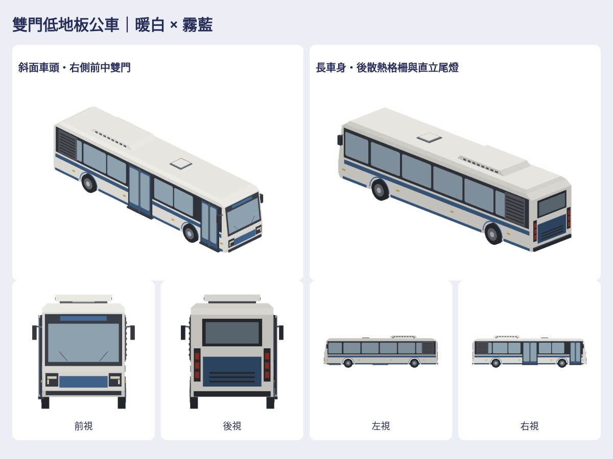

# 暖白霧藍雙門低地板公車

依作者第二批4張大型綠白公車前後左右圖，保留長車身、右側前中雙門、後段散熱格柵；以遊戲暖白＋霧藍色票重新組合斜肩車頂、車頭／燈、後窗／尾燈、格柵與HVAC，無品牌。

新增1款 `life-lowFloorBus`，另附既有大型公車對照（不算新增）。2 native／2 GLB／14張上、下、左、右、前、後、立體透明圖，另有900px前後底、風格／比較總覽、可旋轉viewer與ZIP。

`Map3DLowFloorBus.model()`／`Map3DStreetModel.lowFloorBus`直接加入standard。約12.08m長、2.46m身寬、含鏡3.05m、高3.40m；非特定品牌實測。輪拱留真空隙，玻璃附背板，風擋沿車身斜面，鏡架與HVAC支腳接實體，頭尾燈glow。原本5%公車池改30%小巴、35%新大型、35%既有大型；小巴seed選型維持，總交通量／公車上限／17m間距不變。這是街景視覺車型，未新增GameCore購車或營運系統。

重用上批小巴的耳切封殼／窗片，station-kit封底及civic-kit封閉輪子；主要比例與雙門布局依本批圖片重新建置。沒有直接搬原始模型、貼圖或品牌。來源及SHA存私有。

[私有成品](https://github.com/a91453/railway-reference-private/tree/codex/low-floor-bus-assets-2026-10-21/Railway/game-art-previews/docs/art/low-floor-bus-2026-10-21) · [工具](../../../tools/low-floor-bus/README.md) · [Claude/Codex指引](../../../.claude/skills/low-floor-bus/SKILL.md) · [驗證](verification.json)。Metal真機／效能、車輪車門動畫未驗證。

本批stacked PR以尚未合併的小巴#941為base，合併後可轉main。兩批各自審查，不重複計新增資產。
