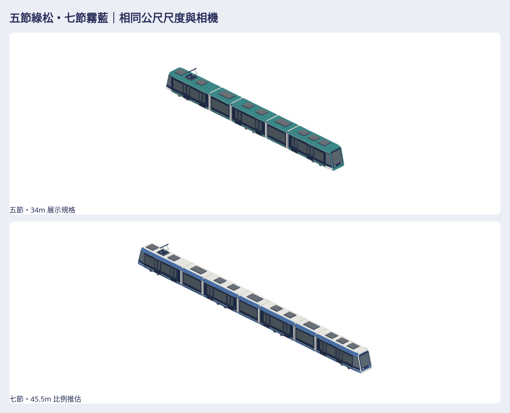

# 五節綠松・七節霧藍輕軌

依作者最新要求，兩台最終模型均不用紅色。五節改為暖白細邊／綠松車頂與裙板；七節採暖白屋頂／霧藍肩線與裙板、灰藍玻璃。兩套使用遊戲色票、霧面頂點色、不用貼圖或品牌。

公開[draft #992](https://github.com/a91453/railway-game-ios/pull/992)／私有[draft #40](https://github.com/a91453/railway-reference-private/pull/40)，工作[#991](https://github.com/a91453/railway-game-ios/issues/991)。本輪更新同一組PR，兩庫base=main、均draft，不新增依賴未合併#988或碰其他session的營運整合。

- [重建、尺寸／各節組裝](../../../tools/lrt-pair/README.md) · [交接§7.3](../../HANDOFF.md#73-3d-的後續)
- [私有最新完整素材目錄](https://github.com/a91453/railway-reference-private/tree/codex/five-section-lrt-2026-10-22/Railway/game-art-previews/docs/art/lrt-pair-2026-10-22)
- [ZIP下載](https://github.com/a91453/railway-reference-private/raw/refs/heads/codex/five-section-lrt-2026-10-22/Railway/game-art-previews/docs/art/lrt-pair-2026-10-22/asset-package.zip) · [單檔viewer下載](https://github.com/a91453/railway-reference-private/raw/refs/heads/codex/five-section-lrt-2026-10-22/Railway/game-art-previews/docs/art/lrt-pair-2026-10-22/viewer-standalone.html)。需要私有庫存取權；GitHub不直接執行HTML，下載後開啟或照工具README啟動本機伺服器。

完整輸出：16 native／16 GLB＝12獨立單元＋2完整編組＋2既有風格比較、112七向透明PNG、所有單元／編組預覽、白模／剪影、同尺度風格／四底灰階模糊、五節改色與七節窗面修訂前後、viewer、實際尺寸／三角統計、來源／SHA／ZIP。只保留這一張公開總覽；完整模型、各圖與基準都在私有庫。

## 新七節特徵與依據

已實際查看四張新圖：第1張完整前端斜視、第2張較平側面局部、第3張縱向鼻端／車頂、第4張另一端完整斜視。看得到七節、六處鉸接、長節雙門與短節大窗、端部後傾收窄及單端集電弓；原五節五圖也已查看。inline圖無本地原檔，不假造像素測量、圖片SHA或工程尺寸；參考透視與輸出正交角度不同。

| 特徵 | 本次判讀與規格 |
| --- | --- |
| 車種／編組 | 七節低地板鉸接輕軌；長端—短—雙門長—短—雙門長—短—長端 |
| 三向主輪廓 | 低裙板、平直窗帶與薄肩線；十二角橫斷面；兩端後傾且橫向收窄 |
| 相對尺寸 | 殼長9/4.1/7/4.1/7/4.1/9m，殼間.20m；全長45.5m推估；寬2.65m、屋頂3.25m採專案尺度 |
| 端部 | 端部收束1.45m，風擋後傾係數.255；單片高風擋、兩個低燈；左右端獨立裁切窗片 |
| 門窗 | 每側2/0/2/0/2/0/2組雙門；短節單大窗，中間無駕駛設備 |
| 屋頂／底部 | 3/1/2/1/2/1/3個低矮設備，共13個；只有trailing集電弓；封閉底部與支持底座 |
| 走行補全 | 四長節各一組雙軸架、8軸；短節無輪；輪徑.58、軸距1.44m，輪底z=0 |
| 頭尾／左右 | 兩個外端駕駛，單端集電弓；左右乘客門窗對稱；六處風琴半件相接 |
| 不清楚處 | 輪架被裙板遮住，三／四架為補全；底部內部、內裝與工程尺寸無足夠資料 |

查過私有台灣庫`rail-3d/integration/FORMATIONS.md`／`formations.js`，其五節約34m／2.65m可作專案尺度；CAF的Q比例與四門群不符合本圖，不取其mesh。另讀世界版`rail-3d/integration/formations.js`與rolling-stock catalog，未能唯一匹配此七節車。45.5m是以專案寬度和新圖長短節節奏估定的展示長度，**不是高雄輕軌七節工程標準**。七節獨立配方，不呼叫五節車體／底盤／門窗；只重用低階封閉幾何、裁切原理與匯出／viewer，不搬私有原始mesh／貼圖，不送外部生成服務。

## 外觀驗收（與技術測試分開）

已親自查看實際模型的側／正／俯／斜視、兩側、白模／剪影、同尺度風格。新七節初版的反向側窗沿錯誤對角，玻璃與薄框同時離開支持殼面，出現白色破口；五節同類窗片也修正。現在按朝向選擇真實殼面的三角對角，所有其他五節幾何保持穩定。`five-before-after.png`用真實舊紅色producer5a2fd38e；`seven-before-after.png`用本輪真實初版藍色native。兩版固定公尺相機，不用概念圖代替模型，也未把final偽裝成before。

| 驗收項目 | 結論 | 具體證據／限制 |
| --- | --- | --- |
| 整體胖窄、高短／長短節 | 已符合可見比例 | seven-audit正交每列.030m/pixel；overview同公尺，七節不由五節拉長偽裝 |
| 端長、前後懸／鼻端尖鈍 | 已符合可見輪廓；輪位資料不足 | 新圖1、3、4對照detail-front／top；端部1.45m為推估，裙板遮住軸位 |
| 軸距、輪徑／架數 | 資料不足 | 8軸與1.44m／.58m為明示補全，模型與此假設一致，不稱實車已核對 |
| 風擋、肩線／窗帶 | 已符合 | 兩端後傾收窄、薄肩線連續；反向側窗破口已修，見seven-before-after |
| 門窗節奏 | 已符合 | 四張新圖與兩側audit：每側八組雙門，短節無門，中央無駕駛設備 |
| 大型設備／頭尾差異 | 已符合可見配置 | 13設備面、單端集電弓、六鉸接；內部設備功能資料不足 |
| 單元排列／間距 | 已符合 | 七個獨立單元與完整編組逐頂點重建，無旋轉／鏡射，短節保持共同軌面 |
| 浮空、穿模、缺面／反面／閃爍 | 已符合本批檢查範圍 | 最終兩側視檢無已知主要缺陷；12單元封閉邊，216主要玻璃的承板與車殼支持；初版真實缺陷會被加強檢查拒收 |
| 遊戲配色／質感／密度 | 已符合 | 最終無紅色漆；綠松／霧藍／暖白／灰藍，霧面；五4500／七6424三角；style-comparison同尺度、art-checks四底／灰階／模糊 |
| 隱藏輪架／內裝工程還原 | 資料不足 | 本批是靜態外觀素材，不宣稱還原不可見構造或作者已接受 |

## 技術驗證與使用限制

VERIFIED Linux Swift6.4 warnings-as-errors build-tests、28相關XCTest；兩套原生逐頂點／法線讀回、單元組裝、GLB bytes與Blender4.3.2獨立匯入；12單元有向焊接邊零缺口、216主要玻璃三角承板與車殼支持；五／七各缺面／反面／整片保持封閉的玻璃浮空，六案例拒收。五節窗片修正範圍以外的位置／法線／順序／alpha／glow和前producer完全一致；最終兩套無紅漆。112七向與所有PNG完整解碼、透明且不裁邊；viewer16模型、七向、旋轉、縮放、逐件native／GLB／PNG／ZIP下載、390px及斷網內嵌。ZIP完整解壓逐檔／CRC及source-record實際producer bytes結果見私有包。

| 七節模型 | 三角形 | 實際外廓長×寬×高 m |
| --- | ---: | --- |
| leading | 1408 | 9.100×2.769×3.371 |
| suspendedFront／Centre／Rear 各 | 344 | 4.300×2.684×3.131，最低z=.24、頂z=3.371 |
| middleFront／Rear 各 | 1224 | 7.200×2.769×3.371 |
| trailing | 1536 | 9.100×2.769×4.465 |
| formation | 6424 | 45.500×2.769×4.465 |

UNVERIFIED 真機iPhone／iPad Metal、效能、動畫、物理、營運車種接入、工程尺寸與隱藏機構。受管Chromium禁止file://，單檔用斷網內嵌HTML測試，作業系統雙擊未直接測。Linux WebGL／Blender不冒稱真機通過；最新公開提交CI以#992 Checks為準，私有無checks。**兩台均是靜態素材，合併不會自動換路網列車**。沒有GameCore／營運／存檔／golden／replay改動，未合併／auto-merge或啟動TestFlight。
