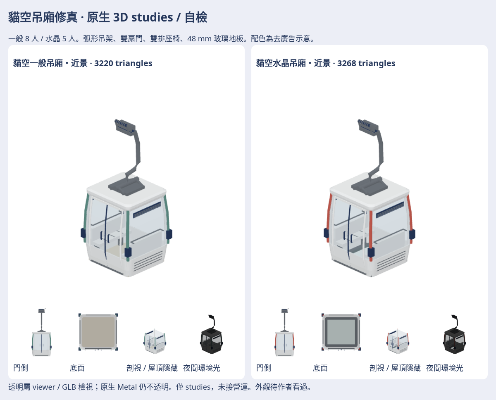

# 貓空吊廂修真 · 自檢

廂體比例、弧形吊架、對開門、雙長椅及水晶地板重做。一般／水晶各近景與LOD，共4款。這是決策575相關的獨立studies，未接營運，外觀待作者看過。

[配方、重建與驗證](../../../tools/maokong-cabin-refine/README.md)。模型、GLB、日夜七向、白模／剪影、實際前版比較、離線viewer、SOURCE均放私有素材庫 `game-art-previews/docs/art/maokong-cabin-refine-2026-11/`。

尚待修真：抱索器、角柱與吊架接頭仍簡化；部分尺寸為照片推估；白底角帶為去廣告示意。原生玻璃仍不透明，viewer／GLB透明屬檢視效果；登車高度變更，未校驗站台／動態間隙。
