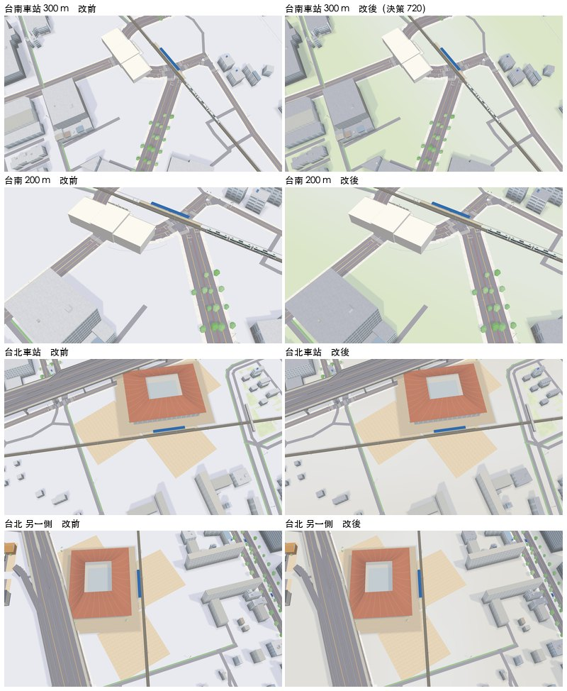
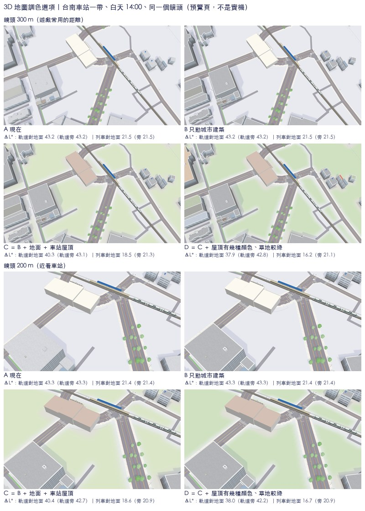

# 3D 地圖「看起來死氣」：調色選項與做出來的樣子

2026-11-13。作者說 3D 地圖「看起來蠻死氣的」。先做了 A／B／C／D 四個預覽（下面），之後照五方做了**瘦身版 C**：城市屋頂深一階、街廓的地面照用途上淡色。決定、數字與沒做的事在[決策 720](../../decisions/720.md)。

## 做出來的（決策 720）



左改前、右改後，同一個鏡頭；是 `Map3DScene` 真的輸出的場景（不是後製），預覽頁畫的，不是 Metal。台南一帶住宅密度低，地面是院子的淡綠；台北車站一帶是鋪面的暖灰。軌道所在的格子留原本的白。

另外兩張只是比較、沒有實作：`web-compare.jpg`（和網頁試做的高雄、台中車站並排，白天）、`night-compare.jpg`（夜晚並排，與一版試調）。作者比較喜歡網頁版的夜晚，列為後續。

## 當初的四個選項（後製的預覽）



場景：`tools/map3d-preview/`，台南車站一帶的新局（真實建物足跡、底圖），鋪一條玩家的路線、一個月台、一列通勤車；白天 14:00；上半鏡頭 300 m，下半 200 m。是預覽頁，不是 Metal，也不是實機。

## 現況對不對（A）

派工時的描述是「地面近白、城市屋頂近白、牆淡灰，三者明度幾乎一樣；車站也是白屋頂」。量到的（畫面上各類像素的中位數，L*）：

| | 地面 | 城市屋頂 | 城市的牆 | 路面 | 道床與軌道 | 列車 |
| --- | --- | --- | --- | --- | --- | --- |
| A | 92.8 | 86.0 | 60.8 | 64.8 | 49.5 | 71.3 |

- **成立的**：地面與屋頂只差 6.7，從上往下看（遊戲的鏡頭）屋頂佔建物的大半，所以整個街廓是一片白；台南車站的模型屋頂是 #FFFDF7，和地面分不開；空地沒有任何顏色。
- **不成立的**：牆不是和屋頂一樣亮。有窗格貼圖的牆中位數是 60.8，比屋頂暗 25。所以問題不是「屋頂要比牆深」，而是「屋頂和地面黏在一起」。

## 選項

| | 做了什麼 | 感覺 |
| --- | --- | --- |
| A | 現在 | 乾淨，但街廓與空地是同一片白 |
| B | 只動城市建築：屋頂 ×0.86（L* 86 → 75）、屋頂邊一圈淺色 #F4F5F8（0.7 m）、牆依朝向分三級（向光 1、側面 0.91、背光 0.82）、牆腳 1.3 m 深一階（×0.66） | 建物有了輪廓，地面仍是白的；最保守 |
| C | B ＋ 地面：建物四周 7 m 是鋪面 #E4E3DF、其餘空地是淡草綠 #DEEACF、道路 2.5 m 與軌道 8 m 內留原本的白；車站屋頂用它配方裡自己的粉灰 #D7C3B9 | 有了「地」，軌道兩側的白邊讓軌道更像被框出來 |
| D | C ＋ 城市屋頂每棟從幾種低彩度的顏色裡取一種（約四成：柔紅 #C98A78、灰綠 #B9C4B0、灰藍 #BFC8D6、米 #D6C2B0），草地較綠 #D2E5C6 | 最有生氣，也最接近台灣街區的鐵皮與瓦；離「淡」最遠 |

## 軌道、列車對地面的明度差（ΔL*，決策 370 的量法）

整張畫面該類像素的中位數相減；括號是只算軌道與列車旁邊（約 6–8 m 內）的地面。

| | 鏡頭 | 軌道對地面 | 列車對地面 | 列車對道床 | 屋頂對地面 | 屋頂對牆 |
| --- | --- | --- | --- | --- | --- | --- |
| A | 300 m | 43.2（43.2） | 21.5（21.5） | 21.8 | 6.7 | 25.2 |
| B | 300 m | 43.2（43.2） | 21.5（21.5） | 21.8 | 17.6 | 15.5 |
| C | 300 m | 40.3（43.1） | 18.5（21.3） | 21.8 | 14.6 | 15.5 |
| D | 300 m | 37.9（42.8） | 16.2（21.1） | 21.8 | 13.4 | 14.6 |
| A | 200 m | 43.3（43.3） | 21.4（21.4） | 21.9 | 6.7 | 24.7 |
| B | 200 m | 43.3（43.3） | 21.4（21.4） | 21.9 | 17.6 | 14.1 |
| C | 200 m | 40.4（42.7） | 18.6（20.9） | 21.7 | 14.6 | 14.1 |
| D | 200 m | 38.0（42.2） | 16.7（20.9） | 21.3 | 13.8 | 12.6 |

（另一個 420 m 的鏡頭數字相同到 ±1，列車對地面 A 18.5、C 15.5、D 13.2。）

- **B 和 A 完全一樣**：沒有碰地面、軌道、列車。
- **C、D 用整張畫面的地面算，比 A 少 3 與 5**：地面不再是純白，這是「地面有顏色」必然的代價。軌道旁邊的地面因為留了白邊，和 A 只差 0.1–0.6。兩個都仍遠高於決策 370 之前的 27。
- 所以照字面「沒有比 A 差」只有 B 做到；C 是「軌道旁邊沒有差、遠處的地面暗了 3」。

## 五方（推薦 C）

- 玩家：C 一眼分得出建物、空地、路，軌道被白邊框住；D 的彩色屋頂會和玩家的黃色建物、藍色雨棚搶一點注意力。
- 鐵道迷：車站屋頂不該為了分開而亂上色。台南站真的是白色平屋頂，這裡用的是它配方裡已有的粉灰；每一站要照自己的資料，另外看。
- 開發：B 只換頂點色，加屋頂邊一圈（多三角形，要量記憶體）。C 的地面要把一格 64 m 的地面改成帶顏色的細網格或貼圖，是三個裡最大的一件。D 多一個每棟的顏色表。
- 美術：B、C 仍是決策 370 的淡色；D 開始往決策 451 之前「有顏色的城市」回去，要作者明講才做。
- 音樂：無。

## 還有哪裡不好

1. **只看了白天晴天**，黃昏、夜晚、雨天沒有拍；決策 370 的路燈與窗燈在深一階的屋頂上會不會太跳，不知道。
2. **只有一個場景**，而且這個場景空地很多，所以 C、D 綠得很明顯；台北那種滿的街廓幾乎只會看到鋪面，差別會小很多。山區、農地也沒看。
3. **空地一律當草地是假的**：台南車站東邊那一大片其實是鐵路用地。實作時要決定哪些空地是草、哪些是鋪面或留白。
4. **牆的三級明暗與牆腳在 300 m 幾乎看不出來**（牆腳約 2 像素），出力最多的是屋頂與地面；這兩項可以不做。
5. **屋頂邊在小建物上糊成一片**，而且是後製加的幾何；真的做要看遠景方塊（`farBoxes`）怎麼帶這一圈。
6. **預覽是對輸出的頂點後製**（依顏色、朝向、高度猜哪些是城市建物），不是改 `Map3DScene`；少數小屋頂沒被認到，仍是原色。
7. 預覽裡車站近看的模型只有方盒般的白牆面朝鏡頭，拱窗在另一側，所以「車站屋頂」只看得出顏色變了。
8. 列車對地面本來就只有 21（白車身），這幾個選項都沒有讓它變好。

## 怎麼重做

```sh
cp tools/map3d-preview/Map3DPreviewDump.swift.txt Tests/GamePresentationTests/Map3DPreviewDump.swift
swift build --build-tests
MAP3D_DUMP=/tmp/tainan MAP3D_WORLD=island MAP3D_AT=22.9971:120.2126 MAP3D_BASEMAP=1 MAP3D_FOOTPRINTS=1 MAP3D_NOBUILD=1 \
  MAP3D_CROP=0:0:800 MAP3D_LINE="-95:-520;-95:-20;-95:520" MAP3D_TRAIN="0:50:0:200:0.7" \
  MAP3D_VIEWS="a:-50:30:300:35;b:-40:20:420:-140;c:-60:20:200:60" swift test --skip-build --filter Map3DPreviewDump
rm Tests/GamePresentationTests/Map3DPreviewDump.swift
```

A 是直接畫這份輸出。B、C、D 是把 `.vertices`／`.indices` 重新上色再畫（屋頂、牆、地面、車站屋頂），牆腳是預覽頁的 shader 多一行；量測是把某一類塗黑再和 A 比出遮罩。這幾支後製與量測腳本（`variant.py`、`contrast.py`、`sheet.py`）照決策 370 的做法不進 repo，留在這一組 session 的共用筆記資料夾 `map-liveliness/`。`tools/map3d-preview/render.sh` 用的 `realpath -m` 在 macOS 沒有，這次是直接呼叫 `render.cjs`。

沒有用參考庫或外部專案的檔案；做法（屋頂深一階加淺邊、牆分明暗、牆腳、鋪面與草地、重點色）是派工的 session 轉述的，只照做法。
