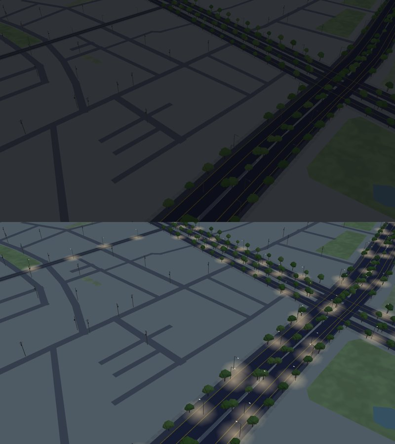
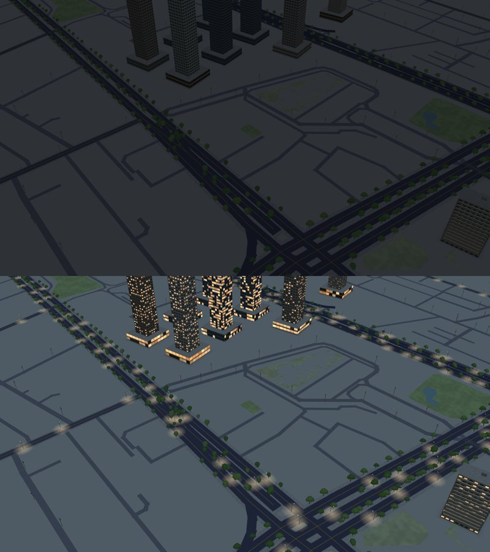
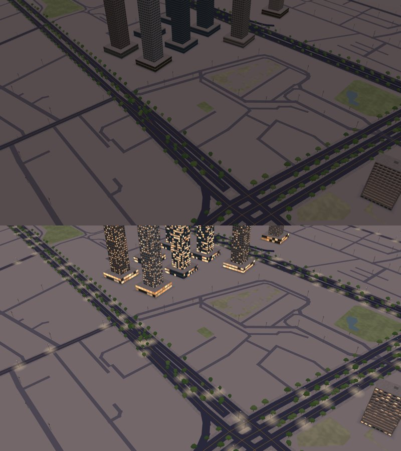
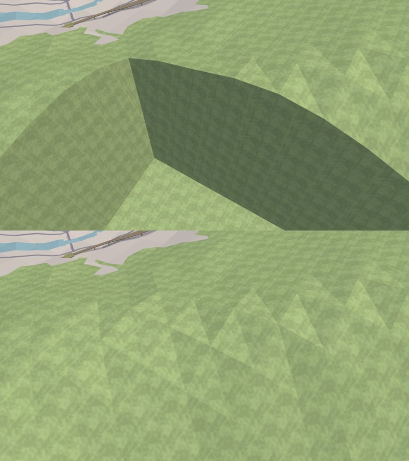

# 3D 地圖：夜晚的燈光與地形的斷崖（2026-10-16）

作者在 TestFlight 問：「晚上 3D 是不是偏暗？然後地形能不能平緩一點，3D 直接突然突起。」後來又問：「還是只是沒路燈而已？」詳見決策 229、234 的「續（2026-10-16）」。

每張圖都是上半 `main`、下半這次的修改，用 `tools/map3d-preview` 畫。這個工具和 `Map3DShaders.metal` 用同一個算式，但不是 iPhone 的畫面，實機請在 TestFlight 看。

| 圖 | 地方、時間 | 看什麼 |
| --- | --- | --- |
|  | 台北車站附近，00:00 | 上半：沒有任何光源，整片深灰。下半：路燈的燈頭亮起來，地上有暖色的光圈，道路與街廓看得出來 |
|  | 台北車站附近，00:00 | 下半：大樓與店面的窗戶有一部分亮著。每晚亮的是同一批窗，不會閃 |
|  | 台北車站附近，18:30 | 黃昏的紫色調保留，燈已經亮了 |
|  | 瑞芳、猴硐的實景示範，14:00 | 上半：軌道經過的 1 km 區塊站在真實高度上，旁邊沒讀的區塊是 0 m，中間一道直立的斷崖。下半：山坡照高度檔連起來 |

量到的數字在 `Map3DNightAndGroundTests`（Linux）。

## 做法

- **光源先做**：
  - 路燈的燈頭在晚上發光，燈下的地面有一圈暖色光圈。
  - 窗戶依照「這一格窗、這一層樓、這一面牆」決定亮或不亮，每晚都一樣。
  - 店面最常亮，辦公樓其次，住家最少。
  - 做法來自本 repo 網站 3D 城市的 `Web/CityView/src/world/materials.js`、`lamplight.js`（MIT）。
- **環境光後調**：
  - 夜晚環境光從 0.58 提高到 0.75，再加上冷色的月光。
  - 地面亮度約為中午的四成，仍然偏藍。

## 另外考慮過的做法

- **只調亮環境光，不加光源**：夜晚會變成「灰灰的白天」，燈光也跳不出來。
- **加色調映射或泛光**：要改著色器，白天的色彩也得全部重調，範圍太大，留待以後。
- **窗戶隨時間開關**（網站的 `uWindowLife`）：派工要求不能閃，所以沒有做。
- **地形限制坡度或壓平**：軌道的高度是從真實地面量的。地形一改平，軌道就會浮起來或埋進去。
