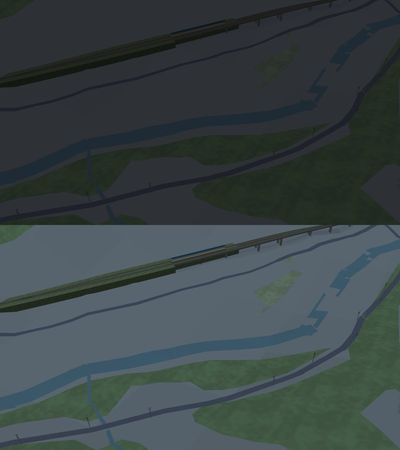
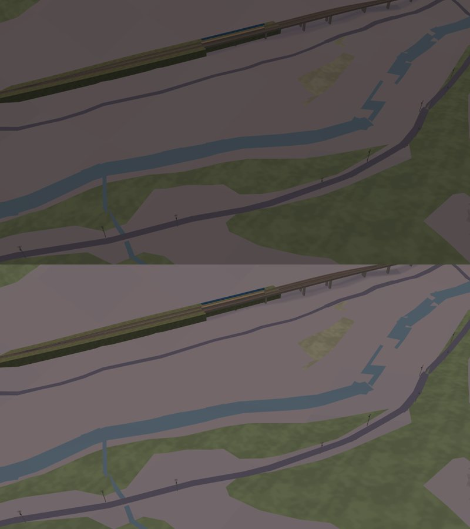

# 3D 地圖：夜晚的亮度與地形的斷崖（2026-10-16）

作者在 TestFlight 問：「晚上 3D 是不是偏暗？然後地形能不能平緩一點，3D 直接突然突起。」決策 229、234 的「續（2026-10-16）」。

每張圖都是上半 `main`、下半這次的修改。場景是瑞芳、猴硐的實景示範（`MAP3D_WORLD=realdemo`，讀台灣底圖），用 `tools/map3d-preview` 畫。這組工具和 `Map3DShaders.metal` 用同一個算式，但不是 iPhone 的畫面，實機請在 TestFlight 看。

| 圖 | 時間 | 看什麼 |
| --- | --- | --- |
|  | 14:00 | 上半：軌道經過的 1 km 區塊站在真實高度上，旁邊沒讀的區塊是 0 m，中間一道直立的斷崖。下半：同一個地方，山坡照高度檔連起來 |
|  | 00:00 | 上半：地面約中午的 22%，道路、河、綠地幾乎看不出來。下半：約 44%，仍是藍調的夜晚 |
|  | 18:30 | 黃昏保留紫色調，整體亮一點 |

量到的數字在 `Map3DNightAndGroundTests`（Linux）。

## 另外考慮過的做法

- 只在 Metal 裡把環境光調大：白天也會跟著變亮，Linux 也測不到。
- 加色調映射：要改著色器，白天的色彩也要全部重調，範圍太大。
- 地形限制坡度或壓平：軌道的高度是從真實地面量的，地形一改平，軌道就會浮起來或埋進去。
