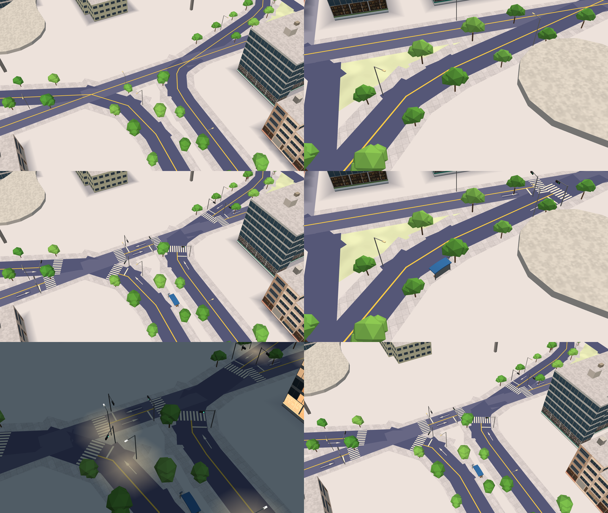

# 3D 地圖的路面標線與街道小物（決策 355）

都是 `tools/map3d-preview/` 的 WebGL 預覽，高雄車站北邊（`MAP3D_WORLD=kaohsiung MAP3D_BASEMAP=1 MAP3D_CITY=1`）：

| 列 | 左 | 右 |
| --- | --- | --- |
| 1 | 路口 14:00，之前（`main`） | 公車亭那段路 14:00，之前 |
| 2 | 同一路口，之後：斑馬線、停止線、箭頭、號誌，中線斷開 | 同一段，之後：公車亭 |
| 3 | 路口近一點 21:00，之後：號誌燈亮 | 路口 14:00，之後，不含陰影 |

其他 10 張（每個鏡頭含／不含陰影）在 `a91453/railway-reference-private` 的 `Railway/game-art-previews/docs/art/map3d-road-markings-2026-10-22/`，那裡的 README 寫了鏡頭與環境變數。

箭頭的形狀與尺寸移植自 `Web/CityView/src/world/decals.js`（MIT）；高雄的建物與道路來自 © OpenStreetMap 貢獻者（ODbL）。
