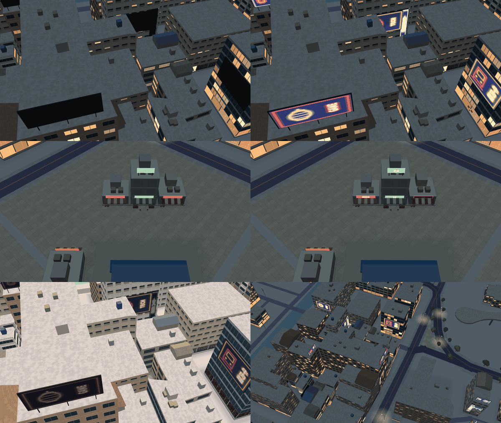

# 3D 地圖的招牌、LED 看板與霓虹（決策 352）

左欄是之前（`MAP3D_SIGNS=0`：看板外框是網格所以還在，畫面不畫），右欄是之後。都是 `tools/map3d-preview/` 的 WebGL 預覽，含陰影：

| 列 | 左 | 右 |
| --- | --- | --- |
| 1 | 高雄車站實景 21:00，之前 | 同一鏡頭，之後（屋頂看板、牆面海報、LED 螢幕） |
| 2 | 測試用兩鎮的站前商店街（決策 322）21:00，之前 | 之後（店名招牌、屋頂看板） |
| 3 | 高雄 14:00，之後（白天不發光） | 高雄 21:00 遠一點，之後 |

其他 24 張（高雄三個鏡頭、商店街三個鏡頭，各有之前／之後、21:00／14:00）在 `a91453/railway-reference-private` 的 `Railway/game-art-previews/docs/art/map3d-signs-2026-10-22/`，那裡的 README 寫了每張的鏡頭與輸出指令的環境變數。

字是 Noto Sans TC（SIL OFL 1.1）；海報構圖移植自 `Web/CityView/src/world/ads.js`（MIT）；高雄的建物與道路來自 © OpenStreetMap 貢獻者（ODbL）。
