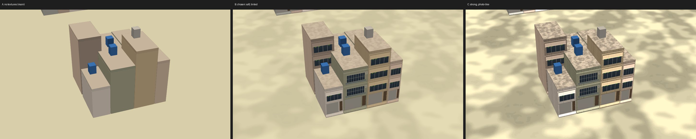

# 3D 地圖的貼圖：素材庫的圖改過再用（2026-10-15）

ARCHITECTURE 決策 231。作者在參考庫加了素材庫 `Railway/procedural_assets_reference_clean/`，說：「裡面圖片素材都可以用 但不能跟原圖一模一樣 需有稍微修改 結合其他檔案的圖片也沒關係」（art-style §7）。

這裡的圖都是軟體算圖：
- 場景從 Swift 輸出（`Map3DScene`，和 App 同一份程式）；
- 用 WebGL 照 `Map3DShaders.metal` 的同一個算式，在 Chromium 裡畫；
- 光線是遊戲的下午兩點。

**不是 Metal、不是 iPhone 的畫面**（UNVERIFIED），要等 TestFlight。

## 三種做法（`options.jpg`）

同一排透天厝，拉近到 90 m：

- **A. 不貼**：現在的 `main`。建物只是色塊。
- **B. 選定**：貼圖很淡，乘在頂點色上，顏色仍是調色盤的。拉近才看得出鐵窗、陽台、鐵捲門。
- **C. 照片感**：同一套圖，對比放大 3.5 倍。地面變成迷彩、淺色牆被洗白。

C 拉遠的樣子：`option-c-mid.jpg`。

## B 的前後對照（每張上半是 `main`，下半是 B）

| 圖 | 看什麼 |
| --- | --- |
| `houses.jpg` | 透天厝：一樓鐵捲門，樓上鐵窗或陽台，水塔；側牆是素牆 |
| `flats.jpg` | 公寓與透天厝的街廓，130 m |
| `track.jpg` | 最近的 62 m：道床墊高後看得到枕木；月台面的鋪面、雨棚的浪板 |
| `mid.jpg` | 鎮中心的大樓，500 m：住宅的窗、辦公樓的帷幕牆、裙樓的店面 |
| `far.jpg` | 1,500 m，地圖剛開始傾斜：貼圖淡掉，顏色和 `main` 一樣 |
| `demo-close.jpg`、`demo-mid.jpg` | 示範地圖：高架、月台、塔樓 |
| `surfaces.jpg` | 13 層貼圖，各重複 2 × 2，配上一種淺色牆 |

## 貼圖怎麼做的

`RailwayGameApp/Resources/Map3D/Map3DSurfaces.png`：
- 512 × 4,608；
- 18 層由上而下，順序同 `Map3DSurface`（第二批的 5 層在最後）；
- 每層左半是顏色，右半是「跟著頂點色」的遮罩。

做法：
- Python 腳本（Pillow、NumPy）讀素材庫的圖，只用程式在本機處理，沒有上傳到任何外部的生成工具：素材庫是作者自己做的，作者不希望別人拿走。
- 腳本放在 scratchpad，沒有進 repo（art-style §3 的做法）。

每一層的步驟：

1. 讀素材庫的圖，縮成 256 × 256；素材庫的材質本來就能無縫重複，縮放後也能。
2. 拿掉顏色，只留亮度，平移、轉向或翻轉。
3. 和另一張混合，再模糊或分階，壓到很低的對比（1–4%）。中灰是 ×1。
4. 立面（窗、店面、鐵捲門）：
   - 在 1,024 × 1,024 上畫：窗、鐵窗、雨遮、冷氣機、陽台、招牌帶、門；
   - 玻璃用素材庫的玻璃改色，浪板與捲門用素材庫的金屬法線圖；
   - 再縮成 256。

每一層用了哪幾張、改了什麼，見決策 231 的表。

## 檢查

- PNG 的 SHA-256 和素材庫 139 張 PNG 都不同。
- 每一層和素材庫每一張（縮成 256，加上轉 90°、左右、上下翻轉）比亮度的相關係數，1 是同一張圖：

| 層 | 最像的素材庫圖 | 相關係數 |
| --- | --- | --: |
| `grass` | `shop-glass-map` | 0.33 |
| `paving` | `sidewalk_ao` | 0.54 |
| `ballast` | `old-concrete-v2_albedo` | 0.51 |
| `concrete` | `old-concrete-v2_albedo` | 0.56 |
| `roof` | `concrete-neutral-map` | 0.30 |
| `plaster` | `plaster-neutral-map` | 0.76 |
| `homeWindows` | `ink_albedo` | 0.25 |
| `homeBalcony` | `glass-map` | 0.52 |
| `shopfront` | `glass-map` | 0.54 |
| `shutter` | `shop-glass-map` | 0.58 |
| `flatWindows` | `sakura-front-glazing-interior-albedo` | 0.22 |
| `officeGlass` | `sakura-front-glazing-interior-albedo` | 0.65 |
| `metalSheet` | `steel-roughness` | 0.19 |

| `shopOptical` | `sakura-front-glazing-interior-albedo` | 0.47 |
| `shopPhone` | `sakura-front-glazing-interior-albedo` | 0.44 |
| `shopEatery` | `sakura-front-glazing-interior-albedo` | 0.63 |
| `shopTea` | `sakura-front-glazing-interior-albedo` | 0.61 |
| `flatBlinds` | `main-sign-rectified` | 0.28 |

最後 5 層是素材庫第二批（決策 231 續）：四種店面與百葉窗，預覽在 `shops.jpg`、`surfaces-shops.jpg`。

`plaster` 最高：它主要是素材庫的灰泥質感，拿掉顏色、對比壓到約 2%，再混入磁磚橫縫與雨痕。
